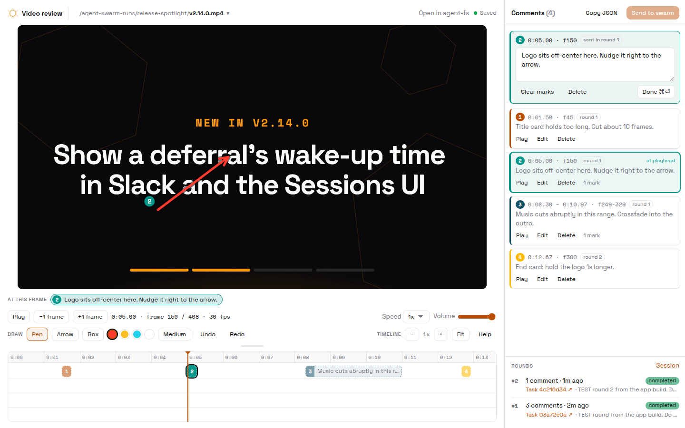

# Video Review

A frame-exact video reviewer for any agent swarm with agent-fs. A person opens a video stored in agent-fs, leaves timestamped comments with drawn marks (pen, arrow, box), and presses **Send to swarm**. Each send becomes one swarm task (a review round). The next cut chains to the same task thread, so every round of a video lives in one session.



## What you get

| Piece | Type | File |
|---|---|---|
| Reviewer | Authed HTML page (`create_page`, `text/html`). Video player, frame stepping, timeline lanes, comments, marks, autosave, rounds panel. Talks to the app through the page's `/@swarm/api` proxy as the viewer. | [page/index.html](page/index.html) |
| Video Review app | Swarm App: model `review` (one row per reviewed video), query `reviews`, script action `api`, task action `send`, page `main` (table of reviews) | [app-definition.json](app-definition.json) |
| `video-review-api` | Script behind action `api`. Ops: `list` (every `.mp4`, `.webm`, `.mov`, `.m4v` in the drive), `open` (signed video URL + feedback file), `save` (write feedback file, mirror a row into the app) | [scripts/video-review-api.ts](scripts/video-review-api.ts) |
| Installer | Saves the script, creates the app and the page, links them. Re-runnable. | [install.sh](install.sh) |
| Onboarding skill | How your agents install it, open videos, read feedback and answer rounds | [SKILL.md](SKILL.md) |
| Feedback example | Shape of the autosaved feedback file | [feedback.example.json](feedback.example.json) |

## Prerequisites

- Server `CAPABILITIES` includes `pages` (enables Swarm Apps and pages).
- agent-fs connected to the swarm. Your videos live in its default drive (the one scripts see at `/afs`).
- Swarm config secret `AGENT_FS_API_KEY`: an agent-fs API key with read/write on that drive (`set-config`, secret on). The script reads it at run time; it never enters the page.

## Install

From any worker container in your swarm:

```bash
mkdir -p video-review/scripts video-review/page && cd video-review
curl -fsSL -o install.sh https://raw.githubusercontent.com/desplega-ai/agent-swarm/main/examples/video-review/swarm/install.sh
curl -fsSL -o app-definition.json https://raw.githubusercontent.com/desplega-ai/agent-swarm/main/examples/video-review/swarm/app-definition.json
curl -fsSL -o scripts/video-review-api.ts https://raw.githubusercontent.com/desplega-ai/agent-swarm/main/examples/video-review/swarm/scripts/video-review-api.ts
curl -fsSL -o page/index.html https://raw.githubusercontent.com/desplega-ai/agent-swarm/main/examples/video-review/swarm/page/index.html
curl -fsSL -o SKILL.md https://raw.githubusercontent.com/desplega-ai/agent-swarm/main/examples/video-review/swarm/SKILL.md
bash install.sh
```

`install.sh` reads what a swarm worker already has in its env: `MCP_BASE_URL`, `API_KEY`, `AGENT_ID`, `APP_URL`, `AGENT_FS_API_URL`, `AGENT_FS_DEFAULT_ORG_ID`, `AGENT_FS_DEFAULT_DRIVE_ID`, `AGENT_FS_LIVE_URL`. Override any of them with `VR_DASH`, `VR_FS_API`, `VR_FS_ORG`, `VR_FS_DRIVE`, `VR_FS_LIVE`. Optional:

- `VR_SEND_AGENT_ID=<agent uuid>`: "Send to swarm" tasks go to this agent. Empty (default) means default assignment, which is your lead.
- `VR_SCRIPT_NAME`, `VR_PAGE_SLUG`, `VR_APP_NAME`: rename the script, page slug and app.

It prints the app URL and the reviewer URL. Ids are kept in `install-state.json`; running it again updates the same script, app and page.

Then install the skill so your agents know how to use it: save [SKILL.md](SKILL.md) as a skill named `video-review` in your swarm (or drop it into your agents' skills folder).

### Install by hand (MCP tools)

Placeholders are `__LIKE_THIS__`.

1. `script-upsert` `scripts/video-review-api.ts` as `video-review-api` (agent scope), with `__FS_ORG__`, `__FS_DRIVE__`, `__FS_API__`, `__FS_LIVE__`, `__DASH__` filled in. Note its id.
2. `app-upsert` the `definition` from `app-definition.json` with `__SCRIPT_ID__` filled and `__PAGE_ID__` empty. Note the app id. To route rounds to one agent, add `"agentId": "<uuid>"` to `actions.send`.
3. `create_page` with the body of `page/index.html`, `__APP_ID__` and `__DASH__` filled, `contentType: "text/html"`, `authMode: "authed"`. Note the page id.
4. Fill `__PAGE_ID__` (action `api` args and the open button) and `app-upsert` the app again.

## Use it

- Open a video: `<dashboard>/pages/<pageId>?path=<url-encoded agent-fs path>`, for example `?path=%2Fvideos%2Flaunch%2Fteaser-v3.mp4`. Without `path` you get a picker over every video in the drive. The app's **Open the reviewer** button goes there too.
- Comment: pause on a frame, press `C` and write, `Cmd+Enter` to finish. `I` / `O` (or drag on the timeline) make a range. Drag on the picture to draw (`P` pen, `A` arrow, `B` box). Click a comment to seek to it; edit or delete inline. The Help button lists every key.
- Every change autosaves to `<video-dir>/.review/<video-stem>.feedback.json`, next to the video. Example: `/videos/launch/teaser-v3.mp4` saves to `/videos/launch/.review/teaser-v3.feedback.json`. Mark points are fractions of the frame, `[0,0]` top left. See [feedback.example.json](feedback.example.json).
- **Send to swarm** sends the unsent comments as one round: a task with the video link, the comments and the feedback file path. The task id is stored in the file under `iterations[]`; the rounds panel links to each task and the session.
- Next cut: the agent that applied the round writes a new file next to the old one and replies with `review.nextRoundLink` filled in (`?path=<new cut>&parent=<its task id>`). Opening that link and sending creates the next round with `parentTaskId` set, so the thread chains.

## Verify

1. Open the app: the table is empty, **Open the reviewer** works.
2. Open a video with `?path=`, add a comment, reload: the comment is still there and `agent-fs cat <video-dir>/.review/<stem>.feedback.json` shows it. The app table shows one row.
3. Send a round with a note containing "test": a task appears, assigned to your lead (or `VR_SEND_AGENT_ID`), and the rounds panel links to it.

## Known limits

- The reviewer is a Page, not an app screen: app components cannot seek a video, so the app holds the backend and the table.
- Feedback saves run as the script's owner (the agent that ran `install.sh`), so agent-fs file history shows that agent. The file's `updatedBy` records the person.
- Conflict check is last-writer on `updatedAt`, fine for one reviewer per video at a time.
