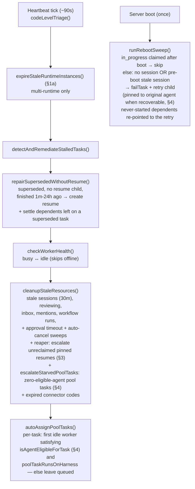
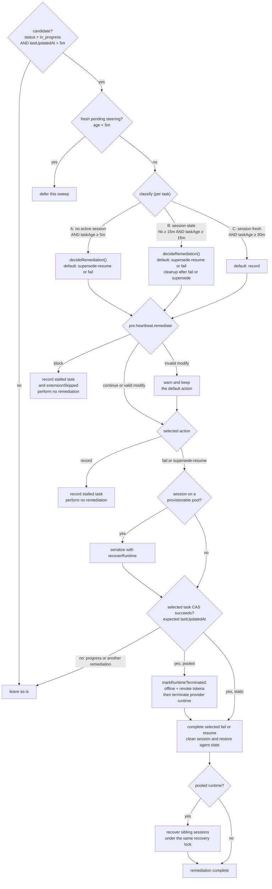
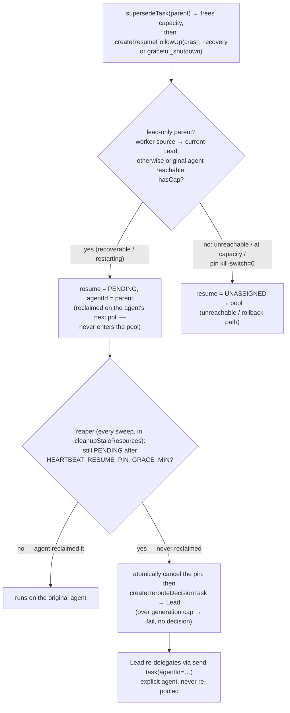
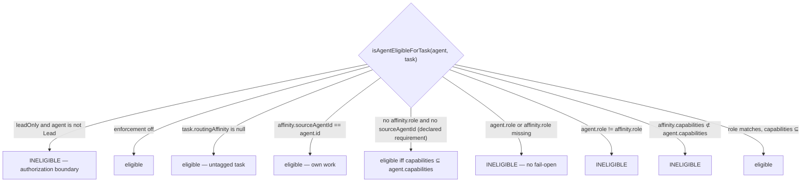
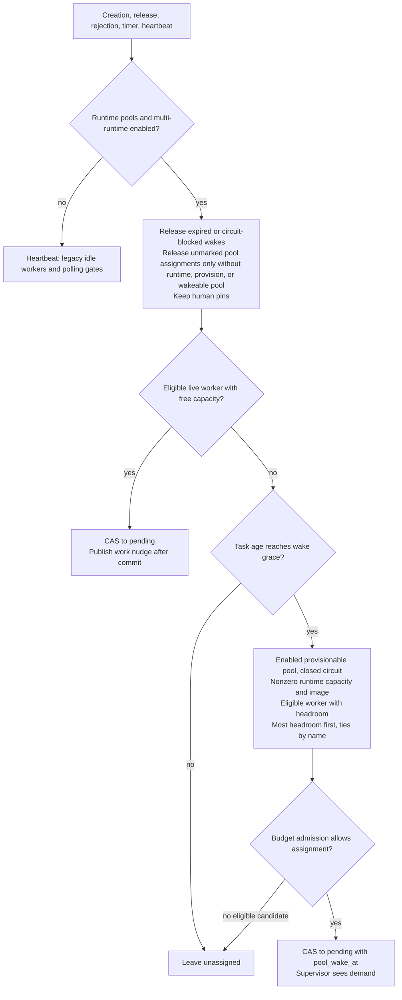
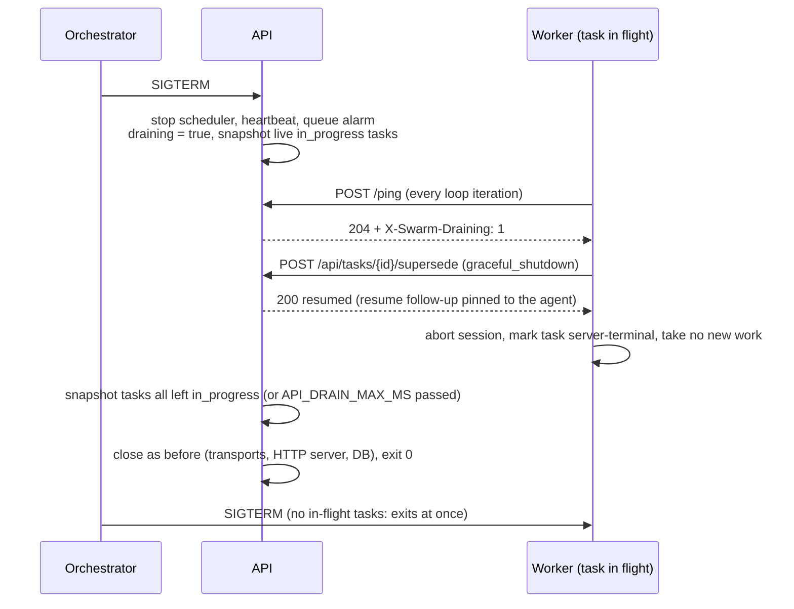
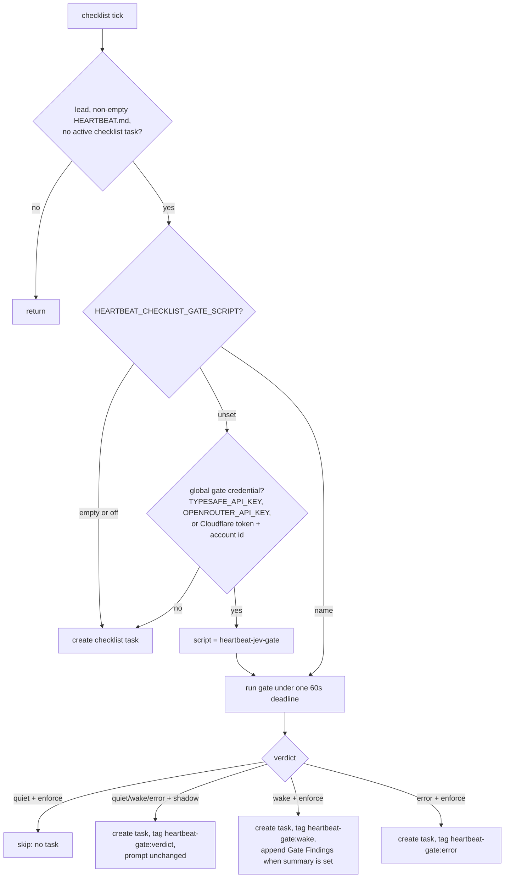

# Heartbeat & Crash-Recovery Flow

> **Maintained doc — current logic only (no history).** This runbook is the canonical reference for the heartbeat sweep, the stalled-task classifier, and the crash-recovery routing heuristic. Keep the diagrams + pseudocode in sync with the code: when you change any of this logic, update this file in the same PR (enforced by the CLAUDE.md rule). It documents *current* behavior — do not turn it into a changelog.

Owner code: `src/heartbeat/heartbeat.ts`, `src/tasks/worker-follow-up.ts`, plus the assignment/claim path in `src/http/poll.ts`, `src/tools/task-action.ts`, `src/tools/send-task.ts`, and `src/be/db.ts`.

Queue-pickup liveness alarm: `src/queue-stall-alarm.ts`.

---

Heartbeat-checklist and boot-triage deduplication only count tasks outside `TERMINAL_TASK_STATUSES` (`completed`, `failed`, `cancelled`, `superseded`). The reboot retry-child guard uses the same exclusion. A superseded task therefore never blocks a new checklist, boot triage, or retry.

## 1. The heartbeat sweep (every ~90s)

`runHeartbeatSweep` → `codeLevelTriage` runs on `DEFAULT_INTERVAL_MS` (90s, env `HEARTBEAT_INTERVAL_MS`):



- **Reboot sweep liveness predicate** (`runRebootSweep`, boot epoch parsed from `globalThis.__runId` = `run_<epochMs>`), evaluated per `in_progress` task in this order:
  1. **Claimed after boot → skip.** A task with `lastUpdatedAt >= bootEpoch - 5s` is skipped before any session lookup. `claimTask` / `startTask` stamp `lastUpdatedAt` at the `in_progress` transition and the API is the sole DB writer, so a post-boot value proves the claim (or a live worker's write) happened after this process started. It cannot be a pre-boot orphan. This is what keeps a task alive when its worker is still inside a slow provider spawn (opencode cold start exceeds the 5s sweep delay). If the task later goes quiet, the regular stalled-task sweep still covers it.
  2. **Session live → skip.** A session is "live, skip" if `lastHeartbeatAt >= bootEpoch - 5s`, **or** if its heartbeat is younger than `STALL_THRESHOLD_STALE_HEARTBEAT_MIN` (15 min). Workers run in their own containers and outlive an API restart, and a session's heartbeat only moves on tool activity or provider output (§2 note), so a live worker inside a long model call that has not streamed yet has no post-boot heartbeat in the first 5s. Only a session stale by the classifier's own threshold is treated as dead → auto-fail + retry child; fresher ones are left to the stalled-task sweep.
  3. If `__runId` is missing/unparseable, both checks fall back to the legacy behavior (session exists → skip, no claim-time check). Never more aggressive than before.
- **Reboot sweep dependents.** `failTask` normally cascade-fails every non-terminal task whose `dependsOn` names the failed task (`cascadeFailDependents`, reason `Blocked dependency <id8> was failed`). The reboot sweep calls it with `cascadeDependents: false` and settles the dependents itself once the retry decision is made: each never-started dependent (`draft`/`backlog`/`unassigned`/`offered`/`reviewing`/`pending`) has the swept id in `dependsOn` replaced by the retry child's id and waits on the retry (`task_dependency_repointed` log row). The dependent keeps its row, so agent, Slack fields, `followUpConfig`, priority and parent are unchanged. Anything still depending on the swept task afterwards — no retry was created (skip-type task, invalid affinity, a non-terminal child already existed, retry creation threw), or a dependent that already started — cascade-fails exactly as before. Already-terminal dependents are never touched. Every other `failTask` caller cascades as today.
- **Worker side** (`src/commands/runner.ts`): the worker registers its active session (POST `/api/active-sessions`, keyed on the per-task runner session id) *before* it starts the provider spawn, and fills in the provider session id on `session_init`. So the window in which an `in_progress` task has no session row is one HTTP round trip, not the whole spawn. On spawn failure the worker fails the task and then removes the row.
- **Worker completion writes**: final progress and `/finish` retry network errors and HTTP 5xx with exponential delays from one second to 30 seconds. They share a `RUNNER_FINISH_RETRY_MAX_SEC` budget (worker environment, default 300 seconds). HTTP 4xx receive no retry, and HTTP 401 stops completion writes immediately. The worker retains its task slot and active session until these writes settle. Per-task and exit-after-N workers wait for completion writes before exit. Budget exhaustion logs a scrubbed error and permits cleanup. Recovery can repeat the task if the API never accepts its result.
- Tasks completed in one pass finish concurrently. Credential reports retain their batch order. Each task releases its slot in `finally`, including when completion preparation throws.
- **Worker slot reconciliation** (`reconcileActiveTasks` in `src/commands/runner.ts`, every main-loop iteration): a task the server holds as `cancelled` gets its session aborted. Every `RUNNER_TASK_RECONCILE_INTERVAL_MS` (default 30s) the worker also reads each active task's status; a task already terminal server-side (for example failed by the stalled-task sweep) gets its session aborted. A session that has not settled 10s after any abort is settled by the runner (`runner exited without result: ...`), so `checkCompletedProcesses` frees the slot. For a task that was terminal server-side the worker sends no `/finish` and no credential or model outcome, so the server's output and failureReason stand. The slot frees at most interval + grace after the server marks the task terminal.
- The **boot-triage seed script** (`src/be/seed-scripts/catalog/boot-triage.ts`) mirrors this logic: it flags `in_progress` tasks that are on an offline agent OR whose session's `lastHeartbeatAt` is older than `stuckMinutes` ago (no fresh session heartbeat).
- `autoAssignPoolTasks` and `claimTask`/`assignUnassignedTaskPending` are gated by the **routing-affinity eligibility check** (§4, `isAgentEligibleForTask`) — a pooled task tagged with a `routingAffinity` snapshot (from a resume/retry, or an explicit `requiredCapabilities` on a fresh `send-task`) can only go to a role/capability-matching agent. Untagged tasks are unaffected — assignment stays open to any idle (non-lead) worker, exactly as before. The pool paths (`autoAssignPoolTasks` and the poll auto-claim scan) also apply `poolTaskRunsOnHarness(task, harness)` (`src/be/model-validation.ts`): a task that pins a `model` the worker's harness cannot run, or asks for a model `profile` of another harness, is skipped for that worker and waits for a compatible one ([model-tiers.md § Harness compatibility](./model-tiers.md), [§ Model profiles](./model-tiers.md#model-profiles)). On a directed claim the same mismatch returns `modelUnsupported` and the worker fails the task without a spawn. `autoAssignPoolTasks` **does** skip idle workers whose `emptyPollCount >= MAX_EMPTY_POLLS` (the poll gate) — assigning to them would just have them exit on their next poll. The filter reads `emptyPollCount` off the rows `getIdleWorkersWithCapacity()` already returns (no per-worker re-query). Note the poll gate is cleared on a genuine `waiting_for_credentials -> ready` recovery (`updateAgentCredentialState`) and on re-register, but **not** by routine post-task `ready:true` credential reports.
- `checkWorkerHealth` only flips `busy↔idle` (it pre-filters `offline`) and never sets `offline`. A successful `/api/poll` dispatch updates the agent to `busy` in the same transaction that starts a pre-assigned task or claims a pool task; the worker-only `poll-task` tool does the same for its direct pending-task path. The heartbeat sweep remains the reconciliation backstop for any other task-state transition that leaves `agents.status` stale. Leads can become `busy` while running a directly assigned task, but remain structurally excluded from pool assignment (`getIdleWorkersWithCapacity` and the pool dispatch query filter `isLead=0`). `offline` has two writers: the graceful `POST /close` handler (`src/http/core.ts`), and — only when `MULTI_RUNTIME_ENABLED` is enabled — the stale-runtime expiry in §1a. With the flag explicitly off, a hard-crashed (SIGKILL) worker is still never auto-offlined.

### Offer cleanup

After runtime expiry, heartbeat releases offers to deleted or unreachable offline recipients.
Both full triage and cleanup-only sweeps pass `isAgentReachable` to the legacy offer reaper.
With runtime pools enabled, an offline agent remains reachable when its enabled pool can wake or already has a provision in progress.
Wakeable pools require nonzero runtime capacity and an image or resolved image, in addition to a provisionable kind and closed circuit.
An existing provision preserves reachability during an open circuit.
The guarded update only releases tasks still offered to an offline or deleted recipient, so a concurrent claim wins.
With `RUNTIME_POOLS_ENABLED=false`, the reaper retains its legacy offline predicate and clears the released recipient and offer timestamp.

### Workflow recovery

Every cleanup sweep invokes `recoverIncompleteRuns`, also used at server startup.
Its recovery count is logged only when nonzero; it does not mean the engine or
container restarted. Running runs with a live graph walk in this API process are
skipped, including while an executor is awaiting a long script or checkpointing
its result. Ownership lasts until all overlapping walks settle and is released
on errors too. Runs without a live walk reconstruct active edges from each
completed node's latest persisted step and selected `nextPort`, using the same
routing helper as the live walker. Readiness follows those active edges, so
untaken ports cannot start sibling branches or replay a completed downstream
node. Steps without a selected port retain the live walker's default successor
behavior. Waiting runs reconcile finished tasks, approvals, and durable waits.

The last pass, `recoverForeachFanouts`, re-drives `foreach` fan-outs. It covers
runs in `running` or `waiting` whose open foreach parent has a queued
(`pending`) child, or a `running` child that no drive in this process owns. Every
item settles through `settleForeachChild`, which writes the child and runs the
join in one transaction. So a crash leaves a child queued, orphaned, or
waiting, never half-joined.

```
# recoverIncompleteRuns, after the task / approval / wait / child-run passes:
recoverForeachFanouts():
  for each (run, foreachId) with a latest child row pending, or running and unowned,
      where run.status in (running, waiting):
    runForeachDrive(run, foreachId):    # holds the run, like a walk
      claim, in one BEGIN IMMEDIATE transaction over latest attempt rows:
        inFlight = running + waiting children
        pending → running while inFlight < config.concurrency (unbounded when absent)
        plus unowned running rows (already counted in inFlight)
      start each claimed child:
        instant body → run it, settle completed/failed   # re-runs an orphan: at-least-once
        async body   → executor dedupes on the child step id (task, child run,
                       approval, wait), so a reconnect never duplicates; park waiting
      joined → walk the parent's successors (or finalize)
      else   → park the run waiting if nothing is running
```

A claimed child that never started goes back to `pending`, so a run retry starts
it. Under fail-fast, a failed item cancels every `pending` sibling instead, and
in-flight siblings finish and record their outcome without reviving the run. Two
recovery sweeps in a row never start more items than the cap: the cap counts the
child rows, not in-process state.

| Crash point | State left | Reconnect |
|---|---|---|
| During materialization | No child rows (one transaction) | The re-walk re-executes the parent and inserts the full set |
| After claim, before start | Child `running`, no invocation | The sweep re-drives it; the executor dedupes on the child step id |
| During execution (async) | Child `waiting` | The task, approval, wait and child-run passes settle it through `settleForeachChild` |
| During execution (instant) | Child `running`, no owner | The sweep re-runs it once: at-least-once, like a top-level instant node |
| During collection | Settle and join committed together | The join is idempotent (parent already `completed`); a missed drive is caught by the sweep |
| During a run retry | One transaction adds every attempt row and resets the run | A second retry finds the run not `failed` and stops |

This ownership guard is process-local, not a distributed lease. It assumes one
API workflow engine owns the database; multiple worker runtimes do not create
multiple API engines. Separate API processes sharing a database would need
cross-process workflow ownership before recovery could safely distinguish their
live work from interrupted work.

### Approval request sweeps

After `recoverIncompleteRuns`, every cleanup sweep runs 2 approval sweeps from
`src/be/approval-sweeps.ts`. Each one guards its write on `status = 'pending'`,
so a concurrent human answer, the recovery pass, or the other sweep wins cleanly.

```
# every sweep, inside cleanupStaleResources, after recoverIncompleteRuns:
timeoutExpiredApprovalRequests():
  for each pending request with expiresAt < now (any workflow run state):
    transaction:
      resolveApprovalRequest(status = timeout, reason = "Timed out by the approval sweep: ...")
      if standalone and source task not terminal: create hitl.timeout follow-up task
    # a failed row rolls back alone and stays pending for the next tick
  # a waiting run whose request became timeout routes on its timeout port
  # on the next tick through getStuckApprovalRuns

autoCancelStaleApprovalRequests():
  days = APPROVAL_REQUEST_AUTO_CANCELLATION_DAYS (default 7; 0 = off)
  for each pending request with expiresAt IS NULL and createdAt < now - days:
    transaction:
      cancelApprovalRequestById(reason = "Auto-cancelled by the approval sweep after <days> days ...")
      if its workflow run is running/waiting:
        cancelWorkflowRunRows(runId, reason)   # steps, linked tasks, run → cancelled
      afterCommit: post "no longer actionable" to each recorded Slack thread (claimed once)
    # a failed row rolls back alone and stays pending for the next tick
```

`recoverApprovalWaitingRuns` writes `timeout` for an expired pending request,
re-reads the request, and claims the step in 1 transaction. It routes on the
re-read status, so a request cancelled after the `getStuckApprovalRuns`
snapshot never reaches a port.

A request with `expiresAt` is never auto-cancelled. A `cancelled` request never
routes to a workflow port. The counts land in `staleCleanup.approvalTimedOut`
and `staleCleanup.approvalAutoCancelled` and add to `stale_cleanup=` in the
sweep log line.

The last cleanup step deletes `connector_codes` rows that expired more than
1 hour ago (`deleteExpiredConnectorCodes` in `src/be/connector-codes.ts`). The
count lands in `staleCleanup.connectorCodes` and adds to `stale_cleanup=`.

## 1a. Runtime liveness (`MULTI_RUNTIME_ENABLED` only)

Remote controllers authenticate on a separate socket at `/api/controllers/connect`.
A disconnect marks the controller offline and prevents provisioning or provider death checks through that controller.
`RUNTIME_CONTROLLER_GRACE_SEC` defaults to 120 seconds. Runtime rows remain unchanged during the grace.
A reconnect lists owner-filtered runtimes before the controller becomes online.
Known handles remain. Ownership labels restore handles when a provision result was lost.
After the grace, `reconcileDisconnectedControllers` invokes its runtime recovery callback for each remaining runtime.
The supervisor supplies `recoverRuntime`, which marks the runtime offline, revokes its tokens, and remediates active tasks.
Failed reconnect handshakes do not extend the original disconnect grace.
Reconnection retires provisioning rows with no handle when the controller list does not report them.
This retirement releases capacity and revokes tokens without a provision failure or infrastructure termination.
Controller offline errors and command timeouts do not increment failures, apply backoff, or change the pool circuit.
An API restart gives persisted online controllers a new grace period when their sockets are absent.

With multi-runtime mode enabled, one logical agent may be served by several
worker processes, each recorded in `runtime_instances`. Workers send their per-boot `X-Runtime-Instance-ID` on `POST /ping` and on
`GET /api/poll`; either refreshes that row's `last_seen_at`, so liveness
tracks actual worker traffic rather than one endpoint's cadence — a worker
sitting inside the long-poll loop keeps itself fresh. For pooled runtimes, `POST /close` retires
the row only when the runner sends `runtimeShutdown: true`. Session hooks preserve the row and token.
Static workers retain their existing close behavior. A ping cannot revive a retired or expired runtime: the refresh
only matches a row that is already live, and registration is the sole path
back to `active`.

Workers preserve an injected `SWARM_RUNTIME_INSTANCE_ID` instead of generating a new runtime ID.
Runtime tokens bind authentication to that agent and runtime, and central authentication rejects conflicting headers.

Push workers send `/ping` at least every 30 seconds, including during budget backoff.
Their safety tick fetches work, cancellation, steering, and configuration every 30 seconds by default.
`RUNNER_PUSH_SAFETY_POLL_MS` changes that fetch interval without changing the ping interval.
Poll workers retain their existing ping and poll cadence.

A crashed, OOM-killed, or network-partitioned process never reaches `/close`,
so status alone would leave it `active` forever and keep its agent falsely
available. Liveness is therefore the conjunction of `status = 'active'` and a
`last_seen_at` newer than `RUNTIME_STALE_THRESHOLD_MIN` (default 5 min, well
above the worker's poll/ping traffic interval, so an idle-but-healthy worker
is never expired):

- `countActiveRuntimeInstancesForAgent` counts only live rows, so a surviving
  runtime's `/close` takes the agent offline immediately when its siblings are
  already stale rather than waiting for a sweep.
- `expireStaleRuntimeInstances` runs **first in the sweep**, before
  `autoAssignPoolTasks`. Assigning before expiry would hand a pool task to an
  agent the same sweep is about to mark offline, stranding it — nothing would
  be left to poll for it. `autoAssignPoolTasks` additionally skips agents that
  have runtime rows but none live.
- Credential readiness is recorded per runtime, and the logical agent's status
  is derived from its live runtimes: offline when none are live, otherwise
  `waiting_for_credentials` only when no live runtime is ready, else the normal
  busy/idle from active work. Task remediation follows the same rule — it never
  returns an agent to idle while no runtime is serving it.
- Expiry retires stale runtimes and marks any agent with no live runtime left
  `offline`. It deliberately does **not** delete active sessions: runtime
  liveness answers "may this process acquire NEW work?", not "is its current
  work dead?". A session's heartbeat only moves on tool activity or provider output (§2 note), so a
  healthy worker inside a long shell command or a model call that is not
  streaming can be quiet past the runtime cutoff — and runtime rows freeze entirely while the flag is off,
  so re-enabling it must not read every healthy worker as crashed. Crash
  classification stays owned by the stalled-task classifier (§2 Case B:
  session heartbeat **and** task both past its stronger threshold), which
  cleans the session when it remediates; the sweep's 30-minute stale-session
  cleanup backstops any leftover row. The worker's next re-registration
  restores its runtime row.
- The heartbeat prunes stale offline rows, including pooled runtimes. It retains active pooled rows and provisioning rows for the supervisor.
- The supervisor batches provider status checks for pooled runtimes every five seconds by default.
  Provider `exited`, `failed`, or absence from a successful owner-filtered list triggers immediate recovery.
  The ping cutoff also triggers termination and recovery. A fresh `unknown` runtime present in the list remains unchanged.
  Provider errors do not prove death.
  An unplanned pause resumes a wanted idle runtime and renews its lease.
  A pause during active work terminates the sandbox, then triggers `recoverRuntime` because the model stream cannot continue.
  An unwanted paused runtime terminates without resuming.
  E2B lease expiry can remove the sandbox. After a failed renewal, the next full reap checks status and recovers confirmed absence.
  A running sandbox retains its tasks after a renewal transport error.
- `recoverRuntime` serializes recovery for its runtime, then calls `markRuntimeTerminated`.
  This marks the row offline, reconciles agent status, and revokes runtime and child tokens.
  Revocation closes token-authenticated sockets. Subsequent worker calls receive 401.
  Recovery reads sessions by `active_sessions.runtimeInstanceId` and applies the existing heartbeat decision to each in-progress task.
  With runtime pools enabled, recovery also reads sessionless dispatches from `agent_tasks.runtime_instance_id` and `runtime_instances.task_id`.
  Dispatch records each slot's task ownership within the claim transaction, before the worker registers its session.
  Existing sessions determine ownership and exclude fallback recovery by a different runtime.
  Guarded state updates preserve concurrent completion and prevent repeated recovery from creating duplicate resumes.
  Recovery deletes sessions after remediation. Repeated recovery creates no additional resume.
  A session error logs a scrubbed reason and does not block sibling recovery. A later tick retries the failed session.
  Reachable sleeping pool agents remain valid resume targets after their last runtime becomes offline.
- Provision errors and registration timeouts count as failures. A timeout terminates the runtime.
  The agent row persists the failure count and retry deadline. Retries wait 30, 90, then 180 seconds.
  Each tick counts at most one failure per agent toward retry attempts and the pool circuit, including simultaneous registration timeouts.
  An agent with prior failures permits only one provision awaiting registration. Registration clears retry state and restores concurrent provisioning.
  After `RUNTIME_PROVISION_MAX_ATTEMPTS`, the oldest ready pending task fails with a scrubbed provisioning reason.
  The existing failure follow-up notifies the Lead. Task failure and first registration reset agent retry state.
  A tick with no ready demand clears retry state. Reaching the attempt cap without a ready pending task also clears retry state.
  Each failure stores scrubbed errors on the runtime, pool, and controller.
- The supervisor provisions concurrently, bounded by `RUNTIME_PROVISION_CONCURRENCY` (default 8).
  Started requests reserve demand within agent and pool caps. Each new request checks budget admission, backoff, and the circuit.
  A failure preserves sibling requests and stops further requests for that agent during the tick.
  An expired circuit still permits only one trial awaiting registration.
- `RUNTIME_CIRCUIT_THRESHOLD` consecutive failures open the pool circuit for `RUNTIME_CIRCUIT_OPEN_MIN` minutes.
  An open circuit blocks provisioning and tier-2 routing. Existing runtimes continue their tasks.
  Opening the circuit clears retry state for its agents.
  After expiry, one trial provision may await registration. First registration resets pool failures and closes the circuit.
  Re-registration of a healthy runtime does not change the circuit.
  Failure opens the circuit again.
- The last push socket disconnect schedules a provider check after `RUNTIME_SOCKET_GRACE_SEC` seconds.
  Reconnection cancels the check. A running provider runtime keeps its tasks. Confirmed death triggers recovery.
- Within `RUNTIME_TOKEN_ROTATE_BEFORE_MIN` minutes of token expiry, an idle runtime drains first.
  The next tick checks activity again and terminates it if it remains idle.
  A busy runtime drains and accepts no new tasks. Demand can provision a replacement within the pool cap.
  The supervisor terminates the drained runtime when its tasks finish.
- A draining runtime cannot receive work through `/api/poll`. The supervisor drains idle runtimes before termination and checks activity again next tick.
- The supervisor counts non-terminal task sessions as busy.
  Taskless `unread_mentions`, `pool_tasks_available`, and `channel_activity` sessions also count while `lastHeartbeatAt` remains fresh.
  `HEARTBEAT_STALE_CLEANUP_MIN` bounds taskless occupancy (default 30 minutes). Runtime pings do not extend this session deadline.
  Each tick checks idle-lifecycle runtimes for terminal task sessions, missing task executions, and stale taskless sessions.
  Each check remains scoped to the runtime being checked.
  The supervisor issues DELETE only when that read finds a stale session.
  A runtime's recorded `in_progress` or `reviewing` task also keeps it busy without a session row.
  Workers delete sessions concurrently for each completed batch, with three one-second attempts and 100/200 ms backoffs.
  Final failure logs a scrubbed warning and lets task completion continue.
- Per-task runtimes preserve sessions and tokens after task completion so the runner can report cost, logs, and context.
  Runner shutdown sends `/close` with `runtimeShutdown: true`, which retires the row and permits provider teardown.
  Without shutdown, teardown waits `RUNTIME_PER_TASK_EXIT_GRACE_SEC` seconds from task completion (default 60).
  The finished runtime still counts toward agent `maxTasks` and pool `maxRuntimes` during this grace.
- E2B runtimes use the same drain path within `RUNTIME_ROTATE_BEFORE_SEC` seconds of their continuous runtime limit.
  Demand can provision replacements within the pool cap. Busy runtimes finish their tasks before termination.
  The limit comes from controller `E2B_MAX_CONTINUOUS_SEC`, then the deployment value, then 3600 seconds.
  Pro deployments can configure 86400 seconds. Planned rotation never pauses a busy runtime.
- Supervisor termination immediately marks the runtime offline, reconciles the agent status, and revokes runtime tokens. A surviving live runtime keeps its agent available.
- Disabled pools stop provisioning and drain idle runtimes. The supervisor continues provider checks and orphan cleanup.
  Existing runtimes use their recorded controller for listing, status, termination, and E2B renewal.
  The pool's current placement applies only to new provisions.
  Placement and provider-kind changes return 409 while the pool has non-offline runtimes.
  Ordinary and forced deletion also return 409 until all pool runtimes are offline.
  Operators must scale to zero or disable the pool and wait for teardown.
  Agent binding changes return 409 while that agent has non-offline pool runtimes.
- The whole mechanism is inert while the flag is off. After a rollback workers
  stop refreshing their rows, and expiring them would offline agents that are
  running fine under legacy semantics.

Registration is the only path that sets a runtime back to `active`, so a
delayed ping from a retired or unknown runtime cannot resurrect it.

Startup session cleanup is disabled in this mode: several processes share one
agent id, and a booting worker has no evidence that distinguishes its crashed
predecessor's session from a live-but-quiet sibling's (a session's heartbeat
only moves on tool activity or provider output, and a live worker's runtime may
have no row at all during the activation window). A crashed boot's task is reclaimed by the stalled-task
classifier (§2 Case B) once both its session heartbeat and the task go stale;
the sweep's stale-session cleanup backstops leftover rows. With the flag off,
boot cleanup keeps its legacy behavior (one process per agent, so every
session of the agent is a dead predecessor's).

## 2. The stalled-task classifier (`detectAndRemediateStalledTasks`)



- Candidate set = `getStalledInProgressTasks(STALL_THRESHOLD_NO_SESSION_MIN)` → `status='in_progress' AND lastUpdatedAt > 5m`. Tasks in `pending`/`offered` are **not** seen by this sweep. A candidate with a pending steering message newer than `STEERING_STALL_GRACE_MIN` is deferred for that sweep; once the bounded grace expires, normal classification and remediation resume.
- An **active_session** = one worker-*run* process for a task (`active_sessions`, `UNIQUE(taskId)`), created lazily *after* the provider process spawns, kept alive by two inputs to `active_sessions.lastHeartbeatAt`: **tool activity** (`PUT /api/active-sessions/heartbeat/{taskId}`, throttled ~5s worker-side) and **provider output** (`POST /api/session-logs` with a `taskId`: `refreshActiveSessionOnActivity` refreshes that task's own session row, at most once per 30s, via a `lastHeartbeatAt < cutoff` guard on the UPDATE). Provider output covers every harness and a long reasoning stream with no tool calls; it is task-scoped, so it never refreshes another task's session. The one wall-clock ping is scoped to background work: a Claude session (CLI or SDK transport) that has at least one non-ambient task in its latest `system/background_tasks_changed` set PUTs the heartbeat every 60s (`ClaudeBackgroundKeepalive`, `src/providers/claude-background-keepalive.ts`), so a turn that ended waiting on a `run_in_background` job stays live (the session also keeps Claude's input open until a result after the set empties; see [harness-providers.md](./harness-providers.md#claude-session-end-with-live-background-work)); the ping stops when the set empties, the session ends, or the session has emitted nothing for 2h. Any other silent worker (no tool call, no output, no background task) still goes stale. "No active session" is AND-gated with `lastUpdatedAt > 5m`, so it means *"no live run **and** no task progress in 5 min."* It can false-positive on a long-but-quiet live worker; the resume-generation budget (`MAX_RESUME_GENERATIONS`) bounds the blast radius.
- The classifier emits `no-session`, `stale-session`, or `fresh-stalled` only after a task crosses its existing threshold. Extensions cannot change thresholds or classify a healthy task as stalled.
- `decideRemediation` keeps the default recovery policy. It selects `fail` for workflow steps, excluded task types, existing resume children, and exhausted resume budgets. It otherwise selects `supersede-resume`. A fresh-session stall defaults to `record`.
- For a selected remediation with a session on a provisionable pool, the classifier uses the same runtime lock as `recoverRuntime`.
  A successful task CAS fences the runtime before session cleanup or resume creation. Provider termination follows the fence.
  A failed CAS leaves the runtime unchanged. Progress after the candidate read cancels remediation and fencing.
  The classifier completes the selected action, then recovers sibling sessions under the same lock.
  Concurrent provider recovery waits for that action. Extension blocks and `record` actions leave the runtime unchanged.
  Static workers retain their existing behavior.
- `pre.heartbeat.remediate` receives the task, optional session, classification, proposed action, reason, and age values before any remediation write. An extension can select `supersede-resume`, `fail`, or `record`. A block records the stalled task and an `extensionSkipped` finding, then performs no remediation during that sweep. An invalid action logs a scrubbed warning and keeps the original proposal.
- Thresholds (env-overridable): `STALL_THRESHOLD_NO_SESSION_MIN=5` (`HEARTBEAT_STALL_NO_SESSION_MIN`), `STALL_THRESHOLD_STALE_HEARTBEAT_MIN=15`, `STALL_THRESHOLD_MINUTES=30`, `STEERING_STALL_GRACE_MIN=5` (`HEARTBEAT_STEERING_GRACE_MIN`), `STALE_CLEANUP_THRESHOLD_MINUTES=30`.

Task creation records each routing reason's origin as `routingSource`.
Caller-supplied reasons use `declared`.
Recovery, scheduling, integration, and other engine routes use `engine_default`.
Historical rows remain unknown (SQL NULL, omitted from task responses).
Owner MCP `send-task` calls with an explicit `agentId` require a trimmed `routingNote` of 10 to 200 characters.
REST creation keeps notes optional.

Authenticated `/mcp-user` sends create `pending` tasks assigned directly to an online Lead, with `engine_default` attribution.
A busy Lead keeps these tasks queued until capacity returns.
Poll checks capacity and the requester's budget before starting each task.
The send call creates no task when no Lead is online.
User arguments and extensions cannot change the Lead assignment or convert it into an offer.
This assignment adds no inherited Lead-only affinity, so the Lead can delegate child tasks to workers.
The user MCP exposes no backlog actions.

## 3. Protected resume routing heuristic (`remediateCrashedWorkerTask` / shutdown → `createResumeFollowUp` → reaper)



`crash_recovery` and `graceful_shutdown` resumes prefer their original agent when that agent is reachable and has capacity.
Reachability includes sleeping agents on enabled provisionable pools with closed circuits when runtime pools are enabled.
The crash and graceful pin switches retain their existing behavior. Other resume reasons still require fresh activity.
A Lead-only task can pin only to an eligible Lead. Recovery uses the current Lead when its original agent is a worker.
The resume remains pending for its selected agent. It enters the pool only when recovery cannot select a valid target.

A pin **never reclaimed within `HEARTBEAT_RESUME_PIN_GRACE_MIN`** (the agent that looked recoverable never returned) is escalated by the **reaper** (`escalateUnreclaimedResumes`, run inside `cleanupStaleResources` on *every* sweep, including the post-reboot sweep): it atomically cancels the still-`pending` resume (skipping if the agent reclaimed it in the gap — TOCTOU-safe) and creates a Lead-owned `task.reroute.decision` follow-up. The Lead re-delegates via `send-task` with an **explicit `agentId`** — the work is never re-pooled. A resume already at the generation cap (`MAX_RESUME_GENERATIONS`) is failed instead of escalated, bounding a flapping task. Net: protected pinned reasons touch the unassigned pool **zero times** unless a fail-open guard or rollback switch sends them there.

**Model pin (every reason, and the reboot-retry child):** the resume and the reboot retry pass `inheritedModelSelection(parent)` (`src/tasks/worker-follow-up.ts`) to `createTaskExtended`, which itself never inherits `model`. It carries the parent's `modelTier` and its own model `profile` (never an agent-default `resolvedProfile`; the child's claim re-resolves that), and its `model` only when that was a task-level pin: the claim recorded `modelSource = "model"` (a `latest:` alias travels from `modelAlias`), a `fallback:cli-unsupported:model` row (the task's own `latest:` alias won, then the claiming CLI rejected its resolution; the alias travels, with or without a tier), a legacy `fallback:cli-unsupported` row with an alias and no tier, or a parent that was never claimed and never reported a session. A `model` written only by the worker's session report is not a pin and is not carried, and neither is a plain `fallback:cli-unsupported` alias: that one came from a tier layer, so only the tier travels. `resolvedModel`, `modelSource`, `modelAlias` and `resolvedProfile` are not copied; the child's own claim writes them. A `profile:task` or `profile:agent-default` source is not a pin. A carried pin that the claiming harness cannot run is skipped by pool claims and fails fast (`[model-harness-mismatch]`) on a directed claim.

### Pseudocode (current)

```text
# session.lastHeartbeatAt (the only session-liveness input) is written by:
#   PUT  /api/active-sessions/heartbeat/{taskId}   tool activity
#   POST /api/session-logs {taskId}                provider output, any harness;
#        UPDATE active_sessions SET lastHeartbeatAt = now
#        WHERE taskId = {taskId} AND lastHeartbeatAt < now - 30s   # task-scoped, throttled
#   PUT  /api/active-sessions/heartbeat/{taskId}   every 60s while a Claude session has live
#        non-ambient background tasks and emitted output within the last 2h

# stalled-task detector, after pending-steering grace:
if task has pending steering newer than STEERING_STALL_GRACE_MIN:
    defer this sweep

classification = no-session | stale-session | fresh-stalled
if classification == fresh-stalled:
    proposed = { action: record, reason: fresh-session stall }
else:
    proposed = decideRemediation(task, facts)

extensionResult = dispatchPre(pre.heartbeat.remediate, task, session,
                              classification, proposed, taskAge, sessionHeartbeatAge)
if extensionResult blocks:
    stalledTasks += task
    extensionSkipped += task + extension + reason
    continue
if extensionResult modifies to a valid action:
    proposed.action = extensionResult.proposedAction
if proposed.action == record:
    stalledTasks += task
    continue
# For a pooled session, run this selected-action block under the same runtime
# lock as recoverRuntime. Concurrent recovery waits until this block finishes.
if proposed.action == fail:
    changed = failTask(task.id, proposed.reason, expectedLastUpdatedAt = task.lastUpdatedAt)
else:
    changed = supersedeTask(parent, expectedLastUpdatedAt = task.lastUpdatedAt)

# Both writes compare against the candidate's lastUpdatedAt.
# A progress write cancels remediation, fencing, and sibling recovery.
if not changed:
    continue
if session belongs to a provisionable pool:
    markRuntimeTerminated(runtime.id, proposed.reason)  # offline + token revoke
    controller.terminate(runtime.handle, proposed.reason)
if proposed.action == fail:
    clean session when stale or pooled
    restore agent state
    if pooled: recover sibling sessions under the same runtime lock
    continue

promotePendingSteeringForTask(parent)       # pending rows → follow-up tasks, exactly once
resume = createResumeFollowUp(parent, reason = crash_recovery | graceful_shutdown):
    # after create: carryUnhandledSteering(parent, resume) (see below)
    preferredAgentId = undefined
    if parent.agentId:
        cand = getAgentById(parent.agentId)
        if cand and isAgentReachable(cand) and activeCount(cand) < cand.maxTasks:
            isCrash = (reason == crash_recovery) and HEARTBEAT_PIN_CRASH_RESUME
            isGraceful = (reason == graceful_shutdown) and HEARTBEAT_PIN_GRACEFUL_RESUME
            isFreshReason = (reason != graceful_shutdown) and (now - cand.lastActivityAt < 30s)
            if isCrash or isGraceful or isFreshReason:   # protected reasons IGNORE the fresh gate
                preferredAgentId = cand.id
    tags = [auto-resume, reason:<r>, resume-generation:<n>]
    if reason == crash_recovery and preferredAgentId: tags += [crash-recovery-pin]   # mark a GENUINE pin
    if reason == graceful_shutdown and preferredAgentId: tags += [graceful-shutdown-pin]
    createTaskExtended(resume, agentId = preferredAgentId, tags = tags)
    #   agentId set  → status = pending  (PINNED to the original agent)
    #   agentId none → status = unassigned (pool — only genuinely-gone / rollback)
# supersedeTask(resumeTaskId = null) leaves dependents waiting on parent; they settle here:
if resume created: backfillSupersedeTaskResumeTaskId(parent, resume)   # log entry + settle(parent, resume)
else:              settleSupersededTaskDependents(parent, null); failTask(parent, resume_creation_skipped_<reason>)
clean session when stale or pooled
restore agent state
if pooled: recover sibling sessions under the same runtime lock

recoverRuntime(runtime.id, reason):
    serialize under the same runtime lock:
        markRuntimeTerminated(runtime.id, reason)
        for session on runtime.id:
            try:
                if task is in_progress:
                    remediateTaskForDeadRuntime(task, reason)  # existing default decision
                else: delete the stale session
            catch: log scrubbed error and continue with the next session

settleSupersededTaskDependents(parent, resume):
    if resume:
        # one UPDATE per settlement: rebuilt from the row's current dependsOn,
        # status checked at write time (concurrent settlements compose; a claim
        # into in_progress is skipped, offered → reviewing/pending is not)
        for d with parent in dependsOn and status in never-started:
            dependsOn(d) = dedupe(replace parent with resume); log task_dependency_repointed
        if any re-pointed and resume is failed/cancelled: cascadeFailDependents(resume)
    cascadeFailDependents(parent, "superseded")   # started dependents, or all when no resume

# every sweep, after the stalled-task detector:
repairSupersededWithoutResume():
    # supersede and resume creation are separate writes; a crash between them
    # leaves a superseded task with no resume and nothing else reads it
    for t in superseded tasks, not workflow steps, finishedAt in [now-24h, now-1m],
             with no child where taskType = 'resume':
        if no agent or resume budget exhausted or resume not created:
            settleSupersededTaskDependents(t, null); continue      # dependents cascade-fail
        createResumeFollowUp(t, crash_recovery); backfillSupersedeTaskResumeTaskId(t, resume)
    # a crash after the resume exists but before the backfill leaves dependents
    # waiting on t, and the loop above no longer sees t
    for t in superseded tasks, finishedAt in [now-24h, now-1m], with a resume child
             and a never-started dependent still naming t in dependsOn:
        settleSupersededTaskDependents(t, latest resume child of t)

# every sweep, inside cleanupStaleResources:
escalateUnreclaimedResumes():
    for r in getStalePinnedResumes(grace):    # tagged crash-recovery-pin OR graceful-shutdown-pin, status=pending, createdAt < now-grace
        if getResumeGeneration(r) >= MAX_RESUME_GENERATIONS:
            failPendingResumeIfUnclaimed(r, "failed", budget_exhausted); continue   # bound flapping
        if no lead: continue                          # leave pending — nothing to escalate to
        transaction:                                  # atomic: all-or-nothing, else roll back + retry next sweep
            if not failPendingResumeIfUnclaimed(r, "cancelled", …): abort  # agent reclaimed it in the gap → skip
            repointTrackerSyncBySwarmId(r.id, original.id)    # return the external-tracker link
            createRerouteDecisionTask(original, staleResume = r) → Lead    # Lead re-delegates via send-task(agentId=…)
```

> The `crash-recovery-pin` and `graceful-shutdown-pin` tags are the reaper's scoping keys: only genuine same-agent pins carry them, so a *pooled* resume that `autoAssignPoolTasks` later flips to `pending` (keeping its old `createdAt`) is never mistaken for a stale pin and reaped.

## 4. Routing affinity — producer/consumer contract

**Goal:** a task interrupted by ANY event (crash, graceful shutdown, reboot, pool redispatch) must only ever land on an agent whose role matches the original assignee's role — and, where declared, whose capabilities cover the task's requirements. When no eligible agent exists, the task queues and is escalated to the Lead — it never falls to an arbitrary idle worker. Kill-switch: `POOL_AFFINITY_ENFORCEMENT=0` restores the pre-affinity, role-blind pool behavior verbatim; untagged tasks (no `routingAffinity`) are always unaffected.

`agent_tasks.routingAffinity` (migration 113) is a nullable JSON snapshot — `{ sourceAgentId?, role?, capabilities: string[], harnessProvider?, leadOnly: boolean }`. `leadOnly` is an explicit caller-supplied authorization constraint for merges and other privileged operations; the platform never infers it from prompt text. It is enforced for direct assignment, offers, pool claims, fallback dispatch, and recovery. (`RoutingAffinitySchema`, `src/types.ts`). `harnessProvider` is informational only (native session resume is deprecated — see §3's model-inheritance note) and never enforced.



The production inventory is enforced by `src/tests/routing-affinity-inventory.test.ts`. It parses every non-test TypeScript source file and classifies every `routingAffinity` property write/read site. Adding a producer without adding an executable dispatch proof fails CI instead of relying on another manual search.

| Producer class | Affinity written | Intended destination |
| --- | --- | --- |
| `createTaskExtended` parent inheritance | Parent provenance or requirement; Lead-only requirements ratchet | Ordinary continuation destination, subject to create-time authorization |
| `createResumeFollowUp` | Fresh source-agent snapshot, falling back to inherited parent affinity | Original agent when recoverable; otherwise eligible pool or Lead recovery |
| `runRebootSweep` | Fresh source-agent snapshot | Original agent when recoverable; otherwise eligible pool |
| `sendTaskHandler` | Explicit `{ leadOnly, capabilities }` requirement | Explicit assignee/offer, or starvation escalation for a capability-only pool task |
| `taskActionHandler` create | Explicit `{ leadOnly, capabilities }` requirement | Pool claim or starvation escalation |
| `createRerouteDecisionTask` | New Lead-only control-plane authorization | Current Lead |
| `createPoolStarvationDecisionTask` | New Lead-only control-plane authorization | Current Lead |

The two decision producers are not continuations of the original execution requirements. They pass `inheritParentRoutingAffinity: false` and declare `{ leadOnly: true, capabilities: [] }`; otherwise a replacement Lead can be rejected by the exact requirement that made the original task unrecoverable. Every other child inherits normally, and a Lead-only parent's capabilities remain a one-way ratchet.

The consumer cross-product has three distinct policies. Pool selection always applies the full predicate. Direct assignments and established offers apply the full predicate when created, then re-check only corrupt affinity and the Lead-only authorization boundary when dispatched. Recovery selection applies the full predicate before pinning or rerouting.

| Consumer surface | Policy |
| --- | --- |
| `createTaskExtended` direct assignment/offer | Full eligibility for caller-declared requirements; inherited provenance does not veto an explicit destination |
| `getPendingTaskForAgent` | Re-check invalid affinity and Lead-only authorization; do not reinterpret ordinary provenance |
| `acceptTask` / `claimOfferedTask` | Re-check invalid affinity and Lead-only authorization on the established offer |
| `claimTask` / `assignUnassignedTaskPending` | Full eligibility before the atomic pool claim |
| `getUnassignedTaskIdsForAgent` / HTTP poll | Filter by full eligibility and harness model compatibility inside the paginated scan, before budget admission and claim |
| `routePoolTasks` / `autoAssignPoolTasks` | Apply eligibility and harness compatibility to live capacity first, then eligible wake demand when runtime pools are enabled |
| `escalateStarvedPoolTasks` | Count only registered agents that pass full eligibility and can run the task's pinned model |
| `resolveLeadOnlyRecoveryAssignment` | Full eligibility for the source candidate and replacement Lead |

Every consumer of the `unassigned` pool calls the **same** `isAgentEligibleForTask` predicate (`src/be/db.ts`) — there is no second implementation to drift out of sync:

- `claimTask` / `assignUnassignedTaskPending` — pre-check before the atomic `UPDATE … WHERE status='unassigned'` (static per (agent, task), so it doesn't reopen the claim race). Rejection logs a distinct `task_claim_rejected_affinity` event and returns `null` — same shape as "already claimed by someone else", so existing callers (poll auto-claim, `task-action claim`) degrade safely.
- `getUnassignedTaskIdsForAgent` (replaces the unfiltered `getUnassignedTaskIds` on the poll auto-claim path in `src/http/poll.ts`) — pages through the pool in `max(limit * 5, ELIGIBILITY_SCAN_BATCH_SIZE)`-row windows, filtering each through the predicate and the caller's optional `accept` filter (the poll path passes `poolTaskRunsOnHarness` for its harness), until `limit` eligible IDs are found or the pool is exhausted (capped at `ELIGIBILITY_SCAN_CAP` rows scanned), so an ineligible task is never even offered to the budget-admission gate. Before this paginated scan (PR #954 review), a single fixed window meant more than `~25` ineligible affinity-tagged tasks at the head of the priority order could hide all eligible work behind them, no matter how many times this was called. The harness filter runs inside the scan for the same reason: filtering the five returned IDs afterwards let five incompatible head-of-line tasks hide compatible work (PR #1764 review).
- `autoAssignPoolTasks` — pages through the pool in `POOL_SCAN_BATCH_SIZE`-row windows (via `getUnassignedPoolTasks(limit, offset)`); for each task in a window (priority/creation order), picks the first idle worker that has capacity, passes the predicate **and** can run the task's pinned model (`poolTaskRunsOnHarness`). Continues to the next window until it has assigned `MAX_AUTO_ASSIGN_PER_SWEEP` tasks or exhausted the pool (capped at `POOL_SCAN_CAP` rows scanned this sweep); a task with no eligible worker anywhere in the scanned pool is left queued (not blindly assigned to the next worker in line). Same PR #954 fix: a single bounded fetch of `MAX_AUTO_ASSIGN_PER_SWEEP` rows used to mean a run of high-priority ineligible affinity tasks could suppress lower-priority eligible work indefinitely — every sweep re-fetched the same ineligible head-of-line rows, so the starvation never self-resolved even as idle eligible workers came and went.
- `task-action` `claim` — same predicate, with a human-readable rejection ("requires role X; yours is Y") so an agent can self-correct instead of retry-looping.

**Where a `routingAffinity` snapshot comes from** (`buildRoutingAffinityFromAgent(agentId)` snapshots an agent's current `role`/`harnessProvider`/`capabilities`; `createTaskExtended` auto-inherits a parent's `routingAffinity` on `parentTaskId` when the child doesn't set its own, except for the explicit control-plane opt-out above):

1. **`createResumeFollowUp`** (§3) stamps a fresh snapshot from `parent.agentId` on **every** leg — pinned AND pool-fallback — so even a resume that falls to the pool (agent offline/gone/at-capacity, or a pin kill-switch off) is gated. Falls back to the parent's own inherited snapshot when the agent row is already gone.
2. `runRebootSweep` uses `getPinCandidateAgent` and capacity checks to select the original agent, like `createResumeFollowUp`.
   A reachable agent receives a pending retry tagged `reboot-retry-pin`. Otherwise, the retry enters the pool with its routing affinity.
   The reaper also covers reboot pins and escalates unclaimed retries to the Lead.
3. **`send-task`** / **`task-action create`** accept an optional `requiredCapabilities: string[]` — written into a fresh pool task's `routingAffinity` with `role` left unset. Per the predicate above, a capabilities-only snapshot (no `role`) is eligible for nobody but its declaring agent (n/a here — there is none), so such a task always ends up escalated to the Lead by §4's starvation check below; it's a way to *record* a requirement for the Lead's judgment, not to auto-route today.

**Starvation escalation** (`escalateStarvedPoolTasks`, wired into `cleanupStaleResources` — runs every sweep): an `unassigned` task carrying a `routingAffinity`, queued longer than `POOL_AFFINITY_ESCALATION_MIN`, with **zero eligible registered agents** (eligible = passes the predicate **and** `poolTaskRunsOnHarness` for its harness; any status — an offline-but-matching agent still counts as "not starved"; this is "nobody of that role exists", not "everyone's busy right now") gets a Lead `task.pool.starved.decision` follow-up (`createPoolStarvationDecisionTask`, same `taskType: "reroute-decision"` discriminator and idempotency check as §3's `createRerouteDecisionTask` — no `staleResume`/generation budget since the task was never pinned).

### Server routing for runtime pools

`RUNTIME_POOLS_ENABLED` defaults to false. The heartbeat keeps its legacy routing when the flag is disabled.
Pool routing also requires `MULTI_RUNTIME_ENABLED=true`. Otherwise, routing keeps the legacy behavior and logs one warning at boot.
Listeners and the timer remain registered while the flag is off. They check both flags before each invocation.
With both flags enabled, the API routes committed unassigned tasks immediately.
The task creation listener reads the task because its event omits status and the offered recipient.
The timer handles grace expiry and missed events independently of the heartbeat.
Routing creates demand for the supervisor. Routing does not provision runtimes.



A busy worker can receive another task if it has an eligible runtime and spare physical and logical capacity.
Warm runtimes must be active and fresh, with no draining flag or unavailable credentials.
A null credential report remains eligible. Bound agents require an enabled pool.
Completed per-task runtimes remain excluded during their exit grace.
Occupied sessions consume physical slots. A runtime task in progress or review consumes one slot when its session is absent.
Pending assignments reserve physical slots. Warm assignment checks capacity again within its write transaction.
An open circuit permits warm routing to healthy runtimes.
Both tiers apply `isAgentEligibleForTask` and `poolTaskRunsOnHarness`.
Tier 2 also applies `canClaim`, including the task requester budget.
A budget refusal skips that agent and tries the next eligible candidate because agent budgets can differ.
Wake assignments use `pool_wake_at`. They retain the existing routing reason.
The router releases marked pending wake assignments after the timeout or when their pool circuit opens.
It also examines agents whose runtime rows record a previous pool, including after unbinding or pool deletion.
It releases unmarked pending assignments only without an eligible runtime, a provision in progress, or a wakeable pool.
This covers unbound agents and missing, disabled, or non-wakeable pools.
Sleeping agents in wakeable pools retain explicit assignments, including between per-task runtimes and during provision backoff.
The supervisor handles pending demand and its existing attempt-limit failure path.
Busy eligible runtimes and provisions preserve unmarked assignments.
The release guards pending status, recipient, wake marker, and human-pin exclusion, so a concurrent claim wins.
Human pins remain assigned.
The sweep excludes the released agent for that pass when another eligible wake candidate exists.
It retries the same agent only when it is the sole candidate and its pool circuit is closed.
Routing reads snapshots before writing. Each assignment CAS checks task state, agent state, pool state, and current capacity.

### Pseudocode (current)

```text
isAgentEligibleForTask(agent, task):
    if task.routingAffinityInvalid: return false             # corrupt data — fail closed
    a = task.routingAffinity
    if not a: return true                                 # untagged — unchanged behavior
    if a.leadOnly: return agent.isLead and capabilities match # authorization ignores kill-switch
    if not POOL_AFFINITY_ENFORCEMENT: return true
    if a.sourceAgentId == agent.id: return true            # own work always eligible
    if not a.role and not a.sourceAgentId:                 # caller-declared requirement (send-task/task-action)
        return a.capabilities ⊆ agent.capabilities          # capability match only (#1601)
    if not agent.role or not a.role: return false           # missing role data — no fail-open
    if agent.role != a.role: return false                   # exact match, v1 (no roleClass taxonomy)
    if a.capabilities not ⊆ agent.capabilities: return false
    return true

# reboot sweep (runRebootSweep, once, 5s after boot), per in_progress task:
bootEpoch = parse(globalThis.__runId)                        # run_<epochMs>; null → legacy session-exists check only
if bootEpoch and task.lastUpdatedAt >= bootEpoch - 5s: skip   # claimed after boot: not an orphan
session = getActiveSessionForTask(task.id)
if session and (bootEpoch is null or session.lastHeartbeatAt >= bootEpoch - 5s): skip
if session and now - session.lastHeartbeatAt < STALL_THRESHOLD_STALE_HEARTBEAT_MIN: skip
failTask(task.id, cascadeDependents=false)                    # then create the retry child below

# reboot-sweep retry child (on each auto-failed in_progress task):
preferredAgentId = undefined
cand = getPinCandidateAgent(task.agentId)                   # reachable agent
if cand and activeCount(cand) < cand.maxTasks:
    preferredAgentId = cand.id
retry = createTaskExtended(task.task,
                    parentTaskId=task.id, agentId=preferredAgentId,
                    tags=[reboot-retry, auto-generated, (reboot-retry-pin if preferredAgentId)],
                    routingAffinity=buildRoutingAffinityFromAgent(task.agentId))
carryUnhandledSteering(task, retry)                          # see "Unhandled steering hand-off"
#   agentId set  → status = pending  (PINNED — never enters the pool)
#   agentId none → status = unassigned (pool — but still routingAffinity-gated)

# dependents of the swept task (settleRebootSweptDependents, in a finally, so
# every exit path above settles them — no retry included):
if retryTaskId:
    for dep in getDependentTasks(task.id) where dep.status in
            {draft, backlog, unassigned, offered, reviewing, pending}:   # never started
        dep.dependsOn = dep.dependsOn with task.id → retryTaskId       # same row, same id
        log task_dependency_repointed(dep, old=task.id, new=retryTaskId)
cascadeFailDependents(task.id, "failed")   # whatever still depends on the swept task

# autoAssignPoolTasks calls routePoolTasks({}) each heartbeat sweep.
# With RUNTIME_POOLS_ENABLED=false, keep the legacy idle-worker scan and gates.
# With both flags enabled, task.created and task.unassigned request targeted routing.
# With runtime pools enabled, releaseTask and rejectTask emit task.unassigned after commit.
# A timer repeats routing every RUNTIME_ROUTING_INTERVAL_MS (default 5000).
routePoolTasks(taskIds?, now):
    read pools and agent snapshots without a write transaction
    if no taskIds and both runtime pools and multi-runtime enabled:
        for pending task with a wake marker or current/recorded pool agent, excluding human_pinned:
            if marked wake age >= RUNTIME_WAKE_REROUTE_SEC (default 600)
               or marked wake's pool circuit is open
               or unmarked pool assignment has no eligible runtime, provision, or wakeable pool:
                releaseTask(task, snapshot) if marked, else guarded UPDATE
                # CAS pending recipient and wake marker, remember old agent
    warm = non-Lead agents with eligible runtimes and pending + in_progress < maxTasks
    eligible runtime = active, fresh, not draining, credentials ready or null, pool enabled if bound
    exclude completed per-task runtimes during exit grace
    require free physical slots after occupied sessions and pending reservations
    if runtime pools disabled or multi-runtime disabled:
        warm = legacy idle workers with capacity
        require a live runtime only when multi-runtime mode is enabled
    exclude offline and waiting_for_credentials from warm
    exclude legacy warm agents at MAX_EMPTY_POLLS
    scan unassigned tasks by priority, creation time, rowid within heartbeat limits:
        worker = first warm agent passing eligibility and harness compatibility
        if no worker and both flags enabled and task age >= RUNTIME_WAKE_GRACE_SEC (default 15):
            wake = non-Lead agents bound to enabled provisionable pools with closed circuits
            require maxRuntimes != 0 and an image or resolved image
            exclude waiting_for_credentials and agents without headroom
            filter by eligibility and harness compatibility
            exclude released agent unless it is the only eligible wake candidate
            order by headroom descending, then name
            worker = first candidate allowed by canClaim(agent, now, requestedByUserId)
            if worker: pool_wake_at = now
        if worker:
            transaction for warm assignment with both flags enabled, otherwise direct:
                if warm with both flags: recheck eligible runtime slots minus pending reservations
                assignUnassignedTaskPending(task, worker, snapshots) # CAS state and capacity
            reserve one slot                         # pending assignments consume headroom

# HTTP poll auto-claim (getUnassignedTaskIdsForAgent(agent, 5, accept)):
accept = task -> poolTaskRunsOnHarness(task, agent.harnessProvider)
ids, offset = [], 0
while len(ids) < 5 and offset < ELIGIBILITY_SCAN_CAP:
    batch = next unassigned rows (same order), max(5 * 5, ELIGIBILITY_SCAN_BATCH_SIZE) per page
    for task in batch:
        if isAgentEligibleForTask(agent, task) and accept(task): ids.append(task.id)
    offset += len(batch); stop when the pool is exhausted
budget gate on ids, then the claim loop tries each id in order

# every sweep, inside cleanupStaleResources:
escalateStarvedPoolTasks():
    for task in getStaleUnassignedAffinityTasks(now - POOL_AFFINITY_ESCALATION_MIN):
        if any(isAgentEligibleForTask(agent, task)
               and poolTaskRunsOnHarness(task, agent.harnessProvider)
               for agent in getAllAgents() if not agent.isLead):
            continue                                        # someone (any status) matches — keep queued
        createPoolStarvationDecisionTask(original=task) → Lead
```

---

## 5. Worker completion follow-ups

`createWorkerTaskFollowUp` skips workflow tasks, Lead-owned tasks, disabled follow-ups, and tasks without a Lead. It renders the completion or failure summary before task creation.

The function dispatches `pre.task.followUp` before it creates the follow-up task. An extension can block creation or modify the description, assignee, priority, and `followUpConfig`.

The resulting task also dispatches `pre.task.create` with origin `followUp`. Both extension events run before any database transaction begins.

### Reachability for sleeping agents

`isAgentReachable(agent)` accepts agents whose status is not offline.
With runtime pools enabled, it also accepts offline agents bound to enabled provisionable pools with closed circuits.
Static pools, disabled pools, and pools with open circuits cannot wake sleeping agents.

User MCP ingress can assign work to a reachable sleeping Lead.
Slack thread follow-ups can return to reachable sleeping workers or a reachable sleeping Lead.
Lead-only recovery and stale-resume escalation accept reachable sleeping Leads.
Boot triage excludes pending and offered tasks held by reachable sleeping agents from its orphan list.
With the flag disabled, these gates retain their previous behavior.

### `followUpConfig` inheritance

A task's `followUpConfig` (its creator's `onCompleted` / `onFailed` / `disabled`) belongs to one piece of work, not to the thread. `createTaskExtended` copies it from the parent only when the caller passes `inheritParentFollowUpConfig: true`; an explicit `followUpConfig` always wins.

| Creator | Inherits? | Why |
|---------|-----------|-----|
| `createResumeFollowUp` (crash recovery, graceful shutdown, `POST /api/tasks/{id}/supersede`) | Yes | Same work, new session |
| `runRebootSweep` retry child | Yes | Same work, re-run |
| `defer-task` wake-up (`schedule.taskType === "deferred"`) | Yes | Continues the deferred work |
| `send-task` with `taskType: "resume"` (reroute-decision re-delegation) | Yes | Continues the crashed work |
| `createWorkerTaskFollowUp` (Lead follow-up) | No | Would re-fire the finished task's instructions on the Lead's next delegation |
| `send-task` without `taskType: "resume"` | No | New work |
| Everything else with a `parentTaskId` (Slack/AgentMail/VCS thread replies, steering promotion, reroute/pool-starvation decisions, `POST /tasks`, scripts) | No | New work in the same thread |

### Unhandled steering hand-off

The same three continuations (`createResumeFollowUp`, the `runRebootSweep` retry child, the `defer-task` wake-up in `createStandaloneScheduleTask`) call `carryUnhandledSteering(predecessor, successor)` (`src/be/steering.ts`) right after the successor is created. The wake-up does it inside the schedule-fire transaction, beside the deferred-wait member transfer, so it reads the rows when the schedule fires.

```
UPDATE task_steering_messages
   SET task_id = successor, status = 'pending', delivered_mode = NULL, delivered_at = NULL
 WHERE task_id = predecessor AND status IN ('pending', 'delivered')
# one task_steering log row per moved message: newValue=pending, metadata.carriedFromTaskId
```

- **Ownership moves with the row.** `accept-steer` and the `/delivered`, `/handled` and `/undeliverable` callbacks authorize against the assignee of the row's current task. After the hand-off that is the successor's assignee, including a replacement worker that claimed a pooled resume. The authorization rule itself is unchanged.
- **The predecessor's session may still be running.** A terminal task row does not mean its session stopped: manual supersede creates the successor first, and the API drain awaits supersede before it asks the worker to abort. A moved `delivered` row returns to `pending` for the successor either way.
- **Delivery is scoped to the session's own task.** The runner polls `GET /api/steering-messages?taskId=<its task>` and keys its process-wide dedup, outcome cache and in-flight set by `taskId:messageId`, so a successor run by the same runner process still receives a moved row once. The codex hook polls only `AGENT_SWARM_TASK_ID`'s rows and delivers nothing without it. Both send `taskId` on the `/delivered` and `/undeliverable` callbacks. A row that moved since the poll answers `409` and stays untouched, so a predecessor's late callback neither marks the successor's row delivered nor promotes it. The runner treats `409` as done; the hook drops the message before injecting it.
- **One delivery path.** The successor's session receives the row through that live delivery, with its `[steering <id>]` marker. Nothing is copied into task text. A provider without live steering reports it undeliverable, which promotes it to a follow-up task once. One window allows a duplicate, never a loss: a runner delivery already injected into the predecessor's session when the row moves gets `409` on its report, and the successor receives the row again.
- **Chains.** Each hop moves whatever is still unacknowledged, so P → R1 → R2 (supersede, reboot retry or repeated deferral) keeps a steer until some session accepts it. An accepted row stays `handled` on the task that accepted it and never moves again.
- **Order with promotion.** Crash recovery and graceful shutdown promote `pending` rows to follow-up tasks before `createResumeFollowUp`, so only `delivered` rows move there. Manual supersede does not promote, so both move. Completion, failure and cancellation promote `pending` rows, so a deferred task's wake-up and a reboot retry receive only `delivered` rows.
- A failed hand-off logs and leaves the rows on the predecessor. It never blocks creating the successor.

---

## 5a. API drain: handoff before the API stops

On a deploy the orchestrator stops the API and the workers together. A worker's SIGTERM handoff (`POST /api/tasks/{id}/supersede`, reason `graceful_shutdown`) then runs after the API is gone, fails, and leaves the task `in_progress` for the heartbeat sweep (`crash_recovery`) or the reboot sweep. The drain moves the handoff earlier, while the API still serves. Owner code: `src/be/api-drain.ts`, `src/utils/api-drain.ts`, `shutdown()` in `src/http/index.ts`, and the drain handling in `src/commands/runner.ts`.



Pseudocode (current):

```
# API, on SIGTERM / SIGINT, after stopping scheduler / heartbeat / queue alarm:
cap = API_DRAIN_MAX_MS (default 0 = skip the whole drain; unset, empty, or invalid also means 0; max 120000)
draining = true                                # process-local; a new API process starts false
ids = in_progress tasks whose agent is not offline and whose agents.lastUpdatedAt is < 30s old
loop until count(ids still in_progress) == 0 or cap passed: sleep 500ms
# then the existing shutdown sequence

# While draining:
#   /api/poll          -> {trigger: null}  (no offer, assignment, pool claim, channel_activity)
#   poll-task (MCP)    -> "draining", not an empty poll
#   task-action claim / accept -> refused
#   every HTTP response carries X-Swarm-Draining: 1
#   creating tasks, supersede, store-progress and the rest keep working

# Worker main loop, every iteration:
draining = ping answered with X-Swarm-Draining: 1      # 5xx or no answer keeps the last state
if draining:
  for each active task whose session has not settled, up to 3 calls per task:
    supersede(task, graceful_shutdown)
    resumed | workflow-failed -> task.serverTerminalStatus = ..., abort session  # slot freed, no finish call
    alreadyFinished | rejected -> leave the session on its normal path; never retried
    call failed (5xx, network) -> task keeps running; the SIGTERM handler is still the fallback
  skip polling                                            # takes no new work
else: poll as usual                                       # also the path against an API that never drains
# SIGTERM handler is unchanged except it skips tasks already server-terminal.
```

Notes:

- The wait only covers tasks held by workers that pinged in the last 30s. A silent worker's tasks belong to the heartbeat sweep.
- Workers older than this feature ignore the header, so the API waits the full cap when one holds a task.
- The drain is opt-in. Enabled, it also fires on an API-only restart (a local restart, a Helm roll of the API Deployment, `docker restart`): live workers supersede their in-flight tasks, which would otherwise keep running. Set it only where the API and the workers stop together.
- `API_DRAIN_MAX_MS` plus the API's close time must stay under the orchestrator's stop grace period for the API.

---

## 5b. Checklist gate: skipping quiet Lead ticks

The recurring `HEARTBEAT.md` checklist tick (`checkHeartbeatChecklist`) can ask a global script whether the tick needs the Lead before it creates the `heartbeat-checklist` task. Owner code: `runChecklistGate` and `defaultChecklistGateRunner` in `src/heartbeat/heartbeat.ts`, `runSavedScriptAsAgent` in `src/be/scripts/run-saved.ts`, and the `heartbeat.checklist.gate_findings` template in `src/heartbeat/templates.ts`. Boot triage never runs the gate.

The seeded `heartbeat-jev-gate` reads the previous completed checklist's receipt from KV namespace `heartbeat-checklist:reported-failures`, keyed by checklist task ID. After creating a recurring checklist, `checkHeartbeatChecklist` writes the exact full IDs of up to ten failures rendered from the same `gatherSystemStatus` query, with a seven-day expiry. A write failure is logged without interrupting checklist creation. Boot triage writes no receipt. The namespace family is reserved against generic KV writes.

The gate accepts an array or a JSON-encoded array of full IDs and compares them before rendering display IDs. Missing, expired, or invalid receipts mean no previous IDs, so all current failures count as new. Task body text and task timestamps never establish which failures were reported; a failure that becomes visible after gathering remains new even if its finish timestamp predates checklist creation.



Pseudocode (current):

```
# checkHeartbeatChecklist, after the lead / HEARTBEAT.md / dedup checks:
raw = HEARTBEAT_CHECKLIST_GATE_SCRIPT
if raw is set:      script = raw.trim(); empty or "off" (any case) = gate off, no tag
else if gateKey():  script = "heartbeat-jev-gate"   # default on, shadow unless MODE says enforce
else:               script = none
# gateKey(): a non-empty global swarm_config row for TYPESAFE_API_KEY; or for OPENROUTER_API_KEY
# while OPENROUTER_BASE_URL is the openrouter.ai default; or for CLOUDFLARE_API_TOKEN (or
# CLOUDFLARE_API_KEY) together with CLOUDFLARE_ACCOUNT_ID. HEARTBEAT_JEV_GATE_PROVIDER narrows
# the candidates the same way the script does. A read error = no key.
mode   = HEARTBEAT_CHECKLIST_GATE_MODE == "enforce" ? enforce : shadow   # anything else = shadow
if script:
  controller = AbortController()
  verdict = race(
    runner(script, lead.id, controller.signal),   # getScript(global) -> credential setup -> runScript as the Lead
    after 60s: controller.abort(); error "gate timed out after 60000ms",
  )
  # The deadline covers script lookup AND credential setup (OAuth refresh can block),
  # not just execution. The race returns at the deadline without waiting for the runner.
  # Abort during credential setup: runSavedScriptAsAgent returns killed and never starts the script.
  # Abort during execution: the executor kills the process group.
  result {quiet: true}            -> quiet
  result {quiet: false, summary?} -> wake (summary capped at 4000 chars)
  throw, timeout, non-boolean quiet, missing script -> error (fails open)
if verdict == quiet and mode == enforce: return        # the only path that skips a tick
status = gatherSystemStatus()
if mode == enforce and verdict == wake and summary:
  status += resolveTemplate("heartbeat.checklist.gate_findings", {gate_summary: summary})
create heartbeat-checklist task, tags += "heartbeat-gate:<verdict>" when the gate ran
```

Notes:

- Shadow is the default. It never changes the prompt, so the Lead's own "all clear" or action stays an independent check on the gate's verdict. Compare tags against outcomes before switching to enforce.
- Every failure fails open in both modes: the checklist task is created and tagged `heartbeat-gate:error`.
- Both keys are read on every tick, so a config reload applies them without a restart. Config writes reject modes other than `shadow` and `enforce`.

---

## Quick reference: env knobs

Heartbeat thresholds use getter functions such as `stallThresholdMinutes()`,
`maxAutoAssignPerSweep()`, and `maxResumeGenerations()`.
The sweep reads them dynamically after `loadGlobalConfigsIntoEnv()` hydrates stored configuration.
Configuration reload applies those thresholds immediately.
`HEARTBEAT_INTERVAL_MS` and `HEARTBEAT_DISABLE` require a restart because startup reads them when creating the timer.
Runtime routing, supervisor timers, and controller seeding also require a restart where marked below.

Rollback switches accept `0`/`false` interchangeably (both parse through
`parseEnvFlag` in `src/utils/env-flag.ts`); `HEARTBEAT_PIN_CRASH_RESUME` and
`POOL_AFFINITY_ENFORCEMENT` previously honoured only `0`.

| Const | Default | Env |
|---|---|---|
| Heartbeat cadence (restart required) | 90s | `HEARTBEAT_INTERVAL_MS` |
| No-session stall (Case A) | 5 min | `HEARTBEAT_STALL_NO_SESSION_MIN` |
| Stale-heartbeat stall (Case B) | 15 min | `HEARTBEAT_STALL_STALE_HB_MIN` |
| Lead-escalation stall (Case C) | 30 min | `HEARTBEAT_STALL_THRESHOLD_MIN` |
| Pending-steering stall grace | 5 min | `HEARTBEAT_STEERING_GRACE_MIN` |
| Stale-resource cleanup | 30 min | `HEARTBEAT_STALE_CLEANUP_MIN` |
| Runtime pools feature flag (restart to seed controllers) | off | `RUNTIME_POOLS_ENABLED` |
| Default worker delivery | poll | `RUNTIME_DEFAULT_DELIVERY` |
| Sleeping-agent wake grace | 15s | `RUNTIME_WAKE_GRACE_SEC` |
| Pending wake reroute timeout | 600s | `RUNTIME_WAKE_REROUTE_SEC` |
| Pool routing cadence (restart required) | 5s | `RUNTIME_ROUTING_INTERVAL_MS` |
| Runtime supervisor cadence (restart required) | 5s | `RUNTIME_SUPERVISOR_INTERVAL_MS` |
| Worker-reachable API URL | Public API URL | `RUNTIME_WORKER_API_URL` |
| Seeded Docker socket (restart required) | `DOCKER_HOST` or local socket | `RUNTIME_DOCKER_HOST` |
| Docker socket fallback | `unix:///var/run/docker.sock` | `DOCKER_HOST` |
| Docker network fallback | unset | `DOCKER_NETWORK` |
| Docker extra hosts fallback | unset | `DOCKER_EXTRA_HOSTS` |
| E2B API endpoint fallback | SDK default | `E2B_API_BASE` |
| Runtime token lifetime | 168h | `RUNTIME_TOKEN_TTL_HOURS` |
| Remote controller token lifetime | 90 days | `RUNTIME_CONTROLLER_TOKEN_TTL_DAYS` |
| Remote controller disconnect grace (§1a) | 120s | `RUNTIME_CONTROLLER_GRACE_SEC` |
| Runtime registration timeout | 300s | `RUNTIME_PROVISION_TIMEOUT_SEC` |
| Runtime provision concurrency | 8 | `RUNTIME_PROVISION_CONCURRENCY` |
| Per-task runtime exit grace | 60s | `RUNTIME_PER_TASK_EXIT_GRACE_SEC` |
| Runtime provision failure limit | 3 | `RUNTIME_PROVISION_MAX_ATTEMPTS` |
| Pool circuit failure threshold | 5 | `RUNTIME_CIRCUIT_THRESHOLD` |
| Pool circuit duration | 10 min | `RUNTIME_CIRCUIT_OPEN_MIN` |
| Push socket grace | 60s | `RUNTIME_SOCKET_GRACE_SEC` |
| Runtime token rotation window | 60 min | `RUNTIME_TOKEN_ROTATE_BEFORE_MIN` |
| E2B lease renewal window | 300s | `RUNTIME_LEASE_RENEW_BEFORE_SEC` |
| E2B template build timeout | 600s | `RUNTIME_E2B_BUILD_TIMEOUT_SEC` |
| Continuous runtime rotation window | 600s | `RUNTIME_ROTATE_BEFORE_SEC` |
| E2B continuous runtime limit | 3600s | `E2B_MAX_CONTINUOUS_SEC` |
| Runtime liveness window (§1a) | 5 min | `RUNTIME_STALE_THRESHOLD_MIN` |
| Same-agent liveness window | 30s | `WORKER_LIVENESS_WINDOW_SECONDS` |
| Worker active-task reconcile cadence (worker env, read at worker start) | 30s | `RUNNER_TASK_RECONCILE_INTERVAL_MS` |
| Worker delivery override (worker env) | Register response | `SWARM_DELIVERY_MODE` |
| Push safety fetch cadence (worker env) | 30s | `RUNNER_PUSH_SAFETY_POLL_MS` |
| Resume-generation cap | 3 | `HEARTBEAT_MAX_RESUME_GENERATIONS` |
| Resume-pin grace, reaper (`0` = off) | 10 min | `HEARTBEAT_RESUME_PIN_GRACE_MIN` |
| Same-agent crash pin, rollback (`0` = off) | on | `HEARTBEAT_PIN_CRASH_RESUME` |
| Same-agent graceful-shutdown pin, rollback (`0` = off) | on | `HEARTBEAT_PIN_GRACEFUL_RESUME` |
| Routing-affinity pool eligibility gate, rollback (`0` = off) | on | `POOL_AFFINITY_ENFORCEMENT` |
| Pool-starvation escalation grace | 15 min | `POOL_AFFINITY_ESCALATION_MIN` |
| API drain cap on SIGTERM (§5a; opt-in, `0` = off, max 120s) | off (`0`) | `API_DRAIN_MAX_MS` |
| `autoAssignPoolTasks` pool-scan page size | 50 | `HEARTBEAT_POOL_SCAN_BATCH_SIZE` |
| `autoAssignPoolTasks` pool-scan hard cap (rows/sweep) | 500 | `HEARTBEAT_POOL_SCAN_CAP` |
| `getUnassignedTaskIdsForAgent` eligibility-scan page size | 25 | `ELIGIBILITY_SCAN_BATCH_SIZE` |
| `getUnassignedTaskIdsForAgent` eligibility-scan hard cap (rows/call) | 500 | `ELIGIBILITY_SCAN_CAP` |
| `HEARTBEAT.md` checklist tick (restart required; `0` = recurring tick off, boot triage still runs) | 30 min | `HEARTBEAT_CHECKLIST_INTERVAL_MS` |
| Checklist tick + boot triage kill switch (restart required; `true`/`1` = off, `false`/`0` = on) | off | `HEARTBEAT_CHECKLIST_DISABLE` |
| Checklist gate script (§5b; global scope; empty or `off` = gate off; unset = `heartbeat-jev-gate` when a global Jev or Clef credential exists) | unset | `HEARTBEAT_CHECKLIST_GATE_SCRIPT` |
| Checklist gate mode (§5b; `shadow` tags only, `enforce` skips quiet ticks) | `shadow` | `HEARTBEAT_CHECKLIST_GATE_MODE` |

---

## Queue-pickup stall alarm (API process)

The queue alarm is deliberately outside the worker runner, swarm scheduler, and heartbeat checklist task. `startQueueStallAlarm` starts directly in the API process after Slack connects, including when `HEARTBEAT_DISABLE` is set. Every five minutes it queries ready `pending`/`unassigned` rows and alerts `SLACK_ALERTS_CHANNEL` when the oldest claimable task has waited at least 30 minutes.

The non-empty queue is the denominator: an empty queue never alarms merely because there were zero pickups. DAG nodes with incomplete dependencies are excluded. The alert includes the claimable count, oldest task ID/age, and the number of `pending|unassigned → in_progress` transitions in the same 30-minute window. Delivery is direct through the API process's Slack client—no agent task is created or claimed. One alert is sent per stall episode, followed by a recovery notice; a failed delivery does not arm the dedup state, so the next tick retries.
