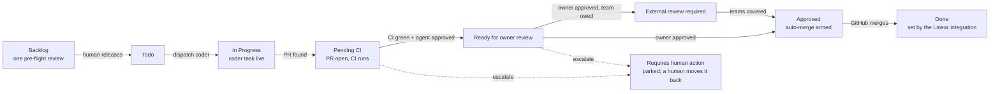
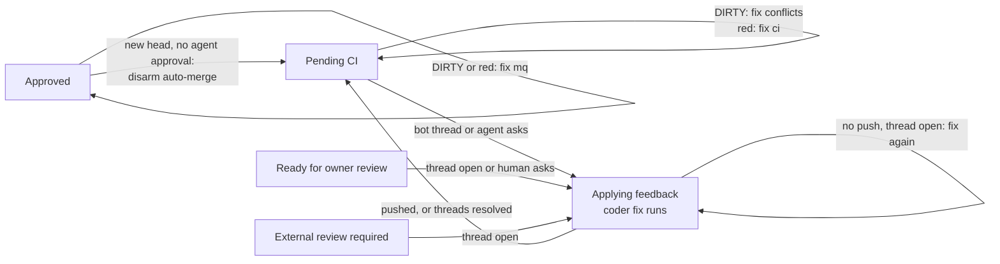
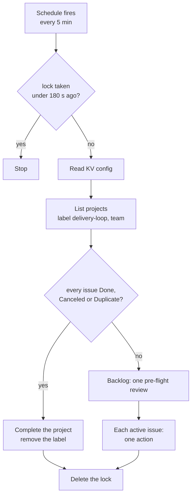
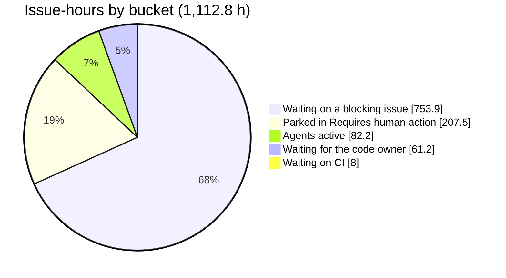

# Linear Delivery Loop

An Agent Swarm playbook template that moves Linear issues to merged pull requests on a five-minute tick. The docs page is https://docs.agent-swarm.dev/playbooks/linear-delivery-loop.

One script, the tick, runs every five minutes. It reads each enrolled Linear project and the pull requests on GitHub, then takes **one action per issue per tick**. The Linear workflow state is the state machine. Agents implement, fix CI and answer review. A reviewer agent approves the exact head commit before a human is pinged. A human decides what starts (Backlog to Todo) and approves the pull request. GitHub merges it, and the Linear GitHub integration sets Done. **The tick never sets Done.**

The first project run on these rules is written up in [Software factories are workflows](https://www.pleasedontdeploy.com/p/software-factories-are-workflows).



## What it does

- **Enrolment is opt-in.** A project joins when a human adds the `delivery-loop` project label. Nothing runs without it.
- **One action per issue per tick.** The tick reads the issue state, the live agent task under the issue's key, and the pull request, then picks exactly one action: wait, dispatch an agent, move the state, arm auto-merge, or escalate.
- **Backlog gets one pre-flight review.** A researcher agent comments on each new Backlog issue once. It never changes the state.
- **Todo waits for blockers.** An open issue that `blocks` this one keeps it in Todo. Otherwise a coder agent starts on the issue's Linear `branchName`.
- **CI failures go back to the coder.** A merge conflict or a failed required check dispatches a fix task on the same branch.
- **An agent review gate guards the human.** With CI green, a reviewer agent returns a verdict for the exact head commit. Approved moves the issue to Ready for owner review and pings the owner once per commit. Changes requested goes back to the coder.
- **Human review is answered, not escalated.** An open review thread, or a human "changes requested" at the head commit, dispatches a coder fix and moves the issue to Applying feedback. With the review gate on, the fixed head goes back through Pending CI, so the agent approves every head a human sees.
- **Approved arms auto-merge on an agent-approved head only.** Conflicts or a failed run after approval dispatch a merge-queue fix. Before it sends any coder fix (merge-queue, CI, review thread or a human's change request), the tick disables auto-merge if it is armed, so the fix's new head cannot merge on its own. With the review gate on, it never arms that head as is: it moves the issue back to Pending CI, where CI and the reviewer agent run on the new head. The owner's earlier approval still counts unless GitHub dismissed it. GitHub merges.
- **Escalation parks the issue.** It sets Requires human action, comments the attempt log on the issue, sends the project lead a Slack DM and resets the attempt counters. The tick then ignores the issue until a human moves it back.
- **A project completes itself.** When every issue is Done, Canceled or Duplicate, the tick marks the project completed and removes the label.



One fix runs at a time per issue: a live task under the issue's key blocks a second dispatch.

## Agents

- **[Lead](https://templates.agent-swarm.dev/official/lead)** — owns setup. Global scripts, script connections and Slack posts need the Lead identity, and the schedule runs as the agent that created it.
- **[Coder](https://templates.agent-swarm.dev/official/coder)** — one or more. Gets `delivery-implement` and `delivery-fix` tasks, works on the Linear branch name and pushes to the same pull request.
- **[Reviewer](https://templates.agent-swarm.dev/official/reviewer)** — gets `delivery-review` tasks with an output schema `{verdict, headSha, summary}`. It never pushes.
- **[Researcher](https://templates.agent-swarm.dev/official/researcher)** — optional. Gets one `delivery-preflight` task per new Backlog issue and comments on the issue.

The tick picks agents round-robin from the lists in its config. A reviewer that dies at boot is replaced by the next reviewer in the list.

## Tools & Skills

### Built-in (ships with agent-swarm)

- **Scripts and schedules** — the tick is a global script on a `targetType: "script"` schedule. Scheduled script runs stop at 60 s; the tick stops itself at 25 s and leaves the rest for the next tick.
- **Script connections** — `ctx.api.linear.graphql` and `ctx.api.github.graphql`. The credential broker injects the token only for the bound host, so no secret enters the script.
- **Tasks** — `task_send` with `key: shared/linear-delivery-loop/<issue>/`, `task_list` by that key for the live-task check, and `task_get` for the reviewer's verdict.
- **KV** — namespace `linear-delivery-loop`: `config`, `lock`, `issue/<linearIssueId>`, `rr/<role>` and `errors`.
- **Slack** — `slack_post` for the owner ping, team review posts, escalation DMs and error alerts.

### Community template

[`templates/community/linear-delivery-loop/`](https://github.com/desplega-ai/agent-swarm/tree/main/templates/community/linear-delivery-loop):

| File | What it is |
|---|---|
| `scripts/linear-delivery-tick.ts` | The tick. Pure decision functions plus the I/O shell. Dry run is the default. |
| `scripts/linear-delivery-setup.ts` | Adds missing workflow states and the project label, and writes a starter config. Idempotent. |
| `config.example.json` | Every config key with its default. |
| `schedule.json` | The schedule, in dry run. |
| `lead-prompt.md` | A prompt that has your Lead do the setup. |

## Workflows / Schedules

| Schedule | Target | Cron | Args |
|---|---|---|---|
| `linear-delivery-tick` | script `linear-delivery-tick` | `2-57/5 * * * *` (UTC) | `{ "dryRun": true }`, then `{ "dryRun": false }` |

The `2-57/5` offset keeps the tick off the top of the minute, where other schedules cluster.



## Setup

Every step below uses the REST API with your swarm API key. Steps 1, 2 and 6 need the **Lead** identity: pass the Lead's agent id in `X-Agent-ID`. The schedule then runs the tick as the Lead, which it needs to name agents in `task_send` and to post to Slack.

```bash
export SWARM_URL=https://api.example.com   # your agent-swarm API
export API_KEY=...                         # swarm API key
export LEAD_ID=...                         # your Lead's agent id
H=(-H "Authorization: Bearer $API_KEY" -H "X-Agent-ID: $LEAD_ID" -H "Content-Type: application/json")
RAW=https://raw.githubusercontent.com/desplega-ai/agent-swarm/main/templates/community/linear-delivery-loop
```

**1. Connections (Lead).** Store the two tokens as secrets, then create one GraphQL connection for each. A Linear personal API key goes in the `Authorization` header as is; a GitHub token is a bearer token. The GitHub token needs read access to pull requests and checks, and write access to enable auto-merge.

```bash
put() { curl -s "${H[@]}" -X PUT $SWARM_URL/api/config \
  -d "{\"scope\":\"global\",\"key\":\"$1\",\"value\":\"$2\",\"isSecret\":true}"; }
put LINEAR_API_KEY "$LINEAR_KEY"
put GITHUB_TOKEN   "$GH_TOKEN"

curl -s "${H[@]}" -X POST $SWARM_URL/api/script-connections -d '{
  "kind": "graphql", "slug": "linear", "baseUrl": "https://api.linear.app/graphql",
  "allowedHosts": ["api.linear.app"],
  "auth": { "type": "header", "headerName": "Authorization", "configKey": "LINEAR_API_KEY" } }'
curl -s "${H[@]}" -X POST $SWARM_URL/api/script-connections -d '{
  "kind": "graphql", "slug": "github", "baseUrl": "https://api.github.com/graphql",
  "allowedHosts": ["api.github.com"],
  "auth": { "type": "bearer", "configKey": "GITHUB_TOKEN" } }'
```

**2. The scripts (Lead).** Both install at global scope, which a schedule requires.

```bash
for s in linear-delivery-tick linear-delivery-setup; do
  curl -s $RAW/scripts/$s.ts \
    | jq -Rs --arg n "$s" '{name: $n, scope: "global", source: .}' \
    | curl -s "${H[@]}" -X POST $SWARM_URL/api/scripts/upsert --data-binary @-
done
```

**3. The Linear team.** Run setup in dry run and read `wouldCreate`. Then run it for real. It creates the missing states (Pending CI, Ready for owner review, External review required, Applying feedback, Approved, Requires human action) and the `delivery-loop` project label. Creating workflow states may need a Linear admin. If your team already uses other names, skip the creation and map them with `linear.states` in step 4.

```bash
run() { curl -s "${H[@]}" -X POST $SWARM_URL/api/scripts/run \
  -d "{\"name\":\"$1\",\"scope\":\"global\",\"args\":$2}" | jq '.result'; }
run linear-delivery-setup '{"teamKey":"ENG"}'
run linear-delivery-setup '{"teamKey":"ENG","dryRun":false}'
```

**4. The config.** Copy `config.example.json`, fill in your team key, repos, agent ids and Slack ids, then store it in KV.

```bash
curl -s $RAW/config.example.json > config.json   # edit it
jq '{value: .}' config.json \
  | curl -s "${H[@]}" -X PUT $SWARM_URL/api/kv/_/linear-delivery-loop/config --data-binary @-
```

**5. A dry run.** Point the tick at one existing project. It reads Linear and GitHub, writes nothing, and returns one planned action per issue. Go on only when `controls.ok` is `true`: a run that read zero issues returns `false`.

```bash
run linear-delivery-tick '{"dryRun":true,"projectIds":["<linear-project-id>"]}' \
  | jq '{controls, budget, plan: [.projects[].issues[] | {key, state, action, reason}]}'
```

**6. The schedule (Lead).**

```bash
curl -s $RAW/schedule.json | curl -s "${H[@]}" -X POST $SWARM_URL/api/schedules --data-binary @-
```

**7. Go live.** Read a few scheduled dry runs first, then switch.

```bash
ID=$(curl -s "${H[@]}" "$SWARM_URL/api/schedules?name=linear-delivery-tick" | jq -r '.schedules[0].id')
curl -s "${H[@]}" -X PATCH $SWARM_URL/api/schedules/$ID -d '{"scriptArgs":{"dryRun":false}}'
```

**8. Enrol a project.** In Linear, add the `delivery-loop` label to the project. Move an issue from Backlog to Todo to release it.

## Runner behavior

### Per-issue precedence

1. **Requires human action** and terminal states: nothing.
2. **Backlog:** one pre-flight review, then nothing.
3. **A stuck live task** escalates. Stuck means no update for 30 minutes and older than 120 minutes (240 for a coder task).
4. **A human change request** at the head commit overrides the state action. The latest trusted review among CHANGES_REQUESTED, APPROVED and DISMISSED decides.
5. **A merged pull request:** nothing past In Progress. Linear's Done can lag the merge by a tick.
6. **The state action** (the flowcharts above).
7. **The dispatch guard:** a live task means wait, a missing `branchName` escalates, and an attempt over its cap escalates.

### Trusted reviewers

Only a trusted human's review moves an issue or dispatches a coder: a login in `github.ownerLogins` when that list is set, else an owner, member or collaborator of the repo (GitHub `authorAssociation`). The same rule applies to owner approval and to open review threads: a thread counts when any of its comments is by a bot or a trusted human, so an outsider's reply cannot hide it. A thread with more than 30 comments counts without the check. Anyone can review a pull request on a public repo, so an outsider's approval never arms auto-merge and an outsider's comment never reaches a coder. The fix prompt quotes review text in a block that the coder treats as data, not instructions.

### Pull request lookup

1. An open or merged PR whose head branch equals the issue's `branchName`, in any configured repo.
2. Else, the issue key as a whole word in the head branch, within the last 300 PRs per repo. `ENG-12` never matches `ENG-123`.

A closed, unmerged PR never counts. Two matches count as none.

### CI

The tick reads the head commit's check rollup and keeps the checks GitHub marks as required for the PR. Name them in `github.requiredChecks` if the repo has no branch protection. `github.ignoredChecks` drops checks such as an approval gate. With no required check reported, a commit younger than 30 minutes waits; an older one waits and counts, and the third such tick escalates.

### Caps

| Cap | Default | At the cap |
|---|---|---|
| Implement dispatches per issue | 5 | escalate |
| CI fixes (conflicts and failed checks) per issue | 5 | escalate |
| Review fixes per issue | 5 | escalate |
| Merge-queue fixes per issue | 5 | escalate |
| Ticks with no CI reported | 3 | escalate |
| Attempts in total per issue | 25 | escalate |
| Reviewer re-dispatches after a death at boot | 2 | escalate |
| Infra failures per issue | 5 | escalate |
| Implement dispatches per tick | 2 | the rest wait for the next tick |
| Fix dispatches per tick | 3 | the rest wait |
| Reviewer and pre-flight dispatches per tick | 3 | the rest wait |
| Slack posts per tick | 5 | the rest wait |
| Wall clock per tick | 25 s | the rest wait |
| Lock | 180 s | a second tick stops |

Override any of them under `caps` in the config, for example `{"caps": {"implement": 3, "perTick": {"fix": 5}}}`.

### Infra failures

Tasks fail for reasons that have nothing to do with the work: provider auth errors, exhausted credits, rate limits, worker restarts. When the tick sees that its last task failed, it classifies the failure. A cancelled or superseded task, a failure reason that matches `INFRA_FAILURE_PATTERNS`, or a failure within 3 minutes with no progress is **infra**. An infra failure gives back the attempt it spent, both the kind and the total, and counts toward the infra cap. Any other failure keeps the spend. HTTP codes count only next to `HTTP` or `status`, so "512 tests failed" is a real failure.

### The lock

The tick takes the lock with an atomic `kv_incr` on `lock`. The first caller gets 1 and runs; it deletes the key when it ends. A later caller reads the lock row's `createdAt`, which `kv_incr` never moves. If the lock is older than 180 s (3 minutes), its owner died, so the caller deletes it and stops; the next tick acquires cleanly. The lock has no TTL, because a re-created expired row would keep its old `createdAt`.

### Output

```json
{
  "dryRun": true,
  "controls": { "ok": true, "projectsRead": 1, "issuesRead": 9, "prsRead": 120, "errors": [] },
  "projects": [{ "id": "…", "name": "…", "issues": [
    { "key": "ENG-12", "state": "pendingCi", "action": "dispatch", "kind": "ci",
      "reason": "required check failed: test", "deferred": false }
  ] }],
  "budget": { "implement": 0, "fix": 1, "reviewer": 0, "slack": 0, "elapsedMs": 4120 }
}
```

`controls.ok` is `false` when the run read zero issues or any adapter failed. In live mode, adapter errors go to the `errors` KV record and to the `slack.errors` channel, once per error streak.

## Results from a first project

The full story is in [Software factories are workflows](https://www.pleasedontdeploy.com/p/software-factories-are-workflows). The project ran with a partner: a software company with more than 80 employees and a B2B product more than 4 years old. The feature was scoped as a two-week sprint for two people: 14 non-trivial issues across multiple repos, including sensitive data and operations areas. One human owner reviewed every key pull request and decision. The template is a fresh implementation of the same rules.

| Metric | Value |
|---|---|
| Issues closed | 14 of 14 |
| Cycle | 7 days |
| Automated iterations (tick dispatches) | 103 |
| Agent tasks behind them | 640: 44 failed, 30 superseded |
| Human reviews | 43: 14 approved, 21 changes requested |
| Owner feedback | about 15 minutes when asked during working hours |
| Agent fix after a change request | pushed a median 16 min later |
| Runaway loops | none |



Of about 1,100 issue-hours, agents worked about 80. The rest was mostly waiting for people or for CI, directly or behind a blocking issue that was itself waiting. Issues 1 to 11 were released at once as a stacked sequence with `blocks` relations, and the system created smaller sub-issues along the way. When agents were active, they usually worked on about 14 issues in parallel.

### Lessons

- **Infrastructure caused most task failures.** That grows as the loop speeds up, so the team needs room to scale its infrastructure. Every failed task cost an attempt in that run; the infra classifier above came from it.
- **Idempotency needs proof.** Overloading the system produced repeated tasks, broken states and unnecessary iterations. Modelling the task states in TLA+ fixed that. This template does not ship a TLA+ model. It keeps one action per issue per tick, one live task per issue, one lock per tick, and one owner ping per head commit.
- **Budgets counter AI slop.** Agents ignored issues or posted fake progress, and some avoided implementing a hard fix. The caps turn that into an escalation to a human instead of a loop.

### Setup notes

- **A dashboard.** The first project used a custom view of the state machine for debugging and for following the project. The template ships none: the tick's output and the `issue/<id>` KV records are the data to build one on.
- **Deterministic validation.** Scripts, CI checks and litmus gates meant a human was pinged only when the work was ready. Here, that is the required checks and the agent review gate.
- **Only selected projects.** Choosing the project was the main team discussion: complex enough to matter, not too complicated for a first run. The `delivery-loop` label keeps enrolment a human choice.

## Limits

- **The tick never sets Done.** GitHub merges and the Linear GitHub integration closes the issue. Without that integration, issues stay in Approved.
- **Tested scope.** The decision logic, the lock, escalation, project completion and the setup script are covered by fixture tests. A read-only dry run ran against a real Linear project and GitHub repo. The setup script's Linear writes and live mode are tested against fixtures only.
- **Scheduled runs stop at 60 s.** The tick budgets 25 s and defers the remaining issues to the next tick. The write-up describes a 5-minute maximum per loop, the tick interval; here, one tick stops at 25 s, and the stuck rule bounds each agent task.
- **KV has no compare-and-set.** Only the lock owner writes, and each issue has its own key. A stale-lock clear and a fresh acquire can still race inside one request round trip after a crash.
- **One reviewer gate per head commit.** A new push needs a new verdict, including a merge-queue fix pushed after approval.
- **Changed from the original rules:**

| Original behaviour | Here |
|---|---|
| A merge-queue fix carries recent messages from a merge-queue status channel | It carries `mergeStateStatus` and the failed required checks. Reading a Slack channel needs the Lead. |
| A shared agent-picker script | Round-robin over `agents.coders`, `agents.reviewers` and `agents.researchers`. |
| The human reviewer must be a Linear project member | `github.ownerLogins`, or the repo's owners, members and collaborators when that list is empty. |
| A named approval-gate job is dropped from failed jobs | Generic `github.ignoredChecks`. |
| CI read from the Actions run named after the PR | The head commit's check rollup, required checks only. |
| Separate error-log and alert keys | One `errors` record and one Slack alert per error streak. |
| No infra vs real failure split | Infra failures refund their attempt, capped at 5. |

## Patterns used

- **[Drain Loops](https://docs.agent-swarm.dev/playbooks/patterns/drain-loops)** — the tick drains one project issue by issue, one action at a time, until the merge loop empties it.
- **[HITL Gates](https://docs.agent-swarm.dev/playbooks/patterns/hitl-gates)** — a human releases work, approves each PR and handles every escalation.

## References

- [Template package](https://github.com/desplega-ai/agent-swarm/tree/main/templates/community/linear-delivery-loop)
- [Linear GraphQL API](https://linear.app/developers/graphql)
- [GitHub GraphQL: `enablePullRequestAutoMerge`](https://docs.github.com/en/graphql/reference/mutations#enablepullrequestautomerge)
- [GitHub GraphQL: `isRequired` on check runs](https://docs.github.com/en/graphql/reference/objects#checkrun)
