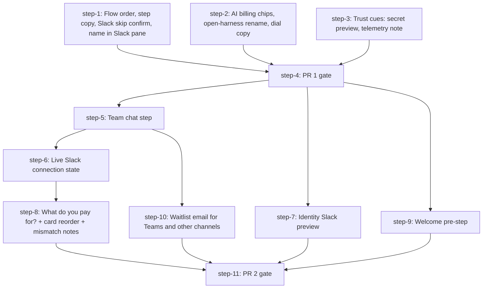

# Onboarding (/setup) rework from Maya's feedback: PR 1 + PR 2 (Plan, DAG)

## Overview

Rework the first-run `/setup` flow from Maya's feedback (review session, 2026-09-25). PR 1 reorders the steps and fixes copy. PR 2 splits Integrations into "Team chat" and "Code & tools", and adds payoff surfaces: a welcome screen, a Slack preview, a live Slack status, and a "what do you already pay for?" question.

- **Motivation**: Maya's review of PR #1604. The flow asks for setup before it shows value, leads with a non-core step (Identity), and hides the "the swarm lives in Slack" story.
- **Related**: `thoughts/taras/research/2026-09-25-onboarding-maya-feedback.md` (verdict table J1-J17, findings F1-F3, decisions, proposed approach), PR #1604, `thoughts/taras/plans-yolo/2026-09-24-ui-onboarding.md` (original /setup plan and decisions).

## Current State Analysis

Baseline: origin/main `d317add09` (refreshed 2026-10-06, 161 commits after the first draft at `4707ca659`). Three of those commits touch this plan: #1780 (telemetry v2 and the vendored event catalog), #1691 (live model catalog, the dial is now tier-driven), and #1836 (Azure embeddings preset, Memory step only, no effect on this plan). Line numbers below are from `d317add09`. Search by symbol if they drift again.

**Step order and ids**
- UI order is one array: `ONBOARDING_STEPS` (`apps/ui/src/api/hooks/use-onboarding.ts:18-26`). `stepNumber()`, `?step=N`, Back/Next (`page.tsx:343-347`, `:495`), the stepper, pill, checklist, and `onboardingResumeStep()` (`use-onboarding.ts:121-129`) all derive from it. A reorder is a one-array change on the UI.
- The API is keyed by id, not position. `OnboardingStepIdSchema` (`src/be/onboarding.ts:10-18`) is membership only.
- A new step id touches hand-written literals: `OnboardingStateSchema.steps` (`src/be/onboarding.ts:113-121`), `freshState()` (`:300-320`), the hand-listed `skip` enum (`:195-200`), one `complete` variant per step (`:159-194`), `STEP_COPY` / `STEP_BODIES` (`page.tsx:46-89`), `STEP_ICON` (`setup-stepper.tsx:30-38`), and `stepSubtitle()` (`setup-checklist-card.tsx:152-192`, exhaustive switch).
- Old persisted blobs get missing steps back-filled on both sides: `parseStoredState()` (`src/be/onboarding.ts:326-346`) and `withAllSteps()` (`use-onboarding.ts:42-49`). No migration is needed for a new id.

**Telemetry (after #1780)**
- Events go out as a v2 envelope from `emit()` (`src/telemetry.ts:595-684`) to `https://proxy.desplega.sh/v1/events`. `ANONYMIZED_TELEMETRY` still gates every event (`isTelemetryEnabled()`, `src/telemetry.ts:65-67`).
- The event catalog is vendored from the private `desplega-ai/proxy` repo into `src/telemetry-contract/` (`catalog.json`, `types.gen.ts`, `EVENTS.md`, `SOURCE.json`). Never hand-edit it. A new event needs a proxy PR first, then `bun run sync:telemetry-contract <proxy-sha>`. An uncatalogued event fails `tsc` here and is rejected at ingest. CI runs `check:telemetry-contract` and `check:telemetry-docs`.
- Onboarding events: `telemetry.onboarding()` (`src/telemetry.ts:760-780`), fed from `src/be/onboarding.ts:254-285` (event and property types) and `queueTelemetry()` (`:364-371`).
- No catalogued event carries an email. The proxy's `/v1/feedback` endpoint (`FeedbackSubmission`, `src/telemetry-contract/types.gen.ts:185-219`) accepts one. The UI Feedback dialog already posts there from the browser (`api.submitFeedback`, `apps/ui/src/api/client.ts:789`, `apps/ui/src/components/feedback/feedback-dialog.tsx:32-48`). On self-hosted origins the proxy blocks CORS, so the client falls back to a fire-and-forget `no-cors` POST and cannot confirm delivery (`client.ts:815-824`).
- The catalog already has `lead.captured` (`catalog.json:1203-1223`): "A consented lead (Teams waitlist or private-beta sign-up). The email stays in feedback_submissions." Source `api-server`. Properties: `channel`, `submission_id`, `consent`. Nothing emits it yet.
- `telemetry.mdx` has a generated event table: `bun run build:telemetry-docs` regenerates it from `EVENTS.md`.

**Integrations step**
- One step, two groups (`apps/ui/src/pages/setup/steps/integrations/catalog.ts:197-200`): "Chat and code" (Slack, GitHub, GitLab, Linear, Jira) and "Business tools" (Gmail, Microsoft 365 inline over OAuth. Figma, Stripe, Salesforce, Shopify, Granola as "Soon").
- Completion: `deriveState()` marks `integrations` done when any of `signals.integrations.{slack,github,gitlab,linear,jira}` is true (`src/be/onboarding.ts:477-486`, `~:488-510`). Method enum: `slack|github|gitlab|linear_oauth|jira_oauth` (`:57-63`). Business tools never complete the step. The UI mirrors this in `connectedMethod()` (`catalog.ts:317-322`) and `step-integrations.tsx:87-106`.
- Linear/Jira OAuth returns to `/setup?step=integrations&integration=...` (`step-integrations.tsx:34`, `:60-83`).
- Teams is absent from /setup. WhatsApp exists as Kapso in Settings only (`apps/ui/src/lib/integrations-catalog.ts:254-307`).

**Slack**
- The Slack pane reads the swarm name from `useStatus()` to fetch the manifest (`slack-pane.tsx:56-67`). Route: `GET /api/integrations/slack/manifest` (`src/http/integrations.ts:85-95`). `manifestName()` cuts at 35 chars (`src/slack/manifest.ts:5-6`). The pane has no name field.
- Onboarding "Connected" = token presence (`src/be/automation-preflight.ts:288-291`).
- A live signal already exists: `getSlackConnectionState()` returns `disconnected | connecting | connected` from Socket Mode lifecycle events (`src/slack/connection-state.ts`, wired in `src/slack/app.ts:12-27`). `/status` uses it. Onboarding does not.
- Saving tokens triggers `scheduleIntegrationsReload()` (`src/http/core.ts:257` onward), which starts the Slack app.
- Slack messages use per-agent personas: `getAgentDisplayName()` (`src/slack/responses.ts:52-54`) and `getAgentEmoji()` (`:443-459`: lead = `:crown:`, others = name hash over 8 emoji). Both are server-only. The UI has no Slack message mock.

**Identity step**
- Copy claims "The name, mark, and color your team sees in the sidebar, in Slack, and on pages." (`page.tsx:53`). Only the name reaches Slack, through the manifest (research F1).
- `SWARM_ORG_NAME` autosaves via `useSetupSave()` (`apps/ui/src/components/onboarding/use-setup-save.ts:45-100`) and `useAutosave` (`step-name.tsx:~119`). The hook works outside the step.
- Preview = `SidebarPreview` (`step-name.tsx:~337`).

**AI Providers and Agents**
- Card order is hardcoded JSX (`step-ai.tsx:112-115`). The open card is local state in `StepAi`.
- Chips: `SetupChip` tones `neutral | done | error | info` (`apps/ui/src/components/onboarding/setup-card.tsx:25`).
- No storage exists for an onboarding answer. `OnboardingState` has no answers field (`apps/ui/src/api/types.ts:~3447`).
- Dial blurbs: `LEVEL_BLURB` (`agents/agent-models.tsx:57-61`). Since #1691 the dial is tier-driven: `model-dial.ts` maps cheap → `regular`, optimal → `smart`, max → `ultra` and resolves each tier from `GET /api/models-catalog/tiers` (live catalog, operator-configurable). `RECOMMENDED = "optimal"` still exists. See `runbooks/model-tiers.md`.

**Skip and secrets**
- Skip calls `act({ action: "skip" })` then `goNext()` with no confirm (`page.tsx:349-359`). `SKIP_HINT` covers `memory` only (`page.tsx:78-80`).
- `AlertDialog` exists (`apps/ui/src/components/ui/alert-dialog.tsx`). Controlled example: `apps/ui/src/pages/config/components/swarm-config-section.tsx:224-241`. Setup shortcuts already pause while an `alertdialog` is open (`setup-footer.tsx:148-156`).
- `AutosaveSecretField` keeps the pre-save value in `draft` (`autosave-secret-field.tsx:162-171`). After save it shows a fixed 12-dot string (`:218-243`). Only /setup uses it (`setup-field.tsx`, `ai/fields.tsx`).

**Tests and tooling**
- API state machine: `src/tests/onboarding.test.ts` (addresses steps by id, so a reorder does not break it. The split changes `:351-360`, `:443-446`, `:492-499`).
- No unit tests under `apps/ui/src/pages/setup/**`. No `packages/ui-e2e` spec walks /setup.
- `openapi.json` + `docs-site/public/openapi.d.ts` embed the onboarding unions. `bun run docs:openapi` regenerates both.
- Telemetry is documented in `docs-site/content/docs/(documentation)/reference/telemetry.mdx` (generated event table).

**Rules that shape the UI work** (read before UI work: root `DESIGN.md`, `.claude/internal-skills/dashboard-ui/SKILL.md`, `apps/ui/CLAUDE.md`, `apps/ui/DESIGN.md`): autosave, no Save buttons. `done` is amber inside /setup only. Short verb-first copy, icons and tooltips over sentences, no em dashes. Links out of /setup use `setupExitHref()`. Never render a stored secret. Blocked actions use `aria-disabled` + tooltip, never `disabled`.

## Desired End State

New /setup order (after PR 2): **Welcome (pre-step) → Connect → AI Providers → Agents → Memory → Team chat → Identity → Code & tools → First task.**

- A first-time visitor sees what they get before the first question.
- The AI step asks what the team already pays for, reorders the cards, labels each option "your plan" or "billed per token", and warns on mismatches.
- The dial copy says Optimal is our pick, without claiming a benchmark.
- Team chat pitches "the swarm is multiplayer", shows the live Slack connection, and collects Teams and other-channel waitlist emails through the proxy feedback endpoint, with an explicit "this goes to Desplega" line. The API records a PII-free `lead.captured` event.
- Skipping Slack asks for confirmation.
- Identity comes after Slack, shows a Slack message preview with the real personas, and its copy no longer claims logo and color reach Slack.
- Secret inputs show the first and last 4 characters plus the length before save.
- Connect discloses anonymous telemetry.

Verify with the Global Verification commands and the Manual E2E walkthrough at the end of this file.

## What We're NOT Doing

- PR 3 sign-in funnel (J1/J2): Google/GitHub/email/SSO capture, the Desplega-side receiver and Slack alert.
- Any embedding or Memory-step preset change (parallel embedding track, `thoughts/taras/research/2026-09-25-memory-embedding-model-dimensions-chunking.md`).
- J17 (first task in Slack).
- Parked research items: cloud-only agents upsell, Pareto chart, favicon fetch / generated logo / logo upload, "Other" code-host field, server-side masked secret hint.
- Changing when the Team chat step counts as done: it stays on token presence. The live state is display only.

## Implementation Approach

- Two stacked PRs. PR 1 (steps 1-4) is copy and order with no API change, so it can merge fast. PR 2 (steps 5-11) changes the onboarding API.
- PR 1 splits by file ownership so steps 1-3 run in parallel without touching the same files. `page.tsx` belongs to step 1 only.
- In PR 2, steps 5, 6, and 8 all edit `src/be/onboarding.ts`, so they run in sequence (5 → 6 → 8). Steps 7, 9, and 10 run beside them. Step 10 (waitlist) was split out of the Team chat step during drafting, because one step with the API route, the sender, and the UI form was too big (planning rule: more than 4 sub-steps).
- Shared PR 2 files (`apps/ui/src/api/types.ts`, `apps/ui/src/api/client.ts`, `page.tsx`, `step-chat.tsx`, `src/be/onboarding.ts` telemetry types): each step edits its own region and re-reads before each edit.
- Parallel PR 2 steps do not regenerate `openapi.json`. Step 11 regenerates it once, so the generated file never conflicts. The vendored telemetry contract changes only in step 8.
- Each step commits only the files it owns (`git add <paths>`, never `git add -A`), as `[step-N] <description>`.
- Decisions taken in planning (Taras, 2026-09-29, revised 2026-10-06):
  - The "what do you pay for?" answer lives in onboarding state and goes to telemetry as anonymous booleans. Step 8 opens the `desplega-ai/proxy` catalog PR for `onboarding.subscriptions_answered` first and waits for Taras's merge (Taras chose to keep this inside step 8).
  - Teams and other channels register interest by email. The browser sends the email to the proxy `/v1/feedback` endpoint through the existing `api.submitFeedback` (same path as the Feedback dialog). The API then emits the catalogued, PII-free `lead.captured` event, which obeys `ANONYMIZED_TELEMETRY`. This replaces the first draft's `waitlist_signup` event: the catalog forbids emails in events.
  - The Slack check shows the existing Socket Mode state. No new Slack call.
  - The welcome screen is a pre-step outside the numbered stepper. It shows before the API connection exists, so a browser-local flag tracks it.
  - These docs ship in a public repo: the reviewer is "Maya" (pseudonym), with no meeting ids, links, or timestamps.

## Quick Verification Reference

Run from the worktree root.

- Root typecheck: `bun run tsc:check`
- Root lint: `bun run lint` (read the output: this Mac's Biome can crash and still exit 0. See project memory "Local Biome stack overflow".)
- Onboarding API tests: `bun run test:root -- src/tests/onboarding.test.ts`
- UI gates: `cd apps/ui && bun run lint && bunx tsc -b && bun run check:tokens`
- API gates (steps that touch `src/http` or `src/be`): `bash scripts/check-db-boundary.sh && bun run check:rbac-coverage && bun run check:openapi-response-coverage && bun scripts/check-floating-promises.ts && bun scripts/check-promise-sinks.ts`
- OpenAPI (step 11 only): `bun run docs:openapi`
- Telemetry contract (step 8, and any step that emits an event): `bun run check:telemetry-contract && bun run check:telemetry-docs`
- Push with the env-sensitive tests muted: `ANTHROPIC_API_KEY= OPENROUTER_API_KEY= DEEPSEEK_API_KEY= OPENAI_API_KEY= git push`

### QA environment (used by every Automated QA block)

A fresh API with a throwaway DB and no repo `.env`, because `.env` tokens auto-complete steps.

```bash
# API on :3313, fresh DB (run with run_in_background)
mkdir -p /tmp/onb-plan-qa && rm -f /tmp/onb-plan-qa/db.sqlite*
env -i HOME="$HOME" PATH="$PATH" PORT=3313 MCP_BASE_URL=http://localhost:3313 \
  DATABASE_PATH=/tmp/onb-plan-qa/db.sqlite AGENT_SWARM_API_KEY=123123 \
  CORS_ALLOWED_ORIGINS=https://ui.swarm.localhost,http://localhost:5274 \
  bun run --no-env-file src/http.ts > /tmp/onb-plan-qa/api.log 2>&1

# UI dev server (portless: https://ui.swarm.localhost), run_in_background
cd apps/ui && bun run dev

# Browser
agent-browser skills get core
agent-browser open "https://ui.swarm.localhost/setup?apiUrl=http://localhost:3313&apiKey=123123"
```

- Reset between runs: stop the API, `rm -f /tmp/onb-plan-qa/db.sqlite*`, start it again, `agent-browser close --all`.
- Restart the API after API edits: it runs `src/` directly, with no watch.
- Phone check: `agent-browser set viewport 390 844` (the #1623 phone layout rules apply).
- Never print credentials. Type secrets into the UI from env vars, never echo them.

## DAG



## Steps

| ID | Name | Depends on | Status | File |
|----|------|------------|--------|------|
| step-1 | Flow order, step copy, Slack skip confirm, name in Slack pane | none | ready | [step-1.md](./step-1.md) |
| step-2 | AI billing chips, open-harness rename, dial copy | none | ready | [step-2.md](./step-2.md) |
| step-3 | Trust cues: secret preview, telemetry note | none | ready | [step-3.md](./step-3.md) |
| step-4 | PR 1 gate | step-1, step-2, step-3 | ready | [step-4.md](./step-4.md) |
| step-5 | Team chat step (new chat id) | step-4 | ready | [step-5.md](./step-5.md) |
| step-6 | Live Slack connection state | step-5 | ready | [step-6.md](./step-6.md) |
| step-7 | Identity Slack preview | step-4 | ready | [step-7.md](./step-7.md) |
| step-8 | What do you pay for? + card reorder + mismatch notes | step-6 | ready | [step-8.md](./step-8.md) |
| step-9 | Welcome pre-step | step-4 | ready | [step-9.md](./step-9.md) |
| step-10 | Waitlist email for Teams and other channels | step-5 | ready | [step-10.md](./step-10.md) |
| step-11 | PR 2 gate | step-7, step-8, step-9, step-10 | ready | [step-11.md](./step-11.md) |

> **Canonical dependencies and execution status live in each `step-<n>.md`'s frontmatter.** This table is a derived snapshot at plan creation. During `/v-implement`, frontmatter `status` (`ready` → `claimed` → `done`) is the source of truth.

## Pre-flight Verification

Run once before step 1:

- [ ] The research worktree is merged with origin/main (`git log -1 --oneline` shows `d317add09` or newer). If main moved again, merge it and re-check the anchors in Current State Analysis.
- [ ] `gh` can reach the private proxy repo (needed in step 8): `gh repo view desplega-ai/proxy --json name -q .name` prints `proxy`
- [ ] Commit the research doc and this plan on a new branch: `git switch -c feat/onboarding-maya-pr1 && git add thoughts/taras/research/2026-09-25-onboarding-maya-feedback.md thoughts/taras/plans/2026-09-29-onboarding-maya-feedback && git commit -m "docs(onboarding): research + plan for Maya's /setup feedback"`
- [ ] Baseline root typecheck passes: `bun run tsc:check`
- [ ] Baseline onboarding tests pass: `bun run test:root -- src/tests/onboarding.test.ts`
- [ ] Baseline UI gates pass: `cd apps/ui && bun run lint && bunx tsc -b && bun run check:tokens`
- [ ] `agent-browser --version` works, and `agent-fs auth whoami` succeeds (if not, PR evidence stays as local paths)

## Global Verification

Run after step 11:

- [ ] Root typecheck: `bun run tsc:check`
- [ ] Root lint: `bun run lint`
- [ ] Full root tests: `bun run test:root -- --parallel=4`
- [ ] Black-box E2E: `bun run e2e`
- [ ] UI smoke: `bun run e2e:ui -- --grep @smoke`
- [ ] UI gates: `cd apps/ui && bun run lint && bunx tsc -b && bun run check:tokens`
- [ ] API gates: `bash scripts/check-db-boundary.sh && bun run check:rbac-coverage && bun run check:openapi-response-coverage && bun scripts/check-floating-promises.ts && bun scripts/check-promise-sinks.ts`
- [ ] OpenAPI is fresh: `bun run docs:openapi && git diff --exit-code openapi.json docs-site/public/openapi.d.ts`
- [ ] Telemetry contract and docs: `bun run check:telemetry-contract && bun run check:telemetry-docs`
- [ ] Both PR bodies pass: `bun scripts/check-pr-body.ts --title "<title>" --body-file <file>`

## Appendix

- **Follow-up plans**: PR 3 sign-in funnel (research doc, "Proposed approach"). Embedding track (see What We're NOT Doing).
- **Derail notes**:
  - Research F3 (telemetry sends the org name) is now by design: the #1780 envelope carries `org_name` in `context` (`src/telemetry-context.ts`). Only the 2026-09-17 brainstorm line is stale.
  - `?step=N` links are index-based and change meaning after the reorder. `?step=<id>` still works (`page.tsx:94-99`).
- **References**:
  - Research: `thoughts/taras/research/2026-09-25-onboarding-maya-feedback.md`
  - Prior plan: `thoughts/taras/plans-yolo/2026-09-24-ui-onboarding.md`
  - Prior research: `thoughts/taras/research/2026-09-24-ui-onboarding-experience.md`
  - UI rules: `.claude/internal-skills/dashboard-ui/SKILL.md`

## Manual E2E

Full walkthrough against a real API and real agents, after step 11. Uses the QA environment above plus Docker agents.

```bash
# 1. Worker image from this branch (slim target)
docker build -f Dockerfile.worker --target worker-slim -t agent-swarm-worker:onb-qa .

# 2. Fresh API + UI: see "QA environment" above (API on :3313)

# 3. Lead (Claude) + worker (pi) against the QA API. No credentials here:
#    they come from what you save in /setup.
LEAD_ID=$(uuidgen); WORKER_ID=$(uuidgen)
common=(-e AGENT_SWARM_API_KEY=123123 -e YOLO=true \
  -e MCP_BASE_URL=http://host.docker.internal:3313 --add-host=host.docker.internal:host-gateway)
docker run -d --name onb-qa-lead "${common[@]}" -e HARNESS_PROVIDER=claude \
  -e AGENT_ID="$LEAD_ID" -e AGENT_ROLE=lead -e TEMPLATE_ID=official/lead agent-swarm-worker:onb-qa
docker run -d --name onb-qa-worker "${common[@]}" -e HARNESS_PROVIDER=pi \
  -e AGENT_ID="$WORKER_ID" -e AGENT_ROLE=worker -e TEMPLATE_ID=official/coder agent-swarm-worker:onb-qa

# 4. Walk it in a fresh browser (welcome shows only without the seen-flag)
agent-browser close --all
agent-browser open "https://ui.swarm.localhost/setup"
```

Checklist for the walk (Taras):

- [ ] Welcome shows first, "Get started" leads to Connect, and a reload does not show it again.
- [ ] Connect shows the telemetry note.
- [ ] AI: answer "Claude" + "ChatGPT", the Claude and Codex cards move up, the chips read "your plan" or "billed per token", and the open-harness card shows its mismatch note.
- [ ] Agents: the dial copy calls Optimal "our pick" and makes no benchmark claim.
- [ ] Team chat: Slack tokens saved → "Connecting" → "Connected". A Teams email submit shows "Sent" and the proxy has the feedback row (check with the proxy owner).
- [ ] Skip on Team chat without Slack asks "Skip Slack?".
- [ ] Identity: the Slack preview shows the lead with a crown and the worker's emoji, and it updates when the name changes.
- [ ] Code & tools: GitHub token completes the step. Slack alone does not.
- [ ] First task completes, and the home checklist shows 8 of 8.
- [ ] Cleanup: `docker rm -f onb-qa-lead onb-qa-worker`, stop the API and UI tasks, `rm -rf /tmp/onb-plan-qa`.
