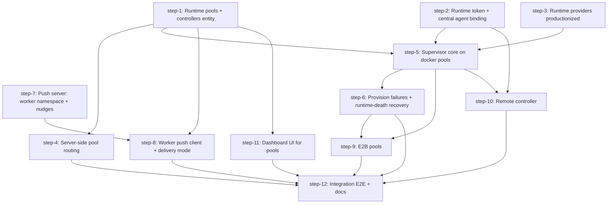

# Push-based workers (runtime pools, on-demand provisioning, push delivery). Plan (DAG)

## Overview

Let the API start worker runtimes on demand through runtime pools and controllers, and let workers receive work by push over a worker-dialed socket. Poll delivery and static workers keep working unchanged.

- **Motivation**: make it easy to run a swarm where workers start on demand and receive work directly, with workers in mixed places (compose, E2B, later k8s) under one API.
- **Related**: `thoughts/taras/brainstorms/2026-10-10-push-based-workers.md`, spike code in `src/runtime-providers/` and `scripts/spike-runtime-providers.ts` (commit de3f17b52).

## Current State Analysis

### Delivery (poll)
- `GET /api/poll` (`src/http/poll.ts:298`) answers at once. It is not a server long-poll. The waterfall runs in one transaction (`poll.ts:348-668`): offered (`:392`), pending-assigned with the `canClaim` budget gate and `startTask` (`:413-518`), mentions (`:527`), worker pool auto-claim via `claimTask` CAS (`:560-663`). `channel_activity` runs after the transaction, through a live Slack call (`:695-761`).
- With multi-runtime on (default), a poll needs a live `active` runtime row (`touchRuntimeInstance`, `poll.ts:372-377`).
- The worker loop (`src/commands/runner.ts:6519`) sleeps 2 s between polls (`pollForTriggerOnce`, `:3324`, `PollIntervalMs` `:5571`). The other per-loop checks are also polls: cancel (`GET /cancelled-tasks` per task, `:6607`, `:4957`), steering (`GET /api/steering-messages`, `:623`, `:6617`), config drift every 10 s (`:6541`).
- One branch point for the poll wait: `pollForTrigger` (`:3305`) and its call site (`:6651`).

### Work-arrival signals
- `createTaskExtended` (`src/be/db.ts:2403`) emits `task.created` on `workflowEventBus` in `afterCommit` (`db.ts:2939-2958`) for every status. `emitTaskStarted` fires on the move to `in_progress` (`src/be/task-lifecycle-events.ts`).
- No event exists for release (`releaseTask`, `db.ts:3018`), reject, accept, or `assignUnassignedTaskPending` (`src/be/db/tasks/write.ts:196`).
- `autoAssignPoolTasks` (`src/heartbeat/heartbeat.ts:1157`) assigns pool tasks to idle live workers only on the 90 s sweep. It skips `canClaim`.

### Runtimes and capacity
- `runtime_instances` (`src/be/migrations/132_multi_runtime_instances.sql:17-44`): `status` has no SQL CHECK. The Zod enum is `active | offline` (`src/types.ts:1967`). `agent_id` is an FK to `agents`.
- The worker allocates the runtime id: `crypto.randomUUID()` at `runner.ts:5649`, exported as `SWARM_RUNTIME_INSTANCE_ID`, sent in the register body. `POST /api/agents` (`src/http/agents.ts:636-747`) upserts the row (`upsertRuntimeInstance`, `src/be/multi-runtime.ts:184`, forces `active`).
- All liveness helpers filter `status='active' AND last_seen_at >= cutoff` (`multi-runtime.ts`). `expireStaleRuntimeInstances` (`:401`) deletes every row past the 5 min cutoff, any status. `reported_slots` is never read by capacity code. Capacity is `hasCapacity` (`src/be/db/agents.ts:530`): active task count below `agents.maxTasks`.
- After `terminate()`, the agent stays `idle` until the reaper runs (spike finding). `markRuntimeInstanceOffline` (`:235`) plus `reconcileAgentStatusFromRuntimes` (`:340`) is the fix path.

### Crash recovery
- Recovery keys only off task `lastUpdatedAt` and `active_sessions.lastHeartbeatAt` staleness (5/15/30 min, `heartbeat.ts:119-129`). No "runtime X died, recover its tasks" function exists. `active_sessions.runtimeInstanceId` is write-only today.
- `remediateCrashedWorkerTask` (`heartbeat.ts:694`) is module-private. Reusable pieces: `supersedeTask`, `createResumeFollowUp` (`src/tasks/worker-follow-up.ts:410`), `deleteActiveSession`, `restoreAgentIdleAfterRemediation` (`heartbeat.ts:1397`).
- `runbooks/heartbeat-crash-recovery.md` §1a "Runtime liveness" (L102-163) is the section to extend.

### Auth
- `aseph_` session tokens (`src/be/migrations/149_session_tokens.sql`): `taskId` NOT NULL, no runtime column. Mint/resolve/revoke in `src/be/users.ts:553-616`. `POST /api/sessions/tokens` is operator-only (`src/http/sessions.ts:203`). Only the ACP adapter uses them.
- `resolveHttpRequestAuth` (`src/http/auth.ts:26-71`) maps `aseph_` to `{kind:"agent", agentId, taskId}`. Only `/mcp` cross-checks `X-Agent-ID` and `X-Source-Task-Id` against the token (`src/http/mcp.ts:99-113`). REST handlers trust the `X-Agent-ID` header (`src/http/index.ts:332`).
- Boot-route survey for an agent principal: register, poll, ping, prompt render, skills sync, session logs, `keys/available`, profile PUT all pass today. **`GET /api/config/resolved?includeSecrets=true` masks secrets for a non-lead agent** (`config.read.secrets` is `leadOnly`, `src/http/config.ts:55-81`, `src/rbac/legacy-policy.ts:304`). The entrypoint calls it with secrets (`docker-entrypoint.sh:138`, `:226`, `:547`).
- Worker credential: `getApiKey()` (`src/utils/api-key.ts:16`) feeds the runner. `docker-entrypoint.sh:28` requires `$API_KEY` and uses it raw in curl calls and `.mcp.json`. Injecting the runtime token as `API_KEY` reaches every worker call path without code changes.

### Realtime hub
- `/api/realtime` (`src/realtime/transport.ts:134-160`) authenticates via `resolveHttpRequestAuth`. `identityFromHttpAuth` (`:72-92`) reads `X-Agent-ID` only for `operator` auth, so an `aseph_` token yields no agent identity today.
- Reads (`subscribe`) are open on every non-reserved namespace (`src/realtime/auth.ts:155-159`). Reserved families: `apps`, `comb` (`kv-reserved-namespaces.ts:7-11`). `presence:comb:` (`auth.ts:109-150`) is the only namespace-specific allow-list.
- Server publish: `realtimeBus.publish(channelTopic(ns, name), data)`. `channelTopic` is not exported (`transport.ts:131`). Clients must `{ack}` frames or get closed after 128 (`:195-198`). No server-side connect/disconnect hook. `connect()` (`:179`) and the close handler (`:427`) are the insertion points.
- No non-browser client exists. `src/realtime/browser.ts:108-133` has the reconnect pattern to port.

### Patterns to copy
- Entity family: `src/be/extensions/db.ts` (getDbClient, audit columns), `src/http/extensions.ts` (`route()` + `rbac` + `schema`, `requirePermission`), `src/tools/extension-*.ts` (proxy to REST), wired in `src/http/all-routes.ts:28`, `src/http/index.ts:392`, `src/server.ts:420`. RBAC verbs in `src/rbac/permissions.ts:314` and `src/rbac/legacy-policy.ts:335`.
- Secrets refs: `swarm_config` key names, resolved server-side (script-connections precedent, `src/be/script-connections.ts:1131`).
- Provider registration test: `src/tests/provider-registration.test.ts:67-173` (TOUCH_POINTS + exemptions).
- Background loop: `startHeartbeat` / `stopHeartbeat` (`heartbeat.ts:2006-2053`), wired in `src/http/index.ts:777` and shutdown `:463`. Tests call the tick function directly.
- Boot seeding: `src/http/index.ts:611-660`, `src/be/boot-seeds.ts`.
- UI: `apps/ui/src/pages/settings/extensions-page.tsx` + detail page, `use-extensions.ts` hooks, router `apps/ui/src/app/router.tsx:191`, nav `settings-layout.tsx:44`.

### Spike (already on this branch, PR #2045)
- `src/runtime-providers/{types,index,docker,e2b}.ts`: interface, lazy factory, docker (unix socket, Bun fetch) and e2b (wraps `src/e2b/dispatch.ts`) adapters. No `static` adapter. Factory error says "Supported in spike".
- `src/e2b/dispatch.ts`: `createSandbox` (`:234`), `killSandbox` (`:311`), `listSandboxes` (`:324`), `setSandboxTimeout` (`:286`, lease renewal), `buildImageTemplate` (`:566`).

### Other constraints
- Single-lead check lives only in `src/tools/join-swarm.ts:104`. `POST /api/agents` has none. The supervisor must reuse the lead's stable `AGENT_ID`.
- `canClaim` (`src/be/budget-admission.ts:72`) is pure and safe as a dry check before provisioning.
- Migration tail on `main` is `205` (`205_favorites_per_dashboard_user.sql`, landed after planning). No open PR adds a migration (re-checked 2026-10-11). Next free ordinal: 206.

## Desired End State

With `RUNTIME_POOLS_ENABLED=true` on the API:

- An operator defines runtime pools (`static`, `docker`, `e2b`) and binds agents to them via REST, MCP and the dashboard (Settings, BETA chip, version-gated).
- When work exists for a pool-bound agent with no live free slot, the supervisor provisions a runtime through the pool's controller (built-in or remote), within `maxTasks` and `maxRuntimes`, after the budget gate. The runtime boots with a scoped runtime token as its credential.
- Pool tasks route server-side: a live free slot first, then a wakeable on-demand agent.
- Runtimes exit per pool lifecycle (`idle` N min, `never`, `per-task`). `minRuntimes` keeps N warm. Tokens are revoked at teardown. Dead runtimes are detected through the provider in seconds and their tasks go to crash recovery.
- Push-mode workers dial `/api/realtime`, subscribe to `worker:<agentId>`, and wake on nudges for work, cancel, steering and config. On every nudge or reconnect they run the existing fetch (`/api/poll` and friends). Poll-mode workers behave as today.
- A remote `agent-swarm controller` process provisions on infra the API cannot reach.

With the flag off (default), nothing changes for existing installs. Verify with the Global Verification gate and the Manual E2E in `step-12.md`.

## What We're NOT Doing

- `k8s` provider (next adapter, separate plan).
- Multi-controller placement / spill-over (v2). The data model keeps a placement list with one entry.
- Generic warm pool with late binding, bulk boot-bundle endpoint (#2048).
- E2B `idle: pause` lifecycle (right after v1). v1 renews leases and rotates near the continuous limit.
- "Bring any image" runner injection. Custom images must extend the worker base image.
- Server-side `channel_activity`. A lead with `LEAD_MONITOR_CHANNELS=true` must use `poll` delivery.
- Serverless / multi-node API. Per-agent persistent volumes and volume GC.
- Extracting a separate `assignWork()`. Push reuses `/api/poll` as the fetch.

## Implementation Approach

- **One feature flag.** `RUNTIME_POOLS_ENABLED` (default `false`) gates the supervisor, pool routing, nudge publishing, the pool and controller routes and tools, and the UI (via `/status`, like Comb). UI pages also use `useFeatureGate("<next release version>")` and a BETA chip.
- **Delivery and provisioning stay separate** (brainstorm decision 1). They share the DB as the source of truth. Push is a nudge, never a payload.
- **Credential = existing `aseph_` tokens, extended.** The supervisor injects the runtime token as `API_KEY` / `AGENT_SWARM_API_KEY`, so every worker call path (runner, entrypoint curl, `.mcp.json`) carries it with no worker refactor. A new self-scoped secret-read rule keeps the entrypoint's boot-time secret export (`docker-entrypoint.sh:538`) working.
- **One runtime row from request to exit.** The supervisor pre-inserts `runtime_instances` with `status='provisioning'` and injects `SWARM_RUNTIME_INSTANCE_ID`. The runner honors it instead of `randomUUID()`. Registration flips it to `active`.
- **Supervisor = reconcile loop** with an exported `reconcileOnce()` (heartbeat pattern). Controllers implement one `ControllerCommands` interface: `BuiltinController` wraps a `RuntimeProvider` in-process. `RemoteController` is the API side of a ws session.
- **Pre-assigned migration ordinals** so parallel steps never collide: step-1 owns `206_runtime_pools.sql`, step-2 owns `207_runtime_session_tokens.sql`. No other step adds a migration. Re-check `main`'s tail before merging.
- **DAG shape.** Four independent roots (entity, token, providers, push server side) maximize the first wave. The supervisor joins entity + token + providers. Failure handling and the remote controller fan out from the supervisor. E2B builds on failure handling (drain, recovery), so it waits for step-6. One integration step closes with E2E and docs.

## Quick Verification Reference

- Inner loop: `bun run check`
- Targeted tests: `bun run test:root -- src/tests/<file>.test.ts`
- Lint (CI scope): `bun run lint`
- Typecheck: `bun run tsc:check` (tsgo), `bun run tsc:check:tsc` (CI authority)
- DB seams: `bash scripts/check-db-boundary.sh`, `bash scripts/check-async-db-seam.sh`, `bun scripts/check-floating-promises.ts`, `bun scripts/check-promise-sinks.ts`
- Routes: `bun run check:rbac-coverage`, `bun run check:openapi-response-coverage`, `bun run docs:openapi`
- Migrations: `bash scripts/check-migration-conflicts.sh`, `bash scripts/check-audit-columns.sh`
- MCP tools: `bun scripts/check-sdk-tool-registration.ts`
- UI: `cd apps/ui && bun run lint && bunx tsc -b`
- Black-box: `bun run e2e`

## DAG



## Steps

| ID | Name | Depends on | Status | File |
|----|------|------------|--------|------|
| step-1 | Runtime pools + controllers entity | none | ready | [step-1.md](./step-1.md) |
| step-2 | Runtime token + central agent binding | none | ready | [step-2.md](./step-2.md) |
| step-3 | Runtime providers productionized | none | ready | [step-3.md](./step-3.md) |
| step-4 | Server-side pool routing | step-1 | ready | [step-4.md](./step-4.md) |
| step-5 | Supervisor core on docker pools | step-1, step-2, step-3 | ready | [step-5.md](./step-5.md) |
| step-6 | Provision failures + runtime-death recovery | step-5 | ready | [step-6.md](./step-6.md) |
| step-7 | Push server: worker namespace + nudges | none | ready | [step-7.md](./step-7.md) |
| step-8 | Worker push client + delivery mode | step-1, step-7 | ready | [step-8.md](./step-8.md) |
| step-9 | E2B pools | step-5, step-6 | ready | [step-9.md](./step-9.md) |
| step-10 | Remote controller | step-2, step-5 | ready | [step-10.md](./step-10.md) |
| step-11 | Dashboard UI for pools | step-1 | ready | [step-11.md](./step-11.md) |
| step-12 | Integration E2E + docs | step-4, step-6, step-8, step-9, step-10, step-11 | ready | [step-12.md](./step-12.md) |

> **Canonical dependencies and execution status live in each `step-<n>.md`'s frontmatter.** This table is a derived snapshot at plan creation. During `/v-implement`, frontmatter `status` (`ready` → `claimed` → `done`) is the source of truth.

**Shared-file hotspots** (parallel steps touch them; merge sequentially and regenerate, never hand-merge generated output): `src/types.ts`, `src/http/all-routes.ts`, `src/server.ts`, `src/rbac/permissions.ts`, `src/rbac/legacy-policy.ts`, `openapi.json` + `docs-site/content/docs/api-reference/**` (re-run `bun run docs:openapi` after each merge), `apps/ui/src/lib/configuration-catalog.ts`, `runbooks/heartbeat-crash-recovery.md`.

## Pre-flight Verification

- [x] Branch is based on `spike/push-workers` (PR #2045, holds the spike code in `src/runtime-providers/`), rebased on current `main`
- [x] Working tree is clean
- [x] Baseline passes: `bun run check`
- [x] Baseline typecheck: `bun run tsc:check:tsc`
- [x] Migration tail on `main` is still `204` and no open PR adds `205`/`206`: `git fetch origin main && git ls-tree --name-only origin/main src/be/migrations/ | tail -2` and `bash scripts/check-migration-conflicts.sh`. If taken, renumber steps 1 and 2 before starting. (2026-10-11: main had 205, renumbered to 206/207.)
- [x] Docker (OrbStack) is running for steps 3, 5, 6, 8, 10, 12: `docker info`
- [x] Worker slim image builds from this branch: `bun run docker:build:worker:slim`
- [x] Optional for step-9: `E2B_API_KEY` available plus a way to open an HTTPS tunnel

## Global Verification

Run after all steps complete:

- [x] `bun run check`
- [x] `bun run lint`
- [x] `bun run tsc:check:tsc`
- [x] `bun run test:root -- --parallel=4`
- [x] `bun run e2e`
- [x] `bun run e2e:ui`
- [x] `bash scripts/check-db-boundary.sh && bash scripts/check-async-db-seam.sh && bash scripts/check-test-spawn-sync.sh && bash scripts/check-audit-columns.sh && bash scripts/check-migration-conflicts.sh`
- [x] `bun scripts/check-floating-promises.ts && bun scripts/check-promise-sinks.ts && bun scripts/check-sdk-tool-registration.ts`
- [x] `bun run check:rbac-coverage && bun run check:openapi-response-coverage && bun run check:api-key-boundary && bun run check:dep-graph`
- [x] `bun run docs:openapi` and `bun run build:script-types` leave no diff
- [x] `cd apps/ui && bun install --frozen-lockfile && bun run lint && bunx tsc -b`
- [x] Flag off on a copy of an existing DB: API boots, existing workers register and run a task, no supervisor/routing/nudge activity in logs
- [x] Manual E2E scenarios 1-5 below pass (plus 6 and 7, see thoughts/taras/qa/2026-10-10-push-based-workers.md)

Note (2026-10-11): `bun run e2e` and `bun run e2e:ui` must run from a worktree without the developer `.env` (it leaks MCP_BASE_URL and SLACK_* into the SUT); clean run: e2e 25/25, pools-on leg pass, e2e:ui 66 passed + 1 known flake (tasks.spec, also flaky on main).

## Manual E2E

Shared setup (each scenario starts from it). Replace `<port>` with a free port and keep the API key random.

```bash
export PORT=<port> API_KEY=$(openssl rand -hex 24) DATABASE_PATH=/tmp/rp-e2e.sqlite
rm -f $DATABASE_PATH*
RUNTIME_POOLS_ENABLED=true RUNTIME_WAKE_GRACE_SEC=5 \
RUNTIME_WORKER_API_URL=http://host.docker.internal:$PORT \
AGENT_SWARM_API_KEY=$API_KEY bun run start:http &
bun run docker:build:worker:slim
API=http://localhost:$PORT; AUTH="Authorization: Bearer $API_KEY"
curl -s -H "$AUTH" $API/api/runtime-controllers | jq '.controllers[] | {id,name,kind,status}'
```

1. **On-demand docker coder, push, per-task.**
   ```bash
   POOL=$(curl -s -X POST -H "$AUTH" -H 'Content-Type: application/json' $API/api/runtime-pools \
     -d '{"name":"coders","kind":"docker","placements":["builtin-docker"],"image":"agent-swarm-worker:slim","lifecycle":"per-task","slotsPerRuntime":1,"maxRuntimes":3,"delivery":"push"}' | jq -r .pool.id)
   CODER=$(curl -s -X POST -H "$AUTH" -H 'Content-Type: application/json' $API/api/runtime-pools/$POOL/agents \
     -d '{"name":"coder-1","maxTasks":3}' | jq -r .agent.id)
   for i in 1 2; do curl -s -X POST -H "$AUTH" -H 'Content-Type: application/json' $API/api/tasks \
     -d "{\"task\":\"Use store-progress to report 'pong $i'\",\"agentId\":\"$CODER\",\"routingReason\":\"human_pinned\",\"modelTier\":\"smol\"}" | jq -r .id; done
   watch -n2 "docker ps --filter label=swarm.pool-id=$POOL --format '{{.Names}} {{.Status}}'"
   curl -s -H "$AUTH" $API/api/runtime-pools/$POOL/runtimes | jq '.runtimes[] | {id,status,provisionError}'
   ```
   Expect: two containers, both tasks `completed`, both containers gone, runtimes `offline`, agent `offline`.

2. **Pool task routed to the on-demand agent.** Create an unassigned task (no `agentId`). After about 5 s it is `pending` for `coder-1`, a container starts, the task completes.
   ```bash
   curl -s -X POST -H "$AUTH" -H 'Content-Type: application/json' $API/api/tasks \
     -d '{"task":"Use store-progress to report pong","modelTier":"smol"}' | jq -r .id
   ```

3. **Static lead on poll stays unchanged.** Start a lead the classic way (LOCAL_TESTING.md "Minimal smoke-test", `docker run … -e AGENT_ROLE=lead … agent-swarm-worker:slim` with `API_KEY=$API_KEY`, `MCP_BASE_URL=http://host.docker.internal:$PORT`). It registers, polls (`deliveryMode: poll`), and answers a pinned task.

4. **Crash recovery.** Pin a long task to `coder-1` ("run `sleep 90` in bash, then store-progress done"). When it is `in_progress`, `docker kill <container>`. Expect within seconds: runtime `offline`, task `superseded`, resume task pending for `coder-1`, new container, resume completes. Old token: `curl -s -o /dev/null -w '%{http_code}' -H "Authorization: Bearer <old-token>" $API/me` prints `401`.

5. **Remote controller.** Create a `remote` docker controller, mint its token, run `bun run src/cli.tsx controller --api-url $API --token <t> --kind docker &`, move the `coders` pool placement to it (`PATCH`), repeat scenario 1 with one task. Kill the controller, confirm no new container during the grace, restart it, confirm it reconciles.

6. **E2B (costs money, optional).** Open an HTTPS tunnel to `$PORT`, restart the API with `RUNTIME_WORKER_API_URL=https://<tunnel-host>`, set the key on the controller (`curl -X PATCH -H "$AUTH" -H 'Content-Type: application/json' $API/api/runtime-controllers/builtin-e2b -d '{"secretConfig":{"E2B_API_KEY":"<key>"}}'`), create an `e2b` pool on `builtin-e2b` with the published worker template, `ttl_sec: 300`, `lifecycle: idle`, `idleMinutes: 2`, pin a pong task. Expect: sandbox in `bun run src/cli.tsx e2b list`, renew logged, task completes, sandbox gone after the idle window. Close the tunnel.

7. **Stress: 1 lead, 1 worker, 100 ping-pong tasks (added by Taras 2026-10-11).** Model for both agents: `openrouter/deepseek/deepseek-v4.1-flash` on an OpenRouter-capable harness (pi or opencode), `OPENROUTER_API_KEY` from the repo `.env`. Lead: one agent (static pool or a `docker` pool with `lifecycle: idle`). Worker: one pool agent with `maxTasks: 5`, `slotsPerRuntime: 5`, `maxRuntimes: 1`, `delivery: push`. Give the lead one task: "Use send-task 100 times to send the task `Reply with exactly: pong <n>` (n = 1..100) to agent <worker-id>, then report the 100 task ids." Run the docker leg first, then the same on an `e2b` pool (scenario 6 setup) after step-9.
   Expect and record: 100 tasks created, 100 `completed` with output `pong <n>`, zero `failed`/duplicates/lost tasks; at most `maxRuntimes` runtimes alive at any time and never more than 5 tasks in progress; wall clock from first create to last completion; p50/p95 of create→in_progress and in_progress→completed; `/api/poll` count and nudge count; supervisor/provision errors (expect none); OpenRouter spend (from `/api/session-costs` or the OpenRouter dashboard); API memory and DB size before and after. Cleanup as below.

Cleanup:
```bash
docker ps -aq --filter label=swarm.runtime-id | xargs -r docker rm -f
kill $(lsof -ti :$PORT -sTCP:LISTEN)
rm -f $DATABASE_PATH*
```

## Appendix

- **Risk (flagged during planning)**: the whole v1 is one 12-step DAG by Taras's choice. Claude recommended splitting provisioning and push delivery into two plans. Mitigation: four independent roots, pre-assigned migration ordinals, and the shared-file hotspot list above. Step-5 is the largest node; split it if an executor fails twice.
- **Decisions taken in planning (2026-10-10)**: self-scoped secret read for runtime tokens (the entrypoint already pulls and exports secrets at boot); push = nudge + existing `/api/poll` (no `assignWork()` extraction); all four nudge kinds; full CRUD UI behind `RUNTIME_POOLS_ENABLED` + version gate + BETA; pool writes `leadOrOperatorOrUser` (controller writes operator/user only, see gap review; **amended 2026-10-12** after the PR #2045 security review: pool writes are operator/user only, and leads keep a new `runtime_pool.bind` verb to create or bind agents in existing pools); runtime token TTL 7 d with rotation; `k8s` kept in the enum but rejected; 15 s wake grace; delivery mode from the register response with env override; operator-created pool agents (`POST /api/runtime-pools/{id}/agents`), since no route creates an agent row without a booting runtime today; owner label to isolate swarms sharing one Docker host or E2B team.
- **Follow-up plans**: `k8s` provider; E2B `idle: pause` lifecycle; multi-controller placement; bulk boot-bundle endpoint (#2048); generic warm pool with late binding; server-side `channel_activity` so on-demand leads can monitor channels.
- **Gap review (Opus, 2026-10-10) applied**: listeners re-read tasks because `task.created` lacks `status`/`offeredTo`; sleeping pool agents count as reachable (`isAgentReachable`, step-4); `pool_wake` re-route = brainstorm decision 11 (step-4); controller credentials moved out of `swarm_config` into an encrypted `secret_config` column so runtimes never receive them; child task tokens carry `parentRuntimeId`; realtime sockets close on token revoke; path-scoped agent routes guarded for token principals; controller writes operator/user only; supervisor requires multi-runtime; flag-on tier 1 uses live free slots; mint-token UI moved to step-12; heartbeat runbook + OpenAPI regeneration added to steps 2, 8, 9, 10.
- **Derail notes**: `POST /api/agents` has no single-lead check (only `join-swarm` does); `PUT /api/agents/{id}/profile` has no ownership check; `/api/realtime` subscribe is open on every non-reserved namespace. Out of scope here except where a step closes them.
- **References**:
  - Brainstorm: `thoughts/taras/brainstorms/2026-10-10-push-based-workers.md`
  - Prior art: `thoughts/taras/brainstorms/2026-05-12-agents-push-api-mode.md`
  - Spike PR: https://github.com/desplega-ai/agent-swarm/pull/2045
