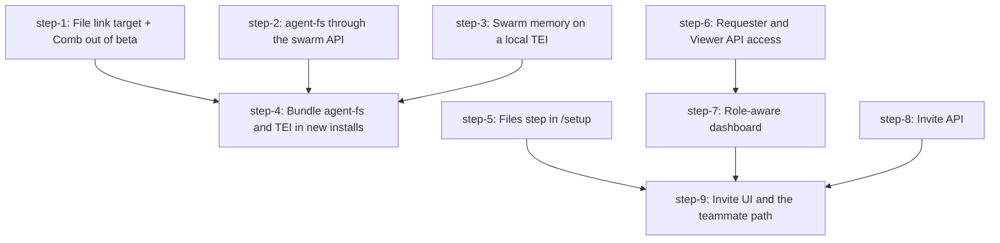

# agent-fs in the agent-swarm onboarding: Plan (DAG)

## Overview

A new install starts agent-fs and a local embeddings server with no extra command and no key. People read agent work in Comb through the swarm API. `/setup` gains a Files step that creates the person's agent-fs account. Admins invite teammates with a one-time link that gives each teammate a personal, role-scoped token. Existing installs see no change.

- **Motivation**: onboarding feedback D7 (memory without a second paid key) and D10 (invite members).
- **Inputs**: brainstorm `thoughts/taras/brainstorms/2026-10-25-agent-fs-onboarding.md`, research `thoughts/taras/research/2026-10-25-agent-fs-onboarding-open-questions.md`.
- **Spikes (run 2026-10-26, all passed)**: `spikes/` in this directory. Each spike has a `README.md` with numbers, and several have a patch that applies cleanly on main `4b88368b5`.

## Decisions made in this plan (read first)

The plan ran in Autopilot. These calls are made, with the evidence. Rows 1 and 2 change a brainstorm decision, so Taras should confirm them.

| # | Decision | Evidence |
|---|---|---|
| 1 | **No `openai-compat` provider in agent-fs.** The bundled agent-fs keeps its built-in `local` embeddings. TEI serves swarm memory only. | Box spike: agent-fs `local` (EmbeddingGemma 2, 331 MB ONNX) used 280-330 MiB and ranked 7 of 7 paraphrase queries first. A TEI provider loses image and PDF search and needs an agent-fs release plus a lockstep pin bump. The working prototype stays parked in `spikes/agentfs-provider/provider.patch`. |
| 2 | **Memory stays at 512 dims.** New installs do not write `EMBEDDING_DIMENSIONS`. | TEI 512-dim output equals the nomic card recipe (mean cosine 0.99997, top-5 overlap 1.00). 768 dims set after first boot silently broke vector search on the box (`memory_vec` keeps the first-boot size). 512 keeps the same schema as every existing install. |
| 3 | **Browser path = proxy.** The swarm API serves agent-fs at `/agentfs/*` (plus public `/share/*` and `/site/*`) when `AGENT_FS_PROXY=true`. It forwards only `Bearer af_` credentials and rate-limits the open `/auth/register`. | Proxy spike: 13 tests pass. 200 MB download streams with 5 MB RSS growth, 50 MB upload, SSE survives 20 s, single CORS header. No second tunnel. |
| 4 | **Files step registers in the browser.** It reuses Comb's `createAndConnect`. No new account route. | Accounts spike: agent-fs has no admin create-user route. Browser register keeps the key out of the swarm. Through the proxy, agent-fs is as reachable as the API. |
| 5 | **Invite = one-time code** on the existing `connector_codes` table (new `kind` column), 7-day TTL, role picker with Requester preselected. | Invites research. The exchange must also flip the user from `invited` to `active`, or the token gets 401. |
| 6 | **Requesters get the verbs they need** for create, cancel, pause, resume, steer and title. Built-in roles gain `task.steer.own` and `comb.presence` (additive). | Non-admin spike: a Requester hit 39 of 63 admission walls. With the patch, 19 remain, all admin-only by design. Operator and admin columns are unchanged. |
| 7 | **Link target**: `AGENT_FS_LINK_TARGET=dashboard\|live`. Unset keeps today's behavior on every surface, including the prompt text. | Link research: attachments already use the dashboard when Comb and `APP_URL` are set. Only an explicit value changes anything. |
| 8 | **Comb leaves beta.** The parity bar (#2406) is merged. | Brainstorm default. |
| 9 | Not in this plan: clamping `agentId`/`model` on Requester task creates, server-side filtering of `GET /api/users`, a `/setup` Playwright fixture. | Follow-ups in the Appendix. |

## Current State Analysis

- **Onboard has no agent-fs.** `agent-swarm onboard` renders `docker-compose.yml`, `.env` and `.agent-swarm/config.json` from three pure functions (`src/commands/onboard/compose-generator.ts`, `env-generator.ts`, `manifest.ts`). The compose has only `swarm-api` plus agents. `install.sh` calls `onboard --yes --preset full` (`install.sh:207-217`) and `--tunnel` forwards only the API port (`install.sh:312-360`).
- **The swarm already provisions agent-fs** when `AGENT_FS_API_URL` is set. The boot seeder registers a service user, creates the org, uses the org's default drive and invites every user with an email (`src/be/seed/agent-fs-provision.ts:60-129`). Agent keys are minted on demand by `ensureAgentFsCredentialsForAgent` (`agent-fs-provision.ts:236`, called from `src/http/fs.ts:255`). The seeder needs the API to start after agent-fs is healthy.
- **Comb is off by default.** `isCombEnabled()` needs `COMB_ENABLED=true` and `AGENT_FS_API_URL` (`src/utils/constants.ts:164-167`). The browser URL is `AGENT_FS_PUBLIC_URL`, else `AGENT_FS_API_URL` (`src/comb/config.ts:28-37`). No compose file sets `COMB_ENABLED`.
- **Swarm memory works with TEI** through env only: `EMBEDDING_API_BASE_URL`, `EMBEDDING_MODEL` and a non-empty `EMBEDDING_API_KEY` (`src/be/memory/providers/openai-embedding.ts:48-90`). Two gaps: TEI's default `--max-client-batch-size 32` makes the swarm drop embeddings for documents with more than 32 chunks (422 is not retried), and the `/setup` memory probe rejects a private `http://tei` URL in production (`src/http/onboarding.ts:203-262`).
- **TEI numbers (nomic-embed-text-v1.5, 1.9.4):** x86 image 685 MB, model volume 1.1 GB, idle 560-680 MiB, about 1 text/s at 373 tokens on 4 vCPU, short query p50 38 ms. Default flags OOM-kill the container on an 8 GB box. `--max-batch-tokens 2048` fixes it (peak about 1 GiB). The bundle adds about 1.0 GB RAM at idle.
- **Comb in the browser** calls agent-fs directly with the person's `af_` key (`apps/ui/src/lib/agent-fs/client.ts`). The key lives in `localStorage` only (`apps/ui/src/lib/agent-fs/credential-store.ts`). `createAndConnect` registers, invites through the swarm and saves the key (`apps/ui/src/components/comb/connect-flow.ts:44-112`).
- **Non-admin users** pass admission only for GETs and for routes whose verb their role holds (`src/rbac/admission.ts:34-59`). `rbac: {ungated}` routes are denied too. `POST /api/tasks` has no verb (`src/http/tasks.ts:279`). The UI has no grant-aware helper, and `OnboardingRedirect` sends every user to `/setup` (`apps/ui/src/components/onboarding/onboarding-redirect.tsx:37-58`). Every new user gets the `admin` role through a DB trigger (`src/be/rbac-roles.ts:70-78`).
- **No invite flow exists.** Connector codes are the reusable piece (`src/be/connector-codes.ts`, migration 197). `aswt_` auth admits only `active` users (`src/http/auth.ts:92-94`).
- **The hosted dashboard deploys from main** and talks to older self-hosted APIs. Any UI that needs a new route must hide itself on older APIs.

## Desired End State

- `curl -fsSL .../install.sh | bash` on a fresh 8 GB box runs `swarm-api`, the agents, `agent-fs` (local disk) and `tei`. The API log shows `[seed:agent-fs-provision] created=1 failed=0`. Memory search returns `retrievalSource` `vec` or `hybrid`.
- `GET /status` on that install shows `agent_fs.comb.enabled: true` and `api_url: <public API URL>/agentfs`.
- `/setup` shows a Files step. It explains agent-fs and finishes with the person connected to Comb, with no key to paste.
- An agent's file link on a new install opens `<APP_URL>/file/~/<org>/<drive>/<path>`.
- An admin invites `ada@example.com` as Requester from People. Ada opens the link, lands in the dashboard with her own token, creates a task, and opens Comb with no 403.
- An existing install that upgrades sees no behavior change: same compose, same prompt text, same links, same `/setup` steps once finished.

## What We're NOT Doing

- An `openai-compat` embeddings provider in agent-fs (decision 1; patch parked).
- Moving existing installs to TEI, or any automatic re-embed. That is a separate, manual migration.
- Changes to `docker-compose.example.yml` and the Helm chart. They keep MinIO and today's env. A follow-up can align them.
- "Connect with agent swarm" from the hosted live agent-fs (parked in the brainstorm).
- Drive or org switching in Comb. Editing and file management stay in the live UI.
- An email sender for invites. The admin copies the link.
- New telemetry events.

## Implementation Approach

- **Flags first, bundle last.** Steps 1 to 3 add server behavior behind new envs that default to today's behavior. Step 4 is the only place that writes those envs, and only for new installs.
- **Accounts and access in parallel.** The Files step (5), the role fixes (6, 7) and the invite API (8) do not touch the bundle. They work on any install with Comb on.
- **One integration leaf.** Step 9 joins invites, roles and the Files flow into the teammate path.
- **Spike code is the starting point.** Steps 2, 5 and 6 begin with `git apply` of a spike patch that applies on main today.

## Constraints for every step

- **Backward compatibility.** An unset new env means today's behavior. Only `onboard --yes` (step 4) writes new values.
- **No new telemetry events.** `onboarding.step_*` carry a free-string step id, so a new step id needs no catalog change.
- **Routes**: use `route()` from `src/http/route-def.ts`. Every non-GET route declares `rbac`. Every 2xx declares `schema` or `unstructured`. After a route change, run `bun run docs:openapi`, commit `openapi.json` and `docs-site/content/docs/api-reference/**`, and set the operation count in `src/tests/docs-index-footprint.test.js` (lines 81, 106, 107) to the value the regenerated spec has. Recompute after every rebase: steps 2 and 8 both add operations.
- **Servers you start in QA**: start them in the background with `& echo $! > <dir>/pid` and stop them with `kill "$(cat <dir>/pid)"`, as root Manual E2E part A does.
- **Hosted dashboard on older APIs.** UI that needs a new route must not show on an older API. Use `useFeatureGate(<MIN_VERSION>)` (`apps/ui/src/api/hooks/use-feature-gate.ts:29`), with the constant in its own module (root-run tests cannot resolve `@/` aliases in modules that `use-config-api` imports). Set the constant to the first unreleased version on the day the PR merges (`package.json` is 2.5.4 and v2.5.4 is released, so 2.5.5 or later).
- **Operator env vars** go in `apps/ui/src/lib/configuration-catalog.ts`, with a validator in `VALIDATED_KEYS` (`src/be/swarm-config-guard.ts`) when constrained, and a row in `docs-site/content/docs/(documentation)/ui/configuration.mdx` and `reference/environment-variables.mdx` in the same PR. Add every new env to the cleared lists in `src/tests/preload.ts` and `src/tests/preload-env.test.ts`.
- **Frontend PRs** need screenshots and, for flows, a recording in `## Before / after` (LOCAL_TESTING.md, "When you need to verify a UI change"). Never `qa-use`. Always `AGENT_BROWSER_SESSION=<step-name>`.
- Never touch `CHANGELOG.md`. Never print keys or setup links.

## Delivery

- **One PR for the whole plan**: the draft PR on branch `feat/agent-fs-onboarding`, which also holds this plan. Each step lands as its own commit, `[step-N] <summary>`, on that branch. Parallel steps may run in their own worktrees off the branch and merge back into it. Keep the PR a draft. Taras merges.
- Run in Autopilot: do not wait at the per-step pause. Collect each step's Manual Verification items in the PR description for Taras.
- Rebase on the latest `main` before each wave. After each rebase, recheck the migration ordinal (step-8) and the `docs-index-footprint` count.
- Fill every section of `.github/pull_request_template.md` as the steps land: the Review map by step, Heads-up for the accepted 401 to 404 change (step-2) and the additive role verbs (step-6), and Before / after for the UI steps. Risk: high (RBAC and a migration), so the PR carries `risk:high`. Urgency: "nice to have" unless Taras says otherwise.
- **Wave 1 (parallel)**: step-1, step-2, step-3, step-5, step-6, step-8.
- **Wave 2**: step-4 (after 1, 2, 3), step-7 (after 6).
- **Wave 3**: step-9 (after 5, 7, 8).
- Step-6 and step-8 are `risk: high` (RBAC, migration). The others are low or medium.

## Quick Verification Reference

Run from the repo root of the step's worktree (never the main checkout: its `.env` holds real tokens).

- Inner loop: `bun run check:local`
- One test file: `bun run test:root -- src/tests/<file>.test.ts`
- Lint: `bun run lint` and `bun run lint:slop`
- Types: `bun run tsc:check:tsc`
- UI: `cd apps/ui && bun install --frozen-lockfile && bun run lint && bunx tsc -b`
- Routes: `bun run check:rbac-coverage && bun run check:openapi-response-coverage && bun run docs:openapi`
- Async DB: `bun scripts/check-floating-promises.ts && bun scripts/check-promise-sinks.ts`
- Black-box: `bun run e2e`
- UI E2E: `bun run e2e:ui -- --no-build specs/<file>.spec.ts`

## DAG



## Steps

| ID | Name | Depends on | Status | File |
|----|------|------------|--------|------|
| step-1 | File link target + Comb out of beta | none | ready | [step-1.md](./step-1.md) |
| step-2 | agent-fs through the swarm API | none | ready | [step-2.md](./step-2.md) |
| step-3 | Swarm memory on a local TEI | none | ready | [step-3.md](./step-3.md) |
| step-4 | Bundle agent-fs and TEI in new installs | step-1, step-2, step-3 | ready | [step-4.md](./step-4.md) |
| step-5 | Files step in /setup | none | ready | [step-5.md](./step-5.md) |
| step-6 | Requester and Viewer API access | none | ready | [step-6.md](./step-6.md) |
| step-7 | Role-aware dashboard | step-6 | ready | [step-7.md](./step-7.md) |
| step-8 | Invite API | none | ready | [step-8.md](./step-8.md) |
| step-9 | Invite UI and the teammate path | step-5, step-7, step-8 | ready | [step-9.md](./step-9.md) |

> **Canonical dependencies and execution status live in each `step-<n>.md`'s frontmatter.** This table is a derived snapshot at plan creation. During `/v-implement`, frontmatter `status` (`ready` → `claimed` → `done`) is the source of truth.

## Pre-flight Verification

- [ ] Work happens on branch `feat/agent-fs-onboarding`: `git status --short` prints nothing before each wave
- [ ] Each parallel step runs in its own worktree off that branch, with `bun install --frozen-lockfile`
- [ ] Baseline gate passes in that worktree: `bun run check:local && bun run tsc:check:tsc`
- [ ] Docker runs: `docker info --format '{{.ServerVersion}}'`. Without Docker, skip only the items that need it (step-3 live TEI run, step-4 local bundle run) and list them as not run in the PR. Never tick them.
- [ ] Next free migration ordinal checked against main and open PRs (step-8): `ls src/be/migrations | tail -3 && gh pr list --state open --search "migrations" --json number,title`
- [ ] At least 15 GB free before steps 2 to 4 pull images: `df -h /`

## Global Verification

Run after all steps merge, from a fresh worktree of `main`:

- [ ] Whole-repo types: `bun run tsc:check:tsc`
- [ ] Full tests: `bun run test:root -- --parallel=4`
- [ ] Lint: `bun run lint && bun run lint:slop`
- [ ] UI: `cd apps/ui && bun install --frozen-lockfile && bun run lint && bunx tsc -b`
- [ ] Routes and docs: `bun run check:rbac-coverage && bun run check:openapi-response-coverage && bun run docs:openapi && git diff --exit-code openapi.json`
- [ ] Black-box: `bun run e2e`
- [ ] UI E2E: `bun run e2e:ui`
- [ ] Onboard flag off is byte-identical: `bun run test:root -- src/tests/onboard-compose.test.ts src/tests/onboard-env.test.ts`
- [ ] Manual E2E part A and part B below pass

## Manual E2E

### Part A: local stack with unreleased code (before the release)

Use the absolute paths. `$W` is a fresh worktree of `main` with every step merged. The plan dir is `$P`.

```bash
W=/Users/taras/worktrees/agent-swarm/2026-10-26-afo-e2e
P=/Users/taras/Documents/code/agent-swarm/thoughts/taras/plans/2026-10-26-agent-fs-onboarding
git -C /Users/taras/Documents/code/agent-swarm worktree add --detach $W origin/main
cd $W && bun install --frozen-lockfile
mkdir -p /tmp/afo-e2e && openssl rand -hex 16 > /tmp/afo-e2e/key

# agent-fs on local disk, reached by the browser only through the swarm proxy
docker run -d --name afo-e2e-agent-fs -p 7433:7433 \
  -e AGENT_FS_HOME=/data -e HOST=0.0.0.0 -e SERVER_HOST=0.0.0.0 -e PORT=7433 -e SERVER_PORT=7433 \
  -e AGENT_FS_STORAGE_PROVIDER=local -e AGENT_FS_LOCAL_ROOT=/data/storage \
  -e AGENT_FS_PUBLIC_URL=http://localhost:3013/agentfs -e AGENT_FS_APP_URL=http://localhost:5274 \
  -v afo-e2e-agent-fs:/data ghcr.io/desplega-ai/agent-fs:0.18.5

# TEI for swarm memory (arm64 tag on this Mac)
docker run -d --name afo-e2e-tei -p 8091:80 -v afo-e2e-tei:/data \
  ghcr.io/huggingface/text-embeddings-inference:cpu-arm64-1.9.4 \
  --model-id nomic-ai/nomic-embed-text-v1.5 --max-batch-tokens 2048 --max-client-batch-size 256
until curl -sf http://localhost:8091/health; do sleep 5; done

# API with the bundle env. The preload loads Homebrew SQLite so sqlite-vec works on macOS.
# SWARM_DEV_MODE=true passes the UI version gates: this build still reports 2.5.4.
cd $W && DATABASE_PATH=/tmp/afo-e2e/db.sqlite DESPLEGA_TELEMETRY_ENV=test API_KEY="$(cat /tmp/afo-e2e/key)" \
  SLACK_DISABLE=true GITHUB_DISABLE=true JIRA_DISABLE=true LINEAR_DISABLE=true SWARM_DEV_MODE=true \
  AGENT_FS_API_URL=http://localhost:7433 AGENT_FS_PROXY=true COMB_ENABLED=true \
  AGENT_FS_LINK_TARGET=dashboard APP_URL=http://localhost:5274 \
  EMBEDDING_API_BASE_URL=http://localhost:8091/v1 EMBEDDING_MODEL=nomic-ai/nomic-embed-text-v1.5 \
  EMBEDDING_API_KEY=local-tei EMBEDDING_QUERY_PREFIX='search_query: ' EMBEDDING_DOCUMENT_PREFIX='search_document: ' \
  bun --expose-gc --preload $P/spikes/tei-local/scripts/preload.ts src/http.ts > /tmp/afo-e2e/api.log 2>&1 &
echo $! > /tmp/afo-e2e/api.pid
cd $W/apps/ui && bun run dev > /tmp/afo-e2e/ui.log 2>&1 &
echo $! > /tmp/afo-e2e/ui.pid
```

Check, in order:

- [ ] `grep 'seed:agent-fs-provision' /tmp/afo-e2e/api.log` shows `created=1 failed=0`
- [ ] `curl -s -H "Authorization: Bearer $(cat /tmp/afo-e2e/key)" http://localhost:3013/status | jq '.agent_fs.comb'` shows `enabled: true` and `api_url: "http://localhost:3013/agentfs"`
- [ ] `curl -s http://localhost:3013/agentfs/health | jq .` answers from agent-fs through the proxy
- [ ] Walk `/setup` with agent-browser: `AGENT_BROWSER_SESSION=afo-e2e-admin agent-browser open "http://localhost:5274/setup?apiUrl=http://localhost:3013&apiKey=$(cat /tmp/afo-e2e/key)"` (the dashboard strips both params on load). The Files step connects with no key to paste.
- [ ] Store a memory and search it: `POST /api/memory/index` then `POST /api/memory/search`. The response shows `retrievalSource` `vec` or `hybrid`.
- [ ] People > Invite `ada@example.com` as Requester. Copy the link.
- [ ] Open the link in a second session (`AGENT_BROWSER_SESSION=afo-e2e-ada`). Ada lands on the home page, not `/setup`. She creates a task, sees no Settings pages for admins, and Comb shows her as connected.
- [ ] In the Comb share dialog, create a share link and open it in a third session. The file content loads (proves `/share/*` and `/site/*`).

Teardown:

```bash
kill "$(cat /tmp/afo-e2e/api.pid)" "$(cat /tmp/afo-e2e/ui.pid)"
docker rm -f afo-e2e-agent-fs afo-e2e-tei && docker volume rm afo-e2e-agent-fs afo-e2e-tei
docker rmi ghcr.io/huggingface/text-embeddings-inference:cpu-arm64-1.9.4 ghcr.io/desplega-ai/agent-fs:0.18.5
AGENT_BROWSER_SESSION=afo-e2e-admin agent-browser close; AGENT_BROWSER_SESSION=afo-e2e-ada agent-browser close
rm -rf /tmp/afo-e2e && git -C /Users/taras/Documents/code/agent-swarm worktree remove $W && df -h /
```

### Part B: a real install on a Hetzner box (after the release that ships step-4)

Use the onboarding-qa skill (on main since #2362). Run it from the main checkout.

```bash
cd /Users/taras/Documents/code/agent-swarm
S=.claude/internal-skills/onboarding-qa/scripts
RUN=$(TZ=Europe/Madrid date +%m%d-%H%M)-afo
bash $S/box.sh up $RUN docker-ce
bash $S/ui-install.sh $RUN
ssh -F /tmp/onboarding-qa-$RUN/ssh_config box 'docker ps --format "{{.Names}}\t{{.Status}}"; free -m'
bash $S/secrets.sh open-setup $RUN
```

- [ ] `docker ps` lists `swarm-agent-fs` and `swarm-tei` as healthy. `free -m` shows more than 3 GB available.
- [ ] `bash $S/box-api.sh $RUN GET /status` shows Comb enabled with an `https://<tunnel>/agentfs` `api_url`
- [ ] The `/setup` walk (agent-browser, `AGENT_BROWSER_SESSION=onboarding-qa-$RUN`) reaches the Files step and connects
- [ ] Invite a teammate and open the link in a second session, as in part A
- [ ] Teardown: `bash $S/box.sh down $RUN && bash $S/box.sh list` prints no box

## Appendix

- **Spikes** (`spikes/`):
  - `tei-local/`: TEI on arm64, Matryoshka check, swarm memory against TEI, the 422 batch bug, macOS sqlite-vec preload.
  - `box-x86/`: real install on a 4 vCPU x86 box plus agent-fs and TEI, RAM and throughput, the OOM fix, the 768-dim trap.
  - `onboard/`: rendered compose and env, the proposed compose (`proposed-full.compose.yml`, validated with `docker compose config`), edit sites, a test sketch.
  - `proxy/`: `proxy.patch` (applies on main), the proxy test, timings.
  - `accounts/`: agent-fs account flow script, `seeder-invite-retry.patch` (applies on main).
  - `non-admin/`: live 403 matrix before and after, `route-edits.patch` (applies on main), `build-matrix.ts` to re-run it.
  - `agentfs-provider/`: parked `openai-compat` provider prototype (decision 1).
- **Follow-ups**:
  - Clamp `agentId`, `model`, `profile`, `effort` and `dir` on `POST /api/tasks` for user callers (non-admin spike: a Requester can pick any model).
  - Filter `GET /api/users` for non-admin callers (it returns every user and token previews).
  - A `--no-seed` boot plus a `freshSwarm` fixture in `packages/ui-e2e`, so a Playwright spec can walk `/setup`.
  - Align `docker-compose.example.yml` and Helm with the bundle (local storage, TEI, Comb on).
  - Swarm-side batch cap in `embedBatch` for any OpenAI-compatible server, and a loud log when `memory_vec` dims differ from `EMBEDDING_DIMENSIONS`.
  - Other `ungated` non-GET routes that deny non-admins: `POST /api/rooms/get`, `POST /api/pages/{id}/feedback`, `PATCH /api/keys/plan`.
  - `src/fs/agent-fs-provider.ts:84` reports `signedUrl.supported: true` for every backend. On local storage the `signed-url` op returns a login-only `kind: "app"` link, so `/api/fs/tasks/{id}/files/{id}/signed-url` hands out that link with `expiresIn: 3600`. Report the capability from the agent-fs result.
  - `scripts/bump-agent-fs.ts` does not bump `@desplega.ai/agent-fs-just-bash` in `package.json` and `bun.lock`.
- **Derail notes**:
  - `/chat` calls `/api/channels`, which no route serves on main.
  - agent-fs's own Dockerfile `HEALTHCHECK` uses `curl`, which its image lacks. Compose must override it.
  - TEI downloads both the ONNX and the safetensors weights (1.1 GB) because its ORT backend fails on this model.
  - The research doc said TEI caps requests at 32 inputs. TEI 1.9.4 `/info` reports 256 when the flag is set, and the default is 32.
- **References**: research and brainstorm above; Comb parity #2406; onboarding polish #2405; onboarding-qa skill #2362.
