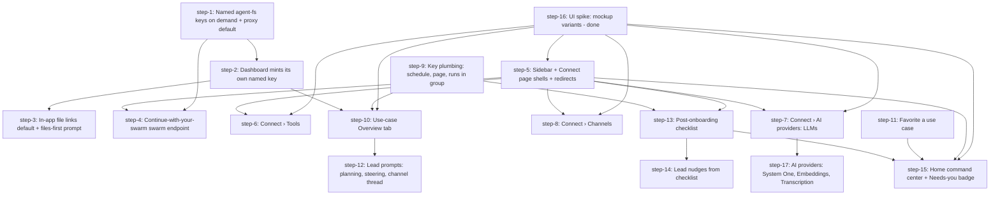

# Post-onboarding: agent-fs wall, IA, use-case groups, Home. Plan (DAG)

## Overview

What happens after `/setup` finishes. Fix the agent-fs credential wall, regroup the dashboard around Work / Connect / Build, give a use case one home (a Sessions group keyed by asset key), and turn Home into a command center with an editable post-onboarding checklist that the Lead also reads.

- **Motivation**: early-user feedback of 2 Nov 2026 (no command center, task vs session confusion, results behind a second agent-fs login). Brainstorm 2026-11-03, research 2026-11-04.
- **Related**: `thoughts/taras/brainstorms/2026-11-03-post-onboarding.md`, `thoughts/taras/research/2026-11-04-post-onboarding-open-questions.md`, PR #2442 (agent-fs onboarding), #2329 and #2408 (Sessions v2), swarm task `49bae4e7-f34f-4981-bccd-d420a87d4449` (agent-fs multi-key, sent to the production Lead 2026-11-04 10:48 BCN).

## Current State Analysis

Facts verified on `fd6131322` (4 Nov 2026). Full detail with line refs lives in the research doc. The load-bearing ones:

**agent-fs credential wall**
- The dashboard keeps the user's agent-fs key in localStorage only (`apps/ui/src/lib/agent-fs/credential-store.ts:8-29`). Every `AgentFsClient` request sends it as `Authorization: Bearer af_...` (`apps/ui/src/lib/agent-fs/client.ts:86-100`). A second browser hits agent-fs `409` on register and lands on a paste-key form with no way to see the key (`apps/ui/src/pages/setup/steps/step-files.tsx:205-210`).
- The `/agentfs/*` proxy (`src/http/agentfs-proxy.ts:215`) is `auth: { apiKey: false }` (`:103`), forwards only a caller-supplied `af_` bearer (`:263-270`), never injects a key, and is off by default (`src/utils/constants.ts:345-347`). The swarm session is a bearer token, not a cookie, so navigations to the API carry no auth.
- `swarm_config` scopes are `global | agent | repo` only (`src/be/migrations/001_initial.sql:248`, `src/types.ts:2015`). There is no per-user scope. The checklist (per-user items) needs a new table.
- agent-fs has ONE key per user and `reset-key` overwrites it everywhere. Multi-key lands in agent-fs PR #153 (`feat/multi-api-keys`, approved by Taras, merge + release pending): `POST /orgs/{orgId}/members/{userId}/keys` mints a **named, org-scoped** key (reaches `/orgs/{orgId}/...` only; `/auth/*`, `/mcp` return 403). Decision (review 2026-11-04): the swarm stores no user keys. It mints a named key per browser (and per live-UI hop) on demand and returns it once; users revoke by name in agent-fs.
- Comb resolves ON only when the browser can reach the agent-fs address (`constants.ts:306-330`). `AGENT_FS_LINK_TARGET` unset means agents hand out `live.agent-fs.dev` links (`src/prompts/base-prompt.ts:252-260`, `src/prompts/session-templates.ts:219`).
- Invite redeem (`src/http/users.ts:1268-1294`, `src/be/connector-codes.ts:71-121`) is the natural hook to mint a user key: the email is known and the user just became active.

**Dashboard IA**
- Sidebar groups WORK / SWARM / RESOURCES are a static `navGroups` array (`apps/ui/src/components/layout/app-sidebar.tsx:123-184`), footer Settings + Usage (`:193-221`), badges keyed by path (`:616-644`), per-group collapse via `CollapsibleSection` with a hard-coded `defaultOpen` (`:670-674`).
- `/connect` is already the connector handoff page (`apps/ui/src/app/routes.tsx:186`). The hub goes to `/integrations`, today a legacy redirect (`routes.tsx:140-151`).
- No redirect preserves `search` or `hash` (`routes.tsx:155-165`, `apps/ui/src/app/route-redirect.tsx:1-19`). The params that must survive: `?tab=`, `?new=1&name=&url=&transport=`, `?oauth=`, `?error*`, `?search`, `?category`, `?rail=`.
- Server-built dashboard URLs: `src/be/automation-preflight.ts:137-145` (`/settings/integrations/<id>`, posted to Slack), `src/http/mcp-oauth.ts:53-55` (`/mcp-servers/<id>?oauth=success`).
- The Integrations catalog has 25 entries (`apps/ui/src/lib/integrations-catalog.ts`), not 6. Telegram and Discord are adapters inside one `chat-sdk` card (`apps/ui/src/lib/chat-sdk-fields.ts:51`). Provider keys (`apps/ui/src/pages/api-keys/page.tsx`) cannot add a key; keys are added via `/api/config/pool-keys` on the integration detail pages.
- `/connections` is a 3,429-line page whose exports sibling pages import. Keep the module, change the route.
- `routes.test.tsx:22-29` fails when a static route has no `nav`/`unlisted` handle or an entity list has no search provider.

**Use-case groups**
- A Sessions group is the task key minus one resource leaf (`src/assets/key.ts:92-101`, `src/be/db/session-tree.ts:189-212`). Schedule runs get `key = schedule.key`, `source = 'schedule'`, `requestedByUserId = schedule.createdBy` (`src/scheduler/schedule-task.ts:63-88`).
- Five conditions hide a schedule run in `/sessions?view=<key>`: the Mine rule (`src/be/db/session-visibility.ts:56-79`), the `comb,ui` default source filter (`apps/ui/src/lib/sessions-show.ts:30`, `session-tree.ts:277-288`), the tree owner filter `requestedByUserId IS NOT NULL` (`session-tree.ts:307`), triage, and viewer scope. The sidebar tree applies the same filters (`session-tree.ts:672-679, 738`).
- `create-schedule` (`src/tools/schedules/create-schedule.ts:301`) and `create-page` (`src/tools/create-page.ts:205-221`) do not inherit the calling task's key. `send-task` does (`src/tools/send-task.ts:470`). The schedules UI never sends `key` (`apps/ui/src/api/hooks/use-schedules.ts:33-51`).
- An asset key is NOT an agent-fs path. No mapping exists and agents are never told to write under the key. Decision: drive path = key string.
- `user_favorites.itemType` is CHECK-constrained to `page | workflow | schedule | agent-fs-path` (`src/be/migrations/192_favorites_agent_fs_path.sql:6-17`). Adding `key` rebuilds the table.
- The system prompt must not vary per task (`src/prompts/base-prompt.ts:13-20`, `src/commands/runner.ts:3493-3498`). Per-task text goes through `buildTaskSessionPrompts` (`runner.ts:3499-3527`).

**Home and checklist**
- Home mounts `SetupChecklistCard` (admin, while onboarding is open), `DashboardNudges`, `FleetBenchmarkCard`, then the timeline or `MobileNow` (`apps/ui/src/pages/home/unified-home.tsx:51-68`). `MobileNow` already is a Needs-you / In-progress prototype (`apps/ui/src/components/dashboard/mobile-now.tsx:60-87`).
- Four inbox hooks exist and nothing mounts them (`apps/ui/src/api/hooks/use-inbox.ts`). `GET /api/session-tree` returns per-group `{total, unread, running, needsYou}` (`src/http/sessions.ts:163-179`). Credential-blocked agents: `GET /api/agents/credential-status` (`src/http/agents.ts:1448-1466`).
- Onboarding state is one global JSON row (`src/be/onboarding.ts:14, 476-483`), with signals derived on read (`src/http/onboarding.ts:110-158`). Signals exist for Slack, GitHub, GitLab, Bitbucket, Linear, Jira. None for Chat SDK adapters (`GET /api/integrations/chat/status`), Gmail or MS365 (OAuth presets `google`, `microsoft`), or "a use case exists under a key".
- `NUDGES` (`src/tools/utils.ts:355-369`) is stateless. One-shot needs a stored marker. Precedent: `upsertKv` with TTL (`src/heartbeat/heartbeat.ts:1866-1872`).
- The poll trigger payload (`src/http/poll.ts:97-114`, built at `:640`) is the server-to-worker carrier for per-task state. The worker renders it next to `buildRequesterProfilePrompt` (`runner.ts:3444-3469`).
- Migration tail is `278`. Ordinals are non-contiguous.

## Desired End State

- An owner in a fresh browser, and an invited non-admin, open a result file in-app with zero extra logins. Each browser silently mints its own named agent-fs key through the swarm API; the swarm stores none of them. The proxy stays a transport and never forwards the swarm key.
- A key-less user on `live.agent-fs.dev` can "Continue with <swarm>" (agent-fs half in the separate plan).
- Agent file links default to the dashboard when `APP_URL` is set. Use-case results are markdown files under the use-case key in the shared drive. Pages only when asked.
- Inset sidebar: WORK (Home, Sessions, Files, Pages, Apps), AUTOMATE (Schedules, Workflows), CONNECT (Channels, Tools, AI providers), BUILD collapsed (Agents, Tasks, Skills, Memory, Scripts), Settings (Servers, People, ..., Advanced: Secrets, Templates, Connection playground, Raw fetch credentials) and Usage at the bottom. Every old route redirects with params and hash kept.
- Connect is three pages: `/integrations/channels`, `/integrations/tools` (tabs Tools, Script connections, OAuth apps, MCP servers) and `/integrations/ai` (tabs LLMs, System One, Embeddings, Transcription). One card or row per provider. Add a provider from a dropdown and a side panel, and see usage and health in one place.
- A use case is a Sessions group: the planning session, the schedule, its runs, pages and files share one key. A pinned Overview tab shows the next run, the schedules, the outputs under the key with a preview, and Ask the Lead. A group can be starred.
- Home: Needs you, In progress by key, Favorites, the post-onboarding checklist, timeline below. A Needs-you badge in the sidebar. The checklist auto-checks from real signals, is editable, and the Lead nudges once per open item.

## What We're NOT Doing

- Team adoption flows: no "invite a teammate" checklist item, no member-safe Connect, no member Home beyond today's RBAC gates.
- A global workflow-runs endpoint and workflow runs on Home (follow-up, see Appendix).
- `session` and `app` favorite types (only `key` lands now).
- Backend merge of `swarm_config`, `oauth_*` and `mcp_servers`. UI-level unification only.
- The agent-fs side of "Continue with your swarm" and multi-key (separate repo, separate plan).
- Server-held agent-fs keys (dropped in review: multi-key makes storage unnecessary). Existing browser-held keys keep working untouched.
- A keys-management UI in the live agent-fs SPA (Taras asked for it on PR #153; agent-fs follow-up).
- Telegram and Discord in `/setup`. They are reachable from the Connect hub and the checklist instead.
- Task-vs-session copy in the first-run guide (Tasks moves to BUILD instead).

## Implementation Approach

- A UI spike first (`step-16`, done in the plan session): five mockup rounds in `mockups/post-onboarding/`. The approved pages are r3-sidebar (Variant 2), r3-home, r3-overview, r4-connect (Channels, Tools) and r5-ai-providers. Steps 5, 6, 7, 8, 10, 15 and 17 build them.
- Four tracks run in parallel. Only `step-5` (C1) edits `app-sidebar.tsx` and `routes.tsx` (step-4 adds one route line after it, step-15 one badge entry). Every other UI step adds pages or components.
- Named keys on demand first (A1: mint route + proxy default), then the dashboard mints its own key silently (A2). Prompt and default changes (A3) ship after the in-app path works, so the links they produce resolve.
- Connect ships as three page shells with the existing components re-mounted (step-5), then each page is rebuilt in its own step (step-6 Tools, step-7 + step-17 AI providers, step-8 Channels).
- Key plumbing (D1) is backend-only and unblocks both the group header (D2) and the checklist's "first use case" signal (E1).
- Home (E3) is last. It reads favorites (D3), the checklist (E1) and the new navigation (C1).
- Each prompt change ships with the feature it references: files-first delivery in A3, use-case planning and channel threads in D4, nudges in E2.
- External dependencies: A1 needs agent-fs PR #153 merged and released; A4 needs the Track B agent-fs release (org `swarm_url`, SPA `#key=` handling, org-scoped `/auth/me`). Both steps pin the version in `Pre-flight`.
- Migrations: `285` (D3 favorites `key` type), `286` (E1 `checklist_items`). Renumbered twice: main took 279 and 281, open PR #2458 holds 282, open PR #2727 holds 283 (2026-11-05). Re-check against `main` and open PRs at kickoff (`scripts/check-migration-conflicts.sh`).

## Quick Verification Reference

- `bun run check:local` (frozen install, Biome on changed files, `bun check`, affected tests)
- `bun run lint` and `bun run lint:slop`
- `bun run tsc:check:tsc`
- `bun run test:root -- src/tests/<file>.test.ts`
- `cd apps/ui && bun install --frozen-lockfile && bun run lint && bunx tsc -b && bun run test`
- `bun run e2e` (black-box contract suite, strict coverage: new routes and tools need a scenario in `scripts/e2e/scenarios/`)
- `bun run e2e:ui -- --grep @smoke` (Playwright, Node 22+)
- `bun run docs:openapi` after any route change, commit `openapi.json`
- `bun run check:rbac-coverage` and `bun run check:openapi-response-coverage` after any route change
- `bun run build:skill-md && bun run check:skill-md` after editing `templates/skills/*/content.md`
- UI steps: screenshots and a recording with `agent-browser` (`AGENT_BROWSER_SESSION=<step>`), uploaded per the `github-attach` skill, in the PR's `## Before / after`.

## DAG

Waves (derived; step-16 is already done): 1 = step-1, step-5, step-9, step-11. 2 = step-2, step-4, step-6, step-7, step-8, step-13. 3 = step-3, step-10, step-14, step-15, step-17. 4 = step-12.

## Steps

| ID | Track | Name | Depends on | Status | File |
|----|-------|------|------------|--------|------|
| step-16 | C | UI spike: mockup variants (rounds 1-5, decided) | — | done | [step-16.md](./step-16.md) |
| step-1 | A | Named agent-fs keys minted on demand + proxy on by default | — (ext: agent-fs PR #153 released) | ready | [step-1.md](./step-1.md) |
| step-2 | A | Dashboard mints its own named key silently, Comb on by default | step-1 | ready | [step-2.md](./step-2.md) |
| step-3 | A | In-app file links by default + files-first delivery prompt | step-2 | ready | [step-3.md](./step-3.md) |
| step-4 | A | "Continue with your swarm" swarm endpoint | step-1, step-5 (ext: Track B agent-fs release) | ready | [step-4.md](./step-4.md) |
| step-5 | C | Sidebar WORK/AUTOMATE/CONNECT/BUILD + Connect page shells + redirects | step-16 | ready | [step-5.md](./step-5.md) |
| step-6 | C | Connect › Tools: one card per provider, tabs, search | step-5, step-16 | ready | [step-6.md](./step-6.md) |
| step-7 | C | Connect › AI providers: LLMs tab, unified list, Add provider panel | step-5, step-16 | ready | [step-7.md](./step-7.md) |
| step-17 | C | Connect › AI providers: System One, Embeddings, Transcription tabs | step-7 | ready | [step-17.md](./step-17.md) |
| step-8 | C | Connect › Channels (Slack, Telegram, Discord) | step-5, step-16 | ready | [step-8.md](./step-8.md) |
| step-9 | D | Key plumbing: schedule + page inherit key, runs visible in group | — | ready | [step-9.md](./step-9.md) |
| step-10 | D | Use-case Overview tab (next run, schedules, outputs, Ask the Lead) | step-9, step-2, step-16 | ready | [step-10.md](./step-10.md) |
| step-11 | D | Favorite a use case (`key` favorite type) | — | ready | [step-11.md](./step-11.md) |
| step-12 | D | Lead prompts: use-case planning, steering, channel thread | step-10 | ready | [step-12.md](./step-12.md) |
| step-13 | E | Post-onboarding checklist (state, signals, edit, Home widget) | step-5, step-9 | ready | [step-13.md](./step-13.md) |
| step-14 | E | Lead nudges from checklist (one-shot) | step-13 | ready | [step-14.md](./step-14.md) |
| step-15 | E | Home command center + Needs-you badge | step-5, step-11, step-13, step-16 | ready | [step-15.md](./step-15.md) |

> **Canonical dependencies and execution status live in each `step-<n>.md`'s frontmatter.** This table is a derived snapshot at plan creation. During `/v-implement`, frontmatter `status` (`ready` → `claimed` → `done`) is the source of truth. Re-render this table when you want a current view.

## Pre-flight Verification

Run before kicking off any step (orchestrator's responsibility; `/v-implement` performs these once at the start of the run):

- [x] Working tree is clean on a `~/worktrees/agent-swarm/<branch>` worktree (not the main checkout).
- [x] Baseline passes: `bun run check:local && bun run tsc:check:tsc`
- [x] Baseline UI passes: `cd apps/ui && bun run lint && bunx tsc -b`
- [x] Migration ordinals 279 and 280 are above `main`'s tail and unused by open PRs: `bash scripts/check-migration-conflicts.sh` and `gh pr list --search "migrations/2" --json number,title`
- [x] step-1 only: agent-fs v0.18.17 (PR #153, released 2026-11-04) is the pin; confirm its Docker image is published. Record the version in step-1 and bump the agent-fs image pins (`src/commands/onboard/compose-generator.ts`, `docker-compose*.yml`, `charts/agent-swarm/values.yaml`). Until then, step-1 is blocked; wave 1 runs step-16, step-9, step-11.
- [ ] step-4 only: the Track B agent-fs release is out (org `swarm_url`, SPA accepts `#key=`, `/auth/me` for org-scoped keys). Until then, step-4 stays `ready` but unclaimed.
- [x] step-16 decisions recorded (`root.md § Design decisions (step-16)`, rounds 1-5, 2026-11-04). Mockups: `mockups/post-onboarding/` (r3-sidebar, r3-home, r3-overview, r4-connect, r5-ai-providers).
- [x] A local agent-fs server is reachable for QA (sibling repo `../agent-fs`, or the compose bundle) with `AGENT_FS_API_URL` set.
- [x] `agent-browser` is on PATH (`agent-browser skills get core` once per session).

## Global Verification

Run after all steps complete (final wave gate):

- [x] Whole-repo gate: `bun run check:local && bun run lint && bun run lint:slop && bun run tsc:check:tsc`
- [x] Root tests: `bun run test:root -- --parallel=4`
- [x] UI: `cd apps/ui && bun install --frozen-lockfile && bun run lint && bunx tsc -b && bun run test`
- [x] Black-box contract suite, strict: `bun run e2e --strict`
- [x] Playwright UI suite: `bun run e2e:ui`
- [x] Route hygiene: `bun run check:rbac-coverage && bun run check:openapi-response-coverage && bun run docs:openapi && git diff --exit-code openapi.json`
- [x] Boundaries: `bash scripts/check-db-boundary.sh && bash scripts/check-api-key-boundary.sh && bash scripts/check-audit-columns.sh && bun scripts/check-floating-promises.ts && bun scripts/check-promise-sinks.ts`
- [x] Skills: `bun run check:skill-sources && bun run check:skill-md && bun run check:seed-skill-files`
- [x] Fresh DB and existing DB both boot: `rm -f /tmp/po-fresh.sqlite && DATABASE_PATH=/tmp/po-fresh.sqlite DESPLEGA_TELEMETRY_ENV=test bun run start:http` (Ctrl-C after "listening"), then the same against a copy of a pre-plan DB.
- [x] Cross-track E2E, agent-browser (`AGENT_BROWSER_SESSION=po-global`): on a local stack with agent-fs, (1) a fresh browser context with the owner's `aswt_` token opens `/file` and a `/file/~/...` link in-app with no connect step; (2) an invited non-admin redeems the invite and opens the same file in-app; (3) `/connections?tab=oauth-apps`, `/settings/integrations/slack?search=x`, `/mcp-servers/<id>?oauth=success` all land on their new `/integrations/...` route with params intact; (4) a planning session with the Lead that creates a schedule under `shared/<slug>/` shows up as one group with header, the run appears inside it after Run now, and a markdown output under the key renders inline; (5) Home shows Needs you (a seeded pending approval), In progress (the running run grouped by key), the starred group under Favorites, and the checklist with "connect a channel" auto-checked after a Telegram token is saved.
- [x] agent-fs `GET /auth/keys` for the owner (primary key) lists one named key per browser profile used in the E2E above, each with `orgId` set and none revoked by the flow.
- [x] Lead prompt review: dump the lead system prompt and one task prompt (host-run lead recipe) and confirm the files-first, use-case and nudge sections appear exactly once and never in the system prompt for the nudge.

## Appendix

### Track B contract (agent-fs repo, separate plan)

The swarm side (step-4) is written against this contract. The agent-fs plan must deliver:

1. **Org trusted swarm**: `orgs.swarm_url` (nullable) plus `PATCH /orgs/{orgId}` for org admins to set it. The swarm's bootstrap admin sets it to `APP_URL` on every boot (step-4 § 3).
2. **Live SPA "Continue with <swarm host>"**: when a deep link lands with no credential and the org has `swarm_url`, link to `<swarm_url>/fs/continue?return_to=<current live URL>`. On return, accept `#key=<af_...>`: store it as the credential, strip the fragment, open the original path (today a key-less deep link redirects to `/credentials` and loses the path).
3. **Org-scoped keys and identity**: admin-minted keys (PR #153) get 403 on `/auth/*`. Either `GET /auth/me` answers for org-scoped keys (identity plus `scopedOrgId`, read-only), or the SPA runs an org-scoped mode that never calls `/auth/*`. Recommendation: the first, it is smaller and also lets the dashboard drop its swarm-side identity shim later.
4. **Keys UI** (Taras on PR #153): a simple view to list, create and revoke keys by label, so users can clean up browser keys minted by the swarm.
5. **Return URL allowlist** on the swarm side: `return_to` origin must equal the configured `AGENT_FS_LIVE_URL` or `AGENT_FS_APP_URL` origin. No open redirect. The key travels in the fragment only (same lesson as the invite link in #2442). No session-token route is needed; named keys replace it. Expiry on keys is an optional agent-fs follow-up.

### Multi-key contract (agent-fs PR #153, swarm task 49bae4e7)

`POST /orgs/{orgId}/members/{userId}/keys` (org admin) with `{ label }` (1-100 chars) returns `201 { id, label, createdAt, apiKey, userId, orgId }`; 403 non-admin, 404 when the target is not a member (the swarm invites first). The key is **org-scoped**: `/orgs/{orgId}/...` only, 403 elsewhere. Self routes `POST/GET /auth/keys`, `DELETE /auth/keys/{keyId}` work with the primary key; the list shows `orgId` and `createdByUserId`. `reset-key` routes rotate only the primary key. Audit events `api_key_created` / `api_key_revoked`. step-1 labels keys `<surface> · <client hint> · <YYYY-MM-DD>`.

### Derail notes (out of scope, do not lose)

- Global `GET /api/workflow-runs?status=` endpoint (about 60-90 lines plus an E2E scenario) so Home can list running workflow runs. Runs have no `key`; a join to `workflows.key` is needed to group by key.
- `session` and `app` favorite types once Home shows favorites.
- `useBrokenInbox` uses a 7-day window and `source: ["ui"]`; a server-side "failed in 24h" route would replace the 50-row client filter.
- `use-credential-missing-agents.ts` header comment cites stale lines (`agents.ts:462-480`, now `:1448-1466`).
- Ownerless schedules (`createdBy` null, or creator deleted at fire time, `src/scheduler/scheduler.ts:206-209`) produce roots invisible in every tree view. step-9 relaxes this inside a group view only.
- `AGENT_FS_PUBLIC_URL` keeps winning over the proxy for the dashboard endpoint when set (direct browser access). Document the rule in `.env.example` and `runbooks/local-development.md`.
- `AGENT_FS_REGISTER_ALLOWED_DOMAINS` on agent-fs can refuse the server-side register in step-1; `GET /api/fs/me` then reports `pending` and the UI shows the reason.
- Design decisions from step-16 land in a new `## Design decisions (step-16)` section of this file (added by that step).
- The Chat SDK Slack adapter and the socket-mode Slack integration are two different "Slack" cards. step-8 presents one Slack card that explains the two modes.
- `lib/page-context.ts` builds the "Ask the swarm" `pageKey` from the pathname. Moving routes changes the key earlier sessions were filed under. Accept.

- User-built Home widgets (Taras, 2026-11-04): the r3 Home mockup shows a quiet "Add a widget" tile as a hint only. Out of scope here; a later brainstorm.
- AI providers data the API lacks today (Taras chose follow-ups): daily usage per key (key filter on the usage summary), agent-by-key breakdown, dated rate-limit history (new table), 5h/7d windows for Codex.
- Server-side PKCE redirect sign-in for Codex: blocked because the Codex client's redirect URI is fixed to localhost:1455; step-7 uses the device flow.

### References

- Research: `thoughts/taras/research/2026-11-04-post-onboarding-open-questions.md`
- Brainstorm: `thoughts/taras/brainstorms/2026-11-03-post-onboarding.md`
- Prior brainstorm: `thoughts/taras/brainstorms/2026-10-25-agent-fs-onboarding.md`
- PR #2442 (agent-fs onboarding), #2329 (Sessions v2), #2408 (source sections)
- Runbooks: `runbooks/testing.md`, `runbooks/local-development.md`, `LOCAL_TESTING.md § When you need to verify a UI change`

## Design decisions (step-16)

Status: round 1 reviewed 2026-11-04 (Taras), round 2 in progress. Final picks land here when Taras approves a variant per surface.

**Round 1 feedback (Taras, 2026-11-04 12:50 BCN):**
- Sidebar: direction A (WORK / CONNECT / BUILD) is fine but not loved. A CONNECT group with a single entry feels wrong. Proposal to test: three entries (Channels, Tools, AI providers), each a deep link into the hub.
- Connect hub: three tabs, no subtitle. The sidebar entries and the tabs should be the same three names.
- Group header: unsure, leaning B (compact strip). Two constraints: people like the current Sessions UI, so disrupt it as little as possible; swarms with 50+ schedules must still get a usable header (counts, search inside an expandable drawer, never 50 rows above the list).
- Home: two columns, for sure. Fit the current activity timeline in as a widget. Another pass on the column layout is needed; the round-1 version reads as "meh". Later idea (derail note): user-built widgets.
- Overall: a second design sweep with a higher visual bar on the selected directions.

**Round 2 feedback (Taras, 2026-11-04):**
1. No layout shift from scrollbars (sidebar and every scroll container): use `scrollbar-gutter: stable`.
2. Open question: Schedules and Workflows may belong in WORK, not BUILD. Round 3 shows both placements.
3. Connect: no tabs inside the hub. The three sidebar entries (Channels, Tools, AI providers) are three pages, not three tabs of one page.
4. Group header: rethink. Brainstorm a cleverer concept before more mockups.
5. BUILD order: Agents, Tasks, Skills, Memory, Scripts. Templates moves to Settings › Advanced.
6. Connect › Tools page gets its own tabs: Tools | Script connections | OAuth apps | MCP servers. Connection playground and raw fetch credentials move under an Advanced area.
7. Sidebar with slightly rounded top and bottom (inset look). Round 3 tries it.
8. Checklist defaults stay at the plan's 3 items (channel, work tools, first use case).

**Group header brainstorm (Taras, 2026-11-04): "Overview tab" chosen.** Opening a use-case group opens two tabs in the existing Sessions tab strip: "Overview" (schedules with search, scales to 50+; outputs; chat box to the Lead) and the unchanged session list. Groups with no schedule and no files get no Overview tab. Rejected: channel view (too big a change to a list people like), schedule/output rows in the grid, sidebar-node only.

**Round 3 decisions (Taras, 2026-11-04):**
- **Sidebar: approved, Variant 2** (`mockups/post-onboarding/r3-sidebar.html`). WORK = Home, Sessions, Files, Pages, Apps. AUTOMATE = Schedules, Workflows. CONNECT = Channels, Tools, AI providers. BUILD (collapsed) = Agents, Tasks, Skills, Memory, Scripts. Settings flyout: Servers, People, Appearance, Configuration, Extensions, Runtime pools, Repos, Debug, then Advanced = Secrets, Templates, Connection playground, Raw fetch credentials. Inset sidebar with rounded top and bottom. `scrollbar-gutter: stable` on every scroll container; transparent scrollbar track.
- **Home: approved** (`r3-home.html`). Two-column widget grid (Needs you + In progress left, checklist + Favorites right), timeline as a full-width widget below, admin nudge banner above. The "Add a widget" ghost tile stays a mockup hint only (user-built widgets is a later idea, not in this plan).
- **Overview tab: approved** (`r3-overview.html`). Pinned Overview tab next to the unchanged list tab. Next-run bar on top; left column Schedules (search from 8 up) then Outputs; right column file preview then Ask the Lead.
- **Connect: round 4 needed.** No page titles (breadcrumbs carry the name; a title only on phone). Every Connect page starts with a search row; on Tools the search sits in the tab row. AI providers needs: usage so far per key, how-to-get guidance per provider (e.g. `claude setup-token`), more provider types (OpenAI-compatible endpoints, AI gateways, others the code supports), remove key, and a per-key detail view with limits, plan and rate-limit notes.

**Round 4 (Connect) status (Taras, 2026-11-04):** iterate (changes pending). Key data decision: step-7 ships only data the API returns today and hides the rest with no "not yet supported" tags. Follow-ups: (a) daily usage per key (key filter on the usage summary), (b) agent-by-key breakdown, (c) dated rate-limit history (new table), (d) 5h/7d windows for Codex (only if the Codex harness reports them).

**Round 4 feedback (Taras, 2026-11-04):** Connect is good overall. AI providers changes: (1) one unified view of all providers with icons instead of per-family sections; (2) an "Add provider" dropdown of supported providers that opens a modal or side panel with the how-to and the add-key flow; (3) AI providers gets tabs: LLMs | System One (typed decision and extraction hosts: Jev via typesafe or OpenRouter, Clef via Cloudflare, laya, OpenAI; `src/workflows/executors/system-one-providers.ts`, `SYSTEM_ONE_DEFAULT_PROVIDER`) | Embeddings (memory) | Transcription. Round 5 mocks this.

**Round 5 decisions (Taras, 2026-11-04): AI providers approved** (`mockups/post-onboarding/r5-ai-providers.html`). Tabs LLMs | System One | Embeddings | Transcription; one unified LLM list with expandable rows; "Add provider" dropdown into a side panel. Additions: the Codex subscription panel offers the in-dashboard sign-in flow and says the subscription serves the codex, pi and opencode harnesses (verify opencode in code; pi and codex are confirmed); add a configurable `SYSTEM_ONE_EXTRACT_DEFAULT_PROVIDER` key. Connect round 4 is approved for Channels and Tools. **step-16 is complete: all surfaces decided.**

## Implementation outcome (2026-11-04, /v-implement autopilot)

All 17 steps are `done` on `t3/post-onboarding`. Four waves of parallel step agents ran (Opus, with Codex gpt-6.1-sol for some backend slices), each in its own worktree. Every wave got a two-axis review (Standards and Spec) and a fix pass: `fix(post-onboarding): address wave-1..4 review findings`.

**Global Verification:** every gate passes on `1fc2eea8e` plus one UI fix: check:local, lint, lint:slop, tsc 5, UI lint and tsc -b, UI tests (2,671), root tests (20,648, 0 fail), `e2e --strict` (100 scenarios, 100% routes, tools and node types), `e2e:ui` (148 passed, 28 skipped), route hygiene, boundaries, skills, migration conflicts, and a fresh-DB boot (283 and 284 apply, `/health` 200). Existing-DB upgrades were checked in step-11 and step-13. The cross-track browser E2E items (1)-(5), the key listing and the Lead prompt review all pass. Item (4) used a simulated Lead (MCP calls), because no Claude auth for a host-run lead was available. Evidence: `/tmp/po-global-*`.

**Track B (agent-fs):** built in this run on the local branch `feat/continue-with-swarm` (worktree `~/worktrees/agent-fs/po-track-b`, commits 71ccb5c, b287b8c, b89d7e4). It is not pushed or released. Contract as built: `PATCH /orgs/{orgId} {swarmUrl|null}`, `GET /orgs/{orgId}/public -> {swarmUrl}`, the `org-swarm-url` feature flag, and the live SPA Continue button. The handoff has `return_to?handoff=<nonce>` (nonce kept in localStorage per nonce, 10 min, single use, bound to the agent-fs endpoint) and the fragment `#key=<af_>&apiUrl=<endpoint>`. The swarm side sends `apiUrl` from `getCombConfig().apiUrl`. It also adds `?apiUrl=` to live links only when `AGENT_FS_PUBLIC_URL` is set.

**Follow-ups (not done):**
- Home "In progress" shows the group count for a running schedule run, but no session rows. Its list query has no `groupKey`, so the step-9 schedule-run relaxation does not apply (`apps/ui/src/components/home/in-progress.tsx`).
- The Overview markdown table preview shows a darker band at its right edge (scrollbar gutter on the table wrapper).
- Revoking a key from "Forget this browser's key" needs an agent-fs admin route to revoke a member's key (none in 0.18.17). Users that the swarm registered have no primary key, so they cannot revoke their minted keys themselves today.
- Release Track B (agent-fs PR, then a release, then bump the pins). Then do the step-4 manual round trip from live.agent-fs.dev.
- The vendored `qa` skill still uses the `${AGENT_FS_LIVE_URL}/file` link wording. The fix goes upstream in ai-toolbox, then re-pin.
- About 15 other pages bind search inputs to the URL without `useUrlSearchInput`, so fast typing can drop characters there.
- The plan's `cd apps/ui && bun run test` commands do not exist (there is no `test` script). Use `bun test --parallel=4 apps/ui/src` from the root.
- Known local flake: `src/tests/claude-routes-e2e.test.ts` (EPERM from process.kill under load).
- Manual checks still open, per step file: compare the mockups (5, 6, 7, 10, 15), a real Telegram bot (8), a Codex device sign-in (7), copy and tone (3, 12, 13, 17), a real Lead reply with a nudge (14), and the Slack thread offer (12).
